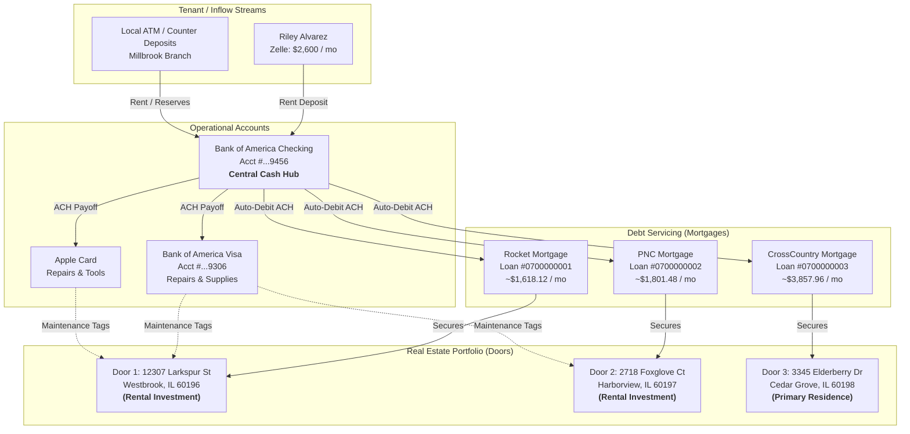
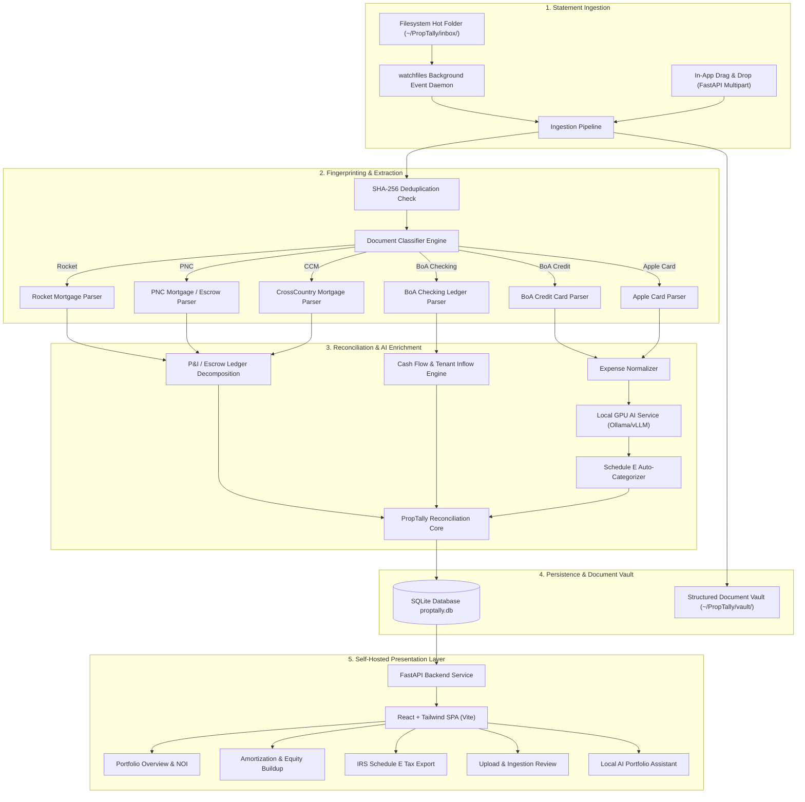
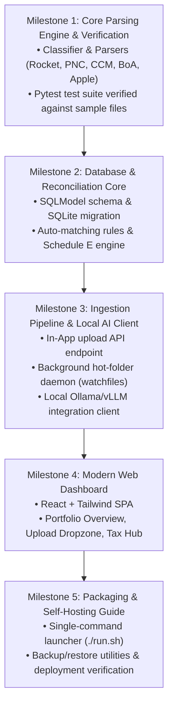

> [!WARNING]
> **SUPERSEDED ARCHITECTURE SPECIFICATION (V1.0)**  
> This initial exploration and V1.0 technical specification is **SUPERSEDED** by the authoritative **PropTally V2.2 Architecture Specification Suite** located in [`docs/architecture/v2/`](docs/architecture/v2/00_CONSISTENCY_MATRIX.md).  
> For the current double-entry accounting model, database schema, transaction splitting engine, post-settlement mortgage lifecycle, and roadmap, refer exclusively to `docs/architecture/v2/`.

# PropTally — Technical Specification & Implementation Plan (V1.0 Archive)
**Bespoke Real Estate Cash Flow, Equity Tracking & Tax Reconciliation Platform**

* **Client:** Portfolio Owner
* **Author / Engineering:** Antigravity Engineering
* **Phase:** Initial Technical Specification (Historical Reference)
* **Document Version:** 1.0 (Superseded by V2.2)
* **Date:** October 2026

---

## 1. Executive Summary & Problem Context

### 1.1 The Client's Portfolio & Challenge
The Client operates a multi-property real estate portfolio comprising both rental investment assets and a primary residence in the Chicago northwest suburbs (Westbrook, Oakhaven, and Cedar Grove, IL).

Managing this portfolio currently suffers from three structural financial frictions:
1. **The "Mortgage Illusion" in Generic Accounting:** Commercial tools (QuickBooks, Monarch, Mint, Excel) treat a $1,800 monthly mortgage deduction as a single expense. In reality, every payment splits into:
   * **Principal:** Balance sheet liability reduction (net worth & equity accumulation, **not** an expense).
   * **Interest:** Immediate tax-deductible expense under IRS Schedule E.
   * **Escrow:** Pre-paid holding reserve for county property taxes and hazard insurance.
2. **Fragmented Ingestion:** Rental income arrives via checking accounts (Zelle transfers and cash deposits), property repairs and maintenance are charged across multiple personal/business credit cards (Home Depot, Lowes, local contractors), and debt obligations are serviced across three distinct mortgage lenders.
3. **Data Privacy & Security Requirements:** Financial statements, loan numbers, tax identification numbers, and tenant memos contain highly sensitive PII. The client requires a **100% self-hosted, air-gapped/private system** that runs on their own hardware without shipping raw financial records to third-party commercial cloud APIs.

### 1.2 The PropTally Solution
PropTally is a bespoke, self-hosted web application and financial reconciliation engine designed specifically around the Client's exact accounts, properties, and document formats. It provides:
* **Dual Ingestion Pipeline:** An in-app drag-and-drop upload zone alongside an automated filesystem hot-folder watcher.
* **Deterministic Native PDF Parsers:** High-speed extraction for Rocket Mortgage, PNC Mortgage, CrossCountry Mortgage, Bank of America Checking, Bank of America Credit Card, and Apple Card.
* **Private Local AI Integration:** Powered by the client's on-premise Linux server with modern NVIDIA GPUs (RTX 3060/4070/5060) running local LLMs (via Ollama or vLLM) for semantic transaction categorization and conversational portfolio analytics.
* **Automated Reconciliation & Tax Reporting:** Instant calculation of True Net Cash Flow, Equity Buildup, and IRS Form 1040 Schedule E annual roll-ups per door.

---

## 2. Portfolio Ecosystem & Financial Entity Mapping

A thorough audit of the client's financial records establishes the following exact entity relationships:



### 2.1 Entity Master Data

| Property Identifier | Role | Servicer & Loan ID | Typical Monthly Payment | Identified Inflow / Tenant |
| :--- | :--- | :--- | :--- | :--- |
| **Westbrook Rental**<br>`12307 Larkspur St, Westbrook, IL 60196` | Rental Investment | **Rocket Mortgage**<br>Loan #`0700000001` | ~$1,618.12<br>*(P&I: ~$1,020, Escrow: ~$598)* | **Riley Alvarez**<br>Zelle memo: *"Alder rent"*, *"partial Rental Deposit + pro-rent 12307 Larkspur"* ($2,600.00/mo) |
| **Harborview Rental**<br>`2718 Foxglove Ct, Harborview, IL 60197` | Rental Investment | **PNC Mortgage**<br>Loan #`0700000002` | ~$1,801.48<br>*(P&I: ~$960.16, Escrow: ~$841.32)* | Cash & ATM Branch Deposits (Millbrook) / Unit Inflows |
| **Cedar Grove Residence**<br>`3345 Elderberry Dr, Cedar Grove, IL 60198` | Primary Residence | **CrossCountry Mortgage**<br>Loan #`0700000003` | ~$3,857.96<br>*(P&I + Escrow)* | Primary Residence operating expenses (e.g. Landscaper snow removal: *"Snow 3345 Elderberry"*) |

---

## 3. Infrastructure, Hardware & External Assumptions

### 3.1 Hardware Environment
* **On-Premise Server:** Dedicated Linux server host with NVIDIA GPUs (RTX 3060, RTX 4070, RTX 5060).
* **Local Storage:** Fast NVMe/SSD storage for application files, SQLite database, and raw document archive.
* **Network Topology:** Runs entirely behind the local LAN. Remote access for client (phone/laptop outside the home) is handled securely via **Tailscale / WireGuard VPN** with no public port exposure.

### 3.2 Local AI Stack & Assumptions
* **Inference Runtime:** **Ollama** or **vLLM** hosted locally on the server exposing an OpenAI-compatible REST endpoint (e.g. `http://localhost:11434/v1` or `http://192.168.x.x:11434/v1`).
* **Selected Models:**
  * **Default Classifier & Extraction Model:** `qwen2.5:14b-instruct` or `mistral:instruct` (runs with near-instant inference and low VRAM footprint).
  * **Advanced Reasoning & Chat Model:** `qwen2.5:32b-instruct` or `deepseek-r1-distill-qwen-14b/32b` (utilizing the 4070/5060 GPUs for in-depth tax categorization analysis and complex conversational synthesis).
* **AI Boundaries & Safety Rules:**
  * **Strict Deterministic Fallback:** Mathematical totals, account numbers, dates, and mortgage breakdowns are **never** generated or guessed by the LLM. They are parsed deterministically by PyMuPDF and regex.
  * The LLM is invoked **only** for:
    1. Vague transaction semantic tagging (e.g., mapping `"MENARDS #312"` or `"FERGUSON ENT"` to Schedule E "Supplies" vs "Repairs").
    2. Conversational portfolio querying.
    3. Parsing scanned paper receipts if non-standard formats are submitted.
  * **Timeout & Fallback:** If the GPU server or inference runtime is offline or unreachable, the application continues to operate seamlessly with standard regex rules and marks unclassified transactions for manual review.

---

## 4. End-to-End System Architecture



---

## 5. Parser Specifications & Data Extraction Contracts

All source PDFs are native digital vector files (100% character fidelity). The table below specifies the extraction contract for each document type:

### 5.1 Rocket Mortgage Parser (`RocketMortgageParser`)
* **Document Class:** Monthly Mortgage Billing Statement (`700000001-*.pdf`)
* **Fingerprint Signature:** Text contains `"Rocket Mortgage"`, `"Mortgage Loan statement"`, and loan prefix `"0700000001"`.
* **Field Extraction Contract:**
  * `loan_number`: Regex `Loan number\s+([0-9]{10})` $\rightarrow$ `0700000001`.
  * `statement_date`: Regex `Statement date\s+([0-9]{2}/[0-9]{2}/[0-9]{4})`.
  * `due_date`: Regex `Due date\s+([0-9]{2}/[0-9]{2}/[0-9]{4})`.
  * `property_address`: Text block following `"Property address"` $\rightarrow$ `12307 LARKSPUR ST, FAIRVIEW, IL 60196`.
  * `explanation_of_amount_due`:
    * `principal`: Regex `Principal\s+\$?([0-9,]+\.[0-9]{2})`.
    * `interest`: Regex `Interest\s+\$?([0-9,]+\.[0-9]{2})`.
    * `escrow`: Regex `Escrow\s+\$?([0-9,]+\.[0-9]{2})`.
    * `total_due`: Regex `Amount due\s+\$?([0-9,]+\.[0-9]{2})`.
  * `outstanding_principal_balance`: Extracted from Page 2 "Past payments breakdown" / "Account information".

### 5.2 PNC Mortgage Parser (`PNCMortgageParser`)
* **Document Classes:**
  1. Monthly Statement (`PNC *.pdf`)
  2. Annual Escrow Analysis (`PNC Escrow *.pdf`)
  3. Form 1098 Mortgage Interest Statement (`PNC * 1098 *.pdf`)
* **Fingerprint Signature:** Text contains `"PNC Mortgage"` or `"PNC BANK"`, with Account Number `"0700000002"`.
* **Field Extraction Contract:**
  * `loan_number`: Regex `Account Number\s+([0-9]{10})` $\rightarrow$ `0700000002`.
  * `statement_date`: Extracted from statement header.
  * `payment_breakdown`:
    * `principal`: Extracted from "Explanation of Amount Due" $\rightarrow$ `Principal`.
    * `interest`: Extracted from "Explanation of Amount Due" $\rightarrow$ `Interest`.
    * `escrow`: Extracted from "Explanation of Amount Due" $\rightarrow$ `Escrow (Taxes and Insurance)`.
    * `regular_monthly_payment`: Total payment due.
  * `outstanding_principal`: Extracted from "Account Information" $\rightarrow$ `Outstanding Principal`.
  * `interest_rate`: Extracted from "Account Information" $\rightarrow$ e.g. `2.5000%`.
  * `secured_property_address`: Extracted from Escrow Analysis / 1098 Box 8 $\rightarrow$ `582 FOXGLOVE CT, LAKESIDE, IL 60197`.

### 5.3 CrossCountry Mortgage Parser (`CrossCountryMortgageParser`)
* **Document Class:** Monthly Mortgage Statement (`CCM *.pdf`)
* **Fingerprint Signature:** Text contains `"CROSSCOUNTRY MORTGAGE"` and Loan Number `"0700000003"`.
* **Field Extraction Contract:**
  * `loan_number`: Regex `Loan Number:\s+([0-9]{10})` $\rightarrow$ `0700000003`.
  * `property_address`: Text under `"Property Address:"` $\rightarrow$ `1017 ELDERBERRY DR, RIVERTON, IL 60198`.
  * `statement_date`: Extracted from header block.
  * `payment_breakdown`:
    * `principal`: Sub-block under "Explanation of Amount Due".
    * `interest`: Sub-block under "Explanation of Amount Due".
    * `escrow`: Sub-block under "Explanation of Amount Due".
    * `amount_due`: Total due.
  * `outstanding_principal_balance`: Extracted from "Past Payment Breakdown" / "Account Information".

### 5.4 Bank of America Checking Parser (`BofACheckingParser`)
* **Document Class:** Adv Plus Banking Monthly Statement (`eStmt_*.pdf`)
* **Fingerprint Signature:** Text contains `"Bank of America"` and `"Your Bank of America Adv Plus Banking"`, Account Number `...9456`.
* **Field Extraction Contract:**
  * `statement_period`: Extracted from header (e.g. `December 17, 2025 to January 15, 2026`).
  * `account_number`: `0029 1385 9456`.
  * `deposits_table`:
    * Date, Description, Amount.
    * Parse Zelle memos: regex `Zelle payment from\s+(?P<sender>[^f]+)\s+for\s+"(?P<memo>[^"]+)"`.
    * Auto-matching rule: If sender == `"JORDAN AVERY"` or memo matches `"Larkspur"`, link transaction directly to **Door 1 (12307 Larkspur St)** as `Rental Income`.
  * `withdrawals_table`:
    * Mortgage ACH Debits: match `"CROSSCOUNTRY"`, `"PNC LENDING"`, `"ROCKET"` with their respective IDs to confirm bank settlement.
    * Card payments: match `"Online payment to CHK ..."` or Apple Card ACH transfers to clear internal balances.

### 5.5 Credit Card Parsers (`BofACreditCardParser` & `AppleCardParser`)
* **BoA Credit Card (`...9306`):**
  * Parse "Purchases and Adjustments" table on Page 3+.
  * Fields: `Transaction Date`, `Posting Date`, `Description`, `Reference Number`, `Amount`.
* **Apple Card:**
  * Parse "Transactions" table on Page 2+.
  * Fields: `Date`, `Description`, `Daily Cash`, `Amount`.
* **Categorization Rule Engine:**
  * Vendors matching `HOME DEPOT`, `LOWES`, `MENARDS`, `ACE HARDWARE` $\rightarrow$ Tagged as `Supplies & Maintenance`.
  * Local service providers (e.g. `"Landsdaping"`, plumbers) $\rightarrow$ Tagged as `Repairs & Services`.

---

## 6. Database Schema Design (SQLite / SQLModel)

```sql
-- Properties (Doors)
CREATE TABLE properties (
    id TEXT PRIMARY KEY,               -- e.g. "prop_alder"
    name TEXT NOT NULL,                -- "12307 Larkspur St"
    address TEXT NOT NULL,
    city TEXT NOT NULL,
    state TEXT NOT NULL,
    zip_code TEXT NOT NULL,
    property_type TEXT NOT NULL,       -- "rental" | "primary"
    target_rent REAL DEFAULT 0.0,
    created_at TIMESTAMP DEFAULT CURRENT_TIMESTAMP
);

-- Loan Accounts
CREATE TABLE loan_accounts (
    id TEXT PRIMARY KEY,               -- e.g. "loan_rocket_1000000001"
    property_id TEXT NOT NULL REFERENCES properties(id),
    servicer_name TEXT NOT NULL,       -- "Rocket Mortgage"
    loan_number TEXT NOT NULL UNIQUE,  -- "0700000001"
    interest_rate REAL,                -- e.g. 0.025 (2.5%)
    current_principal_balance REAL,
    current_escrow_balance REAL,
    monthly_payment REAL,
    updated_at TIMESTAMP
);

-- Ingested Statement Files
CREATE TABLE statements (
    id TEXT PRIMARY KEY,
    file_sha256 TEXT NOT NULL UNIQUE,  -- Deduplication hash
    original_filename TEXT NOT NULL,
    vault_file_path TEXT NOT NULL,
    institution TEXT NOT NULL,         -- "Rocket", "PNC", "CCM", "BofA", "Apple"
    statement_type TEXT NOT NULL,      -- "mortgage", "checking", "credit_card", "escrow", "1098"
    account_number_masked TEXT,
    period_start DATE,
    period_end DATE,
    statement_date DATE,
    total_inflow REAL DEFAULT 0.0,
    total_outflow REAL DEFAULT 0.0,
    raw_metadata JSON,
    ingested_at TIMESTAMP DEFAULT CURRENT_TIMESTAMP
);

-- Mortgage Payment Breakdown Records (Monthly Granularity)
CREATE TABLE mortgage_statements (
    id TEXT PRIMARY KEY,
    statement_id TEXT NOT NULL REFERENCES statements(id),
    loan_account_id TEXT NOT NULL REFERENCES loan_accounts(id),
    payment_due_date DATE NOT NULL,
    statement_date DATE NOT NULL,
    principal_amount REAL NOT NULL,    -- Equity Accumulation
    interest_amount REAL NOT NULL,     -- Schedule E Line 12
    escrow_amount REAL NOT NULL,       -- Taxes & Insurance reserve
    fees_amount REAL DEFAULT 0.0,
    total_amount_due REAL NOT NULL,
    outstanding_principal REAL NOT NULL,
    escrow_balance REAL,
    interest_rate REAL
);

-- Normalized Financial Transactions (Checking & Cards)
CREATE TABLE transactions (
    id TEXT PRIMARY KEY,
    statement_id TEXT NOT NULL REFERENCES statements(id),
    property_id TEXT REFERENCES properties(id), -- Nullable if personal / unassigned
    account_identifier TEXT NOT NULL,           -- e.g. "BofA CHK 9456", "Apple Card"
    transaction_date DATE NOT NULL,
    posting_date DATE,
    amount REAL NOT NULL,                       -- Positive for inflow, negative for expense
    raw_description TEXT NOT NULL,
    clean_merchant TEXT,
    memo TEXT,
    schedule_e_category TEXT,                   -- "rent_income", "mortgage_interest", "repairs", "supplies", "taxes", "insurance", "other"
    is_reconciled BOOLEAN DEFAULT FALSE,
    reconciliation_notes TEXT,
    confidence_score REAL DEFAULT 1.0,          -- 1.0 = deterministic regex, 0.8 = local AI
    created_at TIMESTAMP DEFAULT CURRENT_TIMESTAMP
);

-- Automated Categorization & Mapping Rules
CREATE TABLE categorization_rules (
    id TEXT PRIMARY KEY,
    pattern TEXT NOT NULL,             -- Regex / SQL LIKE pattern
    field_to_match TEXT NOT NULL,      -- "raw_description", "memo", "sender"
    target_property_id TEXT REFERENCES properties(id),
    target_category TEXT NOT NULL,
    priority INTEGER DEFAULT 100
);
```

---

## 7. Financial Reconciliation & IRS Schedule E Engine

### 7.1 True Cash Flow vs. Net Operating Income (NOI)
Traditional bookkeeping distorts real estate metrics. PropTally computes both values side-by-side:

$$\text{Net Monthly Cash Flow} = \text{Gross Rent Collected} - (\text{Total Mortgage Outflow} + \text{Operating Expenses})$$

$$\text{True Economic Net Income} = \text{Gross Rent Collected} - (\text{Mortgage Interest} + \text{Escrow Expenses} + \text{Operating Expenses})$$

$$\text{Monthly Equity Created} = \text{Mortgage Principal Reduction}$$

### 7.2 IRS Schedule E (Form 1040) Mapping
PropTally maps every line item into official IRS categories per property door:

| Schedule E Line | Tax Item | PropTally Data Source |
| :--- | :--- | :--- |
| **Line 3** | **Rents Received** | BoA Checking deposits tagged to Property (`JORDAN AVERY`, rental cash deposits) |
| **Line 12** | **Mortgage Interest Paid** | Sum of `interest_amount` from Rocket & PNC `mortgage_statements` (verified against Form 1098) |
| **Line 14** | **Repairs** | Handyman, plumbing, AC maintenance from Checking/Cards |
| **Line 16** | **Taxes** | Property taxes disbursed from Escrow (from PNC Escrow Analysis and Rocket breakdown) |
| **Line 19** | **Other Expenses** | Snow removal, landscaping, supplies (Home Depot/Lowes) |

---

## 8. Ingestion Pipeline Mechanics

### 8.1 Dual Ingestion Workflows

#### Workflow 1: Web UI Drag & Drop
1. User navigates to the **Upload Center** in the web dashboard.
2. Drags and drops one or multiple PDFs.
3. FastAPI endpoint (`POST /api/statements/upload`) receives multipart stream:
   * Hashes content via SHA-256. If exists, returns immediate `409 Conflict: Already Ingested` with a link to the existing statement.
   * Identifies institution using `proptally.parsers.classifier`.
   * Runs the corresponding parser and extracts balances/transactions.
   * Copies the raw PDF to the persistent vault: `~/PropTally/vault/{institution}/{year}/{filename}`.
   * Returns a JSON parsing summary to the UI for instant user confirmation.

#### Workflow 2: Hot-Folder Daemon (`inbox/`)
1. Background service (`proptally.ingestion.watcher`) runs using `watchfiles` on `~/PropTally/inbox/`.
2. When the user downloads statements into `inbox/`:
   * Wait 500ms for file write to finalize (debounce).
   * Verify file extension is `.pdf` and compute SHA-256.
   * If already ingested, moves the duplicate to `~/PropTally/inbox/duplicates/`.
   * If new, parses the file, updates SQLite records, and moves the file to `~/PropTally/vault/`.
   * Emits a real-time event (WebSocket or SSE) to notify the web dashboard to refresh metrics.

---

## 9. Security, Privacy & Threat Model

* **Threat 1: Cloud Data Leakage**  
  * *Mitigation:* The backend executes 100% on the local host. All AI inference queries are directed to the on-premise GPU server endpoint (`http://localhost:11434` or local LAN IP). No third-party network egress occurs.
* **Threat 2: Statement Tampering or Accidental Re-Upload**  
  * *Mitigation:* Database maintains a unique constraint on `file_sha256`. Duplicate uploads are rejected before any database modification occurs.
* **Threat 3: Network Access Over LAN / Remote**  
  * *Mitigation:* The dashboard binds `0.0.0.0:8080` for LAN/Tailscale use, but public ingress through the operator's own tunnel is gated at Cloudflare's edge by **Cloudflare Access** — email-OTP login limited to the owner's email with a 24h session — so the origin is never anonymously reachable. LAN/Tailscale paths are protected by network-level controls (Tailscale VPN) with optional session PIN/token authentication.
* **Threat 4: Data Loss & Disaster Recovery**  
  * *Mitigation:* The entire system state is stored in two directories: `proptally.db` (SQLite) and `~/PropTally/vault/` (PDFs). A single automated script (`./scripts/backup.sh`) creates a timestamped compressed archive for effortless backup.

---

## 10. Web Dashboard UI/UX Specification

The user interface will be built with React, Vite, and Tailwind CSS, featuring a clean, responsive layout:

1. **Portfolio Overview Dashboard:**
   * **Hero Cards:** Total Portfolio Cash Flow (MTD / YTD), Total Equity Accumulated, Total Debt Balance.
   * **Property Cards (Alder, Maple, Rowan):** Status badge (Rental vs Primary), Current Loan Balance, Interest Rate, Monthly Rent Inflow, Net Cash Flow.
   * **Monthly Cash Flow Waterfall Chart:** Visualizing Gross Rent $\rightarrow$ Mortgage (P&I) $\rightarrow$ Escrow $\rightarrow$ Maintenance $\rightarrow$ Net In Pocket.
2. **Property Deep Dive:**
   * Amortization tracking curve showing principal balance over time.
   * Month-by-month historical table of P&I splits.
   * Tenant payment audit log.
3. **Upload & Ingestion Center:**
   * Drag-and-drop dropzone with status progress indicators.
   * Ingestion Activity Log: History of all processed statements with direct "View PDF" links.
   * Unmapped Transactions Review Queue: Flag any transaction with confidence $< 0.9$ for a 1-click property assignment.
4. **IRS Schedule E Tax Hub:**
   * Tax Year selector (e.g. 2025, 2026).
   * Tabular Schedule E grid broken down by Line 3 (Rent), Line 12 (Mortgage Interest), Line 14 (Repairs), Line 16 (Taxes), Line 19 (Other).
   * **1-Click Export:** Download CSV / Excel formatted specifically for client's CPA.
5. **Local AI Portfolio Copilot:**
   * Natural language query interface powered by the local NVIDIA GPU server.
   * Sample prompt chips: *"Compare Q1 vs Q2 cash flow for Alder"*, *"List all Home Depot transactions this year"*, *"What was my total principal paid down across all loans?"*

---

## 11. Phased Implementation Roadmap



### Detailed Milestone Breakdown

* **Milestone 1: Core Parsing Engine & Verification (Current)**
  * Implement `src/proptally/parsers/`:
    * `classifier.py`
    * `rocket.py`
    * `pnc.py` (handles monthly statements, escrow analysis, and Form 1098)
    * `crosscountry.py`
    * `bofa_checking.py`
    * `bofa_credit.py`
    * `apple_card.py`
  * Create comprehensive test suite in `tests/test_parsers.py` running against the files in `./data/statements`.
  * **Success Criteria:** 100% test pass rate across all statements with verified principal/interest/escrow and transaction extraction.

* **Milestone 2: Database & Reconciliation Core**
  * Implement `src/proptally/db/models.py` and `src/proptally/db/session.py`.
  * Build `src/proptally/reconciliation/matcher.py`:
    * Link Zelle deposits from Riley Alvarez to Alder.
    * Link mortgage ACH debits to respective loan accounts.
    * Build IRS Schedule E aggregation service (`schedule_e.py`).
  * **Success Criteria:** Given all sample statements, generate an exact monthly P&L and Schedule E summary table for 2025 and 2026.

* **Milestone 3: Ingestion Pipeline & Local AI Integration**
  * Build `src/proptally/ingestion/pipeline.py` with SHA-256 deduplication and vault archiving.
  * Build `src/proptally/ingestion/watcher.py` using `watchfiles` to monitor `~/PropTally/inbox/`.
  * Build `src/proptally/ai/client.py`: Local OpenAI-compatible client connecting to Ollama/vLLM on the client's GPU server for transaction classification and conversational Q&A.
  * Build FastAPI REST API in `src/proptally/api/`.
  * **Success Criteria:** Dropping a PDF into `inbox/` or uploading via API automatically processes, categorizes, and updates the database within $< 1$ second.

* **Milestone 4: Web Dashboard Interface**
  * Scaffold React + Vite + Tailwind CSS frontend in `web/`.
  * Implement Portfolio Overview, Property Drilldown, Upload Dropzone, Schedule E Tax Exporter, and Local AI Assistant.
  * Embed dashboard serving directly from FastAPI or via Vite dev server.
  * **Success Criteria:** Fully functional web application running locally on `http://localhost:8000`.

* **Milestone 5: Self-Hosting Delivery & Validation**
  * Write `run.sh` script for zero-configuration startup.
  * Write `scripts/backup.sh` for automated SQLite and PDF vault snapshots.
  * Produce end-user operational documentation for client.
  * **Success Criteria:** Clean handover with automated statement ingestion and verified numbers.
