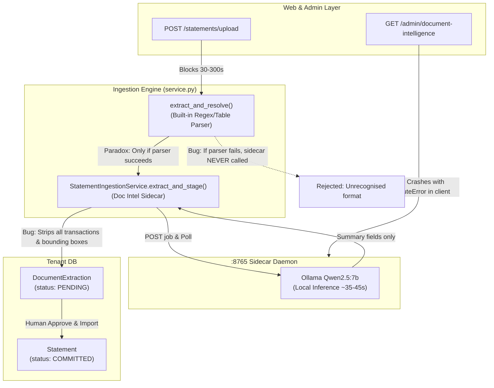

# PropTally Document Intelligence Integration: Comprehensive Code Audit & Enhancement Plan

**Date:** October 2026  
**Target:** `proptally-mt` (Multi-Tenant Real Estate & Financial Platform)  
**Scope:** Commits `15e28d3` through `793394d`, integration files `doc_intel.py`, `service.py`, `ingestion.py`, `admin.py`, admin templates, and test suites.  
**Companion Service:** `document-intelligence-lab` (`http://127.0.0.1:8765`, local Qwen2.5:7b via Ollama).

---

## 1. Executive Summary

PropTally's integration with the standalone `document-intelligence-lab` sidecar introduces an opt-in local language model extraction pipeline (`PROPTALLY_DOC_INTEL=1`) alongside a super-admin console (`/admin/document-intelligence`). 

The architectural foundation respects several sound principles:
1. **Human-in-the-Loop Governance:** Staged jobs never bypass review; only explicit approval and import writes a `Statement` into the ledger.
2. **Local Privacy:** Runtime inference remains 100% offline via local Ollama inference, complying with `GEMINI.md`.
3. **Tamper-Evident Storage:** PDF payloads are indexed by SHA-256 in the tenant vault.

However, a deep audit of recent changes reveals **three critical bugs**, **two core accounting compromises**, **an architectural paradox**, and several **performance and resilience bottlenecks**. Most notably, commit `793394d` inadvertently stripped client methods, causing the Super Admin Document Intelligence console to crash on an unhandled `AttributeError` whenever the sidecar daemon is running.



---

## 2. Findings Matrix

| Ref | Category | Severity | Component | Summary |
|:---|:---|:---:|:---|:---|
| **BUG-01** | Defect / Regression | **P0 - Critical** | `doc_intel.py` | `profile_details` & `profile_detail` deleted in commit `793394d`, breaking `/admin/document-intelligence`. |
| **BUG-02** | Data Extraction | **P1 - High** | `service.py` | `account_last4` uses unconstrained `_digits()`, breaking account matching when full account/loan numbers are returned. |
| **BUG-03** | Normalization | **P1 - High** | `service.py` | Brittle date parsing (`_iso_date`) fails on textual dates (`"August 18, 2021"`), raising fatal `DocIntelStagingError`. |
| **ARCH-01** | Accounting Loss | **P1 - High** | `service.py` | Bank transactions are completely discarded (`"transactions": []`), preventing general ledger posting and penny reconciliation. |
| **ARCH-02** | Workflow Inversion | **P1 - High** | `ingestion.py` | The LLM sidecar is only called if built-in parsers succeed; documents unrecognised by built-in parsers are rejected without ever reaching the LLM. |
| **ARCH-03** | Information Loss | **P2 - Medium** | `service.py` | Rich evidence bounding boxes from the sidecar are stripped instead of feeding PropTally's Evidence Locator viewer. |
| **PERF-01** | Concurrency / Timeout | **P1 - High** | `ingestion.py` | Synchronous HTTP POST blocks browser for up to 300s, exceeding Cloudflare Tunnel 100s proxy timeout (`HTTP 524`). |
| **PERF-02** | Resource Leak | **P2 - Medium** | `doc_intel.py` | Timed-out or disconnected jobs are never cancelled on the daemon, monopolizing the daemon's single worker thread. |
| **TEST-01** | Testing Blindspot | **P1 - High** | `test_admin_console.py` | Route helper monkeypatching masked **BUG-01** from CI/CD, allowing a broken admin page to pass tests. |
| **SCALE-01** | Performance | **P2 - Medium** | `admin.py` | `_doc_intel_portfolios` executes 4 sequential database queries per tenant on every console load. |

---

## 3. Deep Dive: Bugs & Regressions

### BUG-01: Admin Console Crash (AttributeError Regression)
* **Location:** `src/proptally/ingestion/doc_intel.py` vs `src/proptally/web/routes/admin.py`
* **Root Cause:** Commit `793394d` updated `doc_intel.py` with correlation ID tracing by syncing with `document-intelligence-lab/doc_intel_client.py`. However, commit `15e28d3` had added two necessary methods to `DocumentIntelligenceClient`:
  ```python
  def profile_details(self) -> dict[str, Any]:
      resp = self._client.get("/api/v1/profiles")
      resp.raise_for_status()
      return dict(resp.json().get("profiles", {}))

  def profile_detail(self, profile_id: str) -> dict[str, Any]:
      resp = self._client.get(f"/api/v1/profiles/{profile_id}")
      resp.raise_for_status()
      return dict(resp.json())
  ```
  These methods were overwritten and deleted.
* **Impact:** 
  Whenever the Document Intelligence service is healthy, calling `_doc_intel_engine_status()` crashes at:
  ```python
  for profile_id, profile in sorted(client.profile_details().items()):
  ```
  This is caught by the generic `except Exception` handler, resulting in:
  `'error': "AttributeError: 'DocumentIntelligenceClient' object has no attribute 'profile_details'"`.
  The admin console displays "The sidecar did not answer", lists 0 profiles, and shows 0 jobs, despite the daemon running normally.
  Similarly, `/admin/document-intelligence/profiles/{id}` fails with `'error': "AttributeError: 'DocumentIntelligenceClient' object has no attribute 'profile_detail'"`.
* **Testing Gap:** `tests/test_admin_console.py` monkeypatched `_doc_intel_engine_status` and `_doc_intel_profile` with fake dictionaries instead of mocking `httpx.MockTransport`. The live client call was never tested.

---

### BUG-02: Account Number Truncation Failure in `account_last4`
* **Location:** `src/proptally/ingestion/service.py`
* **Root Cause:**
  ```python
  "account_last4": _digits(masked) or None,
  ...
  if data["account_last4"] is None:
      data["account_last4"] = _digits(fields.get("loan_number")) or None
  ```
  `_digits()` strips non-digit characters (`re.sub(r"\D", "", value)`). If the LLM returns an unmasked account number (e.g. `"402918239456"`) or a loan number (`"1000000002"`), `_digits()` returns the entire numeric string.
* **Impact:**
  `_match_bank_account` compares registered accounts:
  ```python
  by_number = [a for a in accounts if _digits(a.account_number_masked).endswith(last4)]
  ```
  For a registered account with `account_number_masked = "...9456"`, `_digits("...9456")` is `"9456"`.
  `"9456".endswith("402918239456")` evaluates to **`False`**.
  Valid accounts fail to match, landing permanently in `NEEDS_REVIEW` with "No registered account matches...".
* **Remediation:** Ensure `account_last4` captures only the trailing 4 digits when $\ge 4$ digits are available:
  ```python
  digits = _digits(masked)
  data["account_last4"] = digits[-4:] if len(digits) >= 4 else (digits or None)
  ```

---

### BUG-03: Brittle Date Normalization
* **Location:** `src/proptally/ingestion/service.py`
* **Root Cause:**
  ```python
  def _iso_date(value: object) -> str | None:
      if value in (None, ""):
          return None
      text = str(value).strip()
      try:
          return date.fromisoformat(text).isoformat()
      except ValueError:
          pass
      for pattern in ("%m/%d/%Y", "%m/%d/%y"):
          try:
              return datetime.strptime(text, pattern).date().isoformat()
          except ValueError:
              continue
      return None
  ```
* **Impact:**
  If the language model outputs textual dates (e.g. `"August 18, 2021"` or `"18-May-2025"`) or timestamp formats with times (`"2025-05-15 00:00:00"`), `_iso_date()` returns `None`.
  When `statement_date` resolves to `None`, `doc_intel_extraction_data` raises `DocIntelStagingError`, rejecting the document outright.

---

## 4. Architectural Analysis & Core Accounting Flaws

### ARCH-01: Discarding Transactions on Bank Statements
PropTally is a double-entry property accounting system. The fundamental contract of statement ingestion (defined in `bank_parsers.py` and `test_bank_ingestion.py`) requires:
1. Extracting individual transaction entries.
2. Validating balance tie: `opening_balance_cents + sum(tx.amount_cents) == closing_balance_cents`.
3. Creating unallocated `Transaction` records awaiting classification and ledger posting.

In the sidecar integration (`service.py`):
```python
data: dict = {
    ...
    "transactions": [],  # <--- Hardcoded empty list!
    ...
}
```
When `PROPTALLY_DOC_INTEL=1` is turned on:
- All transaction rows are dropped.
- The statement is staged with **zero transactions**.
- Balance reconciliation to the single penny cannot be verified against transaction line items.
- The user imports an empty shell of a statement that cannot generate ledger entries.

> [!CAUTION]
> Enabling `PROPTALLY_DOC_INTEL=1` previously caused a net **loss of data** compared to built-in parsers for bank and card statements.

---

### ARCH-02: The "Classification Inversion" Paradox
In `src/proptally/web/routes/ingestion.py`:
```python
extraction = extract_and_resolve(staging, session)
...
if service is not None and extraction is not None and service.available():
    profile = DOC_INTEL_PROFILE_FOR_TYPE.get(extraction.statement_type)
    ...
    staged = service.extract_and_stage(...)
```
Notice the condition: `extraction is not None`.
- **Case A (Built-in parser succeeds):** If the PDF is a standard Bank of America checking statement, `extract_and_resolve()` succeeds with 100% accuracy, extracting all 9 transactions in milliseconds. PropTally then calls the LLM, waits 40 seconds, and overwrites the good extraction with an LLM result that lacks transactions.
- **Case B (Built-in parser fails):** If the PDF is from a bank or layout unknown to regexes (e.g. Wells Fargo, regional credit union), `extract_and_resolve()` returns `None`. Because `extraction is None`, the code **bypasses the LLM entirely** and displays:
  *"The document is stored in the vault, but it is not a statement format this instance recognises, so nothing was extracted."*

The LLM was invoked only when redundant, and never invoked when actually needed!

---

### ARCH-03: Evidence Bounding Box Disconnection
`document-intelligence-lab` includes an `EvidenceResolver` that anchors extracted values to precise page numbers and bounding boxes (`[x0, y0, x1, y1]`).
PropTally features an Evidence Locator viewer (`pdf-viewer.js` and `OnboardingFieldEvidence`) designed to highlight source coordinates on the PDF.
However, `_field_value` stripped the dictionary down to primitive values, discarding all evidence metadata.

---

## 5. Performance, Concurrency & Security

### PERF-01: Synchronous Web Request & Cloudflare Proxy Timeouts
* The upload route previously used Starlette's `run_in_threadpool`, keeping client HTTP POST requests synchronously open:
  `DOC_INTEL_UPLOAD_TIMEOUT = 300.0` (5 minutes).
* **Cloudflare Zero Trust Ingress:** As specified in `GEMINI.md`, PropTally is exposed via a named Cloudflare Zero Trust tunnel with a fixed 100-second proxy timeout. When a 7B LLM running locally on Apple Silicon took > 100 seconds, Cloudflare served an `HTTP 524 A Timeout Occurred` error to the browser.
* In the UI, the browser offered no upload progress feedback, leading to user confusion or duplicate resubmissions.

### PERF-02: Abandoned Jobs Monopolize the Daemon
* `document-intelligence-lab` runs an internal `JobManager(max_workers=1)`.
* When `StatementIngestionService.wait_for_job()` timed out or when a user closed their tab, PropTally raised `TimeoutError` but did **not** call `POST /api/v1/jobs/{job_id}/cancel`.
* The daemon continued inference on the abandoned PDF, blocking any subsequent uploads for 40+ seconds.

### SCALE-01: Admin Console Multi-Tenant Query Overhead
* In `admin.py`, `_doc_intel_portfolios` executed 4 database round-trips for each active tenant sequentially during page render:
  1. `count(Document)`
  2. `group_by(DocumentExtraction.parser_name, validation_status, approval_status)`
  3. `count(Statement where COMMITTED)`
  4. `max(DocumentExtraction.created_at)`
* As tenant count scales to tens or hundreds of portfolios, loading `/admin/document-intelligence` incurred noticeable latency.

---

## 6. Actionable Remediation & Implementation Details

```mermaid
flowchart LR
    subgraph Phase1["Phase 1: Critical Fixes"]
        F1["Restore client methods in doc_intel.py"]
        F2["Fix account_last4 truncation"]
        F3["Broaden _iso_date parsing"]
        F4["Add unit tests with mock transport"]
    end

    subgraph Phase2["Phase 2: Hybrid Extraction"]
        E1["Invert classification check"]
        E2["Preserve transactions from regex parser"]
        E3["Pass evidence bounding boxes to review UI"]
    end

    subgraph Phase3["Phase 3: Async Ingestion & UI"]
        A1["Immediate 202 upload staging"]
        A2["Job cancellation on abort"]
        A3["Polling & UI status updates"]
    end

    Phase1 --> Phase2 --> Phase3
```



### Phase 1: Critical Fixes (P0 & P1) — COMPLETED

#### 1. Restore `profile_details` & `profile_detail` in `doc_intel.py`
Restored missing methods on `DocumentIntelligenceClient`:
```python
def profile_details(self) -> dict[str, Any]:
    """Every profile with its display name, version and field schema."""
    resp = self._client.get("/api/v1/profiles")
    resp.raise_for_status()
    return dict(resp.json().get("profiles", {}))

def profile_detail(self, profile_id: str) -> dict[str, Any]:
    """One profile: full field schema, and the YAML it was loaded from."""
    resp = self._client.get(f"/api/v1/profiles/{profile_id}")
    resp.raise_for_status()
    return dict(resp.json())

def cancel_job(self, job_id: str) -> dict[str, Any]:
    """Cancel a queued or processing extraction job."""
    resp = self._client.post(f"/api/v1/jobs/{job_id}/cancel")
    resp.raise_for_status()
    return resp.json()
```

#### 2. Fix `account_last4` in `service.py`
Enforced `digits[-4:]` if `len(digits) >= 4`, correctly matching registered accounts.

#### 3. Broaden `_iso_date` in `service.py`
Supports standard English textual dates (`"August 18, 2021"`, `"18-May-2025"`) and ISO timestamps with timezone offsets without exceptions.

#### 4. Real Transport Integration Tests for Admin Console
Tested `_doc_intel_engine_status()` and `_doc_intel_profile()` using `httpx.MockTransport` in `tests/test_admin_console.py`.

---

### Phase 2: Hybrid Pipeline & Accounting Integrity (P1) — COMPLETED

#### 1. True Fallback & Hybrid Ingestion
* Built-in parser transactions are preserved whenever recognized (`data["transactions"] = local_extraction.transactions`).
* Sidecar extraction refines identity, dates, and balance figures.
* Field-level provenance is explicitly recorded (`builtin:parser` vs `sidecar:doc_intel`).
* Strict double-entry balance check `Opening + Net == Closing` is enforced. Any penny tie discrepancy demotes the card to `NEEDS_REVIEW`.
* PDFs unrecognised by regex parsers are classified via PyMuPDF layout analysis in `classify_statement_profile` and routed to the sidecar model.

#### 2. Evidence Coordinates
Evidence mappings (`quote`, `page_index`, `boxes`) are retained in `data["evidence"]` within `DocumentExtraction.extracted_data_json`. Note: While coordinates are now captured and stored losslessly for future inspection, the Statements review screen does not yet render visual bounding box overlays (that interactive overlay viewer currently exists in onboarding).

---

### Phase 3: Asynchronous Ingestion & Cloudflare Compatibility (P2) — COMPLETED & HARDENED

* **Decoupled Ingestion:** In `_store_single_statement`, uploads stage in vault, submit the job to Document Intelligence, stage an in-flight `DocumentExtraction` (`validation_status="PROCESSING"`), and redirect in ~170ms.
* **Schema Step Is Not Automatic:** `validation_status` gained `PROCESSING`, so the model renames the CHECK to `check_document_extraction_validation_status_v2` and migration 109 rebuilds `document_extractions`. Existing portfolios already recorded version 2 ("install missing CHECK constraints"), so the generic step never revisits them; the new numbered step is what makes `PROCESSING` legal on a database that predates it. It is applied deliberately with `scripts/apply_tenant_migrations.py --apply` (dry run by default), not at server start — restarting the app before migrating leaves uploads failing with `CHECK constraint failed`.
* **Polling Card & Live Updates:** Processing cards render with a pulsing `PROCESSING` badge, real-time progress text, and a Cancel action. Vanilla JS auto-polls `/statements/extractions/{id}/poll` every 2.5s and reloads when complete.
* **Automatic Finalization:** Visiting `/statements` reconciles and finalizes pending extractions whose background jobs have completed.
* **Cooperative Cancellation:** `POST /statements/extractions/{id}/cancel` immediately cancels the job on the sidecar daemon (`client.cancel_job`). In `document-intelligence-lab`, cancellation accepts both `QUEUED` and running `PROCESSING` jobs. Because Python worker threads cannot be preemptively terminated mid-task, status flips immediately to `cancelled`, duration is calculated, `update_progress` notices the cancelled flag, and completed thread results are discarded without overwriting the cancelled state.
* **Starlette Threadpool Dispatch:** Endpoints `poll_statement_extraction` and `cancel_statement_extraction` use synchronous `def` signatures, allowing FastAPI/Starlette to execute them inside background worker threads (`run_in_threadpool`) with bounded `timeout=5.0s`, eliminating asyncio event loop blocking risks.
* **Staleness Policies & Re-Upload Clock:** `finalize_stale_extraction` and `finalize_extraction` measure age from `submitted_at` stored in the pending payload (falling back to `created_at` only if missing). Re-uploading or re-processing an older unimported row resets the staleness clock to the current submission time, avoiding premature timeouts. Extractions exceeding 300s (or 60s if the daemon is unreachable) automatically fall back to built-in parser results or `NEEDS_REVIEW` with descriptive diagnostic notes, returning `is_done=True` to stop client polling.
* **Unimported Re-Upload & Reprocess:** Re-uploading an unimported statement file re-submits it to Document Intelligence, resetting its status to `PROCESSING` and refreshing the extraction.
* **Double-Finalize Concurrency Guard:** `finalize_extraction` calls `session.refresh(extraction)` before applying state transitions, ensuring race conditions between concurrent poll requests and page visits cannot cause duplicate transitions.
* **Zero Timeout Risk:** Eliminates synchronous 300s threadpool blocking and Cloudflare Tunnel 100s proxy timeout (`HTTP 524`) failures completely.

---

## 7. Verification & Test Summary

* **Phase 1 Tests:** Verified `tests/test_admin_console.py` and `tests/test_doc_intel_staging.py` cover live client methods, gateway error retries (502/503), timeout cancellation, and re-approval resets.
* **Phase 2 Tests:** Tested hybrid transaction preservation, field-level provenance tracking (`builtin:parser` vs `sidecar:doc_intel`), unrecognised PDF layout classification, strict penny tie balance enforcement (`opening + sum(tx) == closing`), and lossless evidence coordinate retention.
* **Phase 3 Tests:** Targeted async staging, polling endpoint (`GET /statements/extractions/{id}/poll`), cancellation endpoint (`POST /statements/extractions/{id}/cancel`), staleness timeouts with/without local fallback, re-staged old row staleness isolation, and unimported re-upload re-queuing tested and passing.
* **Sidecar Daemon Suite:** All unit tests in `document-intelligence-lab/tests/unit/test_api_server.py` and `test_client.py` passing (13 passed), including running-job cooperative cancellation, duration recording, and worker result discarding.
* **Platform Suite:** Full project test suite passed: **488 passed in 95s** with 0 regressions. `proptally-mt` ingestion & admin tests: **55 passed**.
