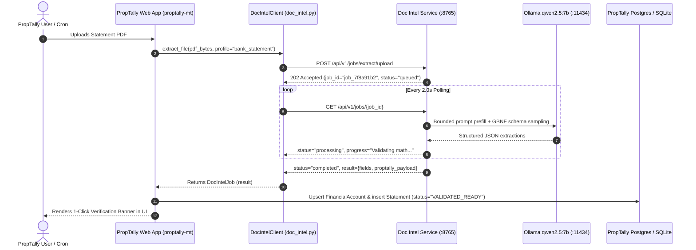

# PropTally Integration Specification
**Document Intelligence Service Integration Guide**  
**Version:** 1.0  
**Target Environment:** Local Apple Silicon Mac mini M4 (16 GB Unified RAM)  
**Consumer App:** `proptally-mt` (Multi-Tenant Real Estate & Financial Platform)  
**Date:** October 2026  

---

## 1. Executive Summary & Topology

The **Document Intelligence Service** operates as an independent, standalone microservice running locally on `http://127.0.0.1:8765`. It processes digitally generated and scanned financial PDFs (Bank Statements, Credit Card Statements, and Mortgage Statements), executes deterministic schema and math normalization, and emits grounded JSON payloads tailored for PropTally's database models.



---

## 2. Service Endpoints & OpenAPI Contract

### Base URL: `http://127.0.0.1:8765`

| Method | Endpoint | Description | Expected Latency |
|:---|:---|:---|:---:|
| `GET` | `/health` | Service health, indexed document count, loaded profiles | < 10ms |
| `GET` | `/api/v1/profiles` | List supported profiles (`bank_statement`, `credit_card_statement`, `mortgage_statement`) | < 10ms |
| `POST` | `/api/v1/jobs/extract/upload` | **Primary Async Ingestion:** Submits PDF upload, returns `job_id` | < 50ms |
| `GET` | `/api/v1/jobs/{job_id}` | Polls job status, progress message, and final result | < 10ms |
| `POST` | `/api/v1/jobs/{job_id}/cancel` | Cancels queued extraction if not yet running | < 10ms |
| `POST` | `/api/v1/proptally/export` | Synchronous entity mapper from raw fields to Prisma schema | < 50ms |
| `POST` | `/api/v1/extract/upload` | Synchronous extraction (use only for small synthetic tests) | ~35–45s |

---

## 3. Client Installation in `proptally-mt`

### 3.1 Copy the Standalone Client
Copy the zero-dependency client file directly into `proptally-mt`:

```bash
# From workspace root
cp ../document-intelligence-lab/doc_intel_client.py src/proptally/ingestion/doc_intel.py
```

### 3.2 Ensure `httpx` is in `pyproject.toml`
Ensure `httpx>=0.27.0` is present in `proptally-mt/pyproject.toml` dependencies:
```toml
dependencies = [
    "httpx>=0.27.0",
    ...
]
```

---

## 4. Entity Mapping to PropTally Database Models

When `map_to_proptally=True` (the default), `result["proptally_payload"]` contains pre-formatted entities mapped directly to PropTally's schema:

### 4.1 `FinancialAccount` Model
* **Deterministic ID:**
  * Known Accounts: `acct_{institution_slug}_{type}_{last4}` (e.g. `acct_bofa_chk_9456`, `acct_bofa_cc_6075`).
  * Unlinked Accounts (e.g. Apple Card where number is withheld): `acct_apple_card_cc_unlinked_{hash}` with `needs_account_linking=True`.
* **Fields:**
  * `account_name`: Formatted display name (e.g. `"Bank of America Checking ...9456"`).
  * `account_type`: `"CHECKING"`, `"SAVINGS"`, `"CREDIT_CARD"`, or `"MORTGAGE"`.
  * `account_number_masked`: `"...9456"` or `"...UNLINKED"`.
  * `currency`: `"USD"`.
  * `is_active`: `True`.

### 4.2 `Statement` Model
* **Deterministic ID:** `stmt_{document_id}` (e.g. `stmt_doc_3182d6096ff329ba`).
* **Period Dates:**
  * `period_start_date`: ISO format `YYYY-MM-DD` (e.g. `"2025-04-17"`). Truncated `MM/DD` strings from BofA transaction tables are automatically anchored to the statement year.
  * `period_end_date`: ISO format `YYYY-MM-DD` (e.g. `"2025-05-15"`).
  * `statement_date`: Closing date (ISO `YYYY-MM-DD`).
* **Balances (Integer Cents):**
  * `opening_balance_cents`: Beginning balance as integer cents (e.g. `$3,412.27` $\rightarrow$ `341227`).
  * `closing_balance_cents`: Ending balance as integer cents (e.g. `$4,147.36` $\rightarrow$ `414736`).
* **Governance Status:**
  * `VALIDATED_READY`: All deterministic math checks passed, account is uniquely identified. Ready for 1-click user acceptance.
  * `PENDING_REVIEW`: Math check flagged anomaly or account requires user linking.

### 4.3 `LoanAccount` & `EscrowAccount` Models (Mortgage Statements)
* **`LoanAccount`:**
  * `rate_type`: `"FIXED"` or `"ARM"` (dynamically parsed from statement notes).
  * `current_interest_rate_bps`: Stored in milli-percent precision (e.g. `5.875%` $\rightarrow$ `5875` bps, `6.125%` $\rightarrow$ `6125` bps).
* **`EscrowAccount`:**
  * `opening_balance_cents`: Current escrow balance (negative values represent escrow shortages).

---

## 5. Human-in-the-Loop Governance Implementation

> [!IMPORTANT]
> **Sections 12.3 & 24 Compliance:**
> Under no circumstances should an ingested statement automatically update the property ledger or financial balances without human confirmation.

1. **Staging:** Upon receiving a completed job, PropTally inserts the records with `ingestion_status = "VALIDATED_READY"`.
2. **Review UI:** The user sees the staged statement card with extracted values:
   * **Opening Balance:** $3,412.27
   * **Closing Balance:** $4,147.36
   * **Period:** 04/17/2025 to 05/15/2025
3. **Commit Endpoint (`POST /api/v1/extractions/{id}/verify`):**
   When the user clicks "Accept", PropTally updates the statement record:
   ```python
   statement.ingestion_status = "COMMITTED"
   statement.verified_by_user_id = current_user.id
   statement.verified_at = utc_now()
   ```

---

## 6. Drop-In Code Recipes for `proptally-mt`

### Recipe 1: Async Ingestion Service (`src/proptally/ingestion/service.py`)

```python
"""PropTally Ingestion Service integration with Document Intelligence microservice."""

from pathlib import Path
from typing import Any, Optional
from proptally.ingestion.doc_intel import DocumentIntelligenceClient, DocIntelJob

DOC_INTEL_URL = "http://127.0.0.1:8765"


class StatementIngestionService:
    def __init__(self, base_url: str = DOC_INTEL_URL):
        self.client = DocumentIntelligenceClient(base_url=base_url)

    def process_statement_async(
        self,
        pdf_path: Path,
        profile_name: str,
        property_id: Optional[str] = None,
    ) -> DocIntelJob:
        """Submit statement to Doc Intel daemon. Returns job immediately."""
        return self.client.submit_extraction(
            file=pdf_path,
            profile_name=profile_name,
            property_id=property_id or "",
            map_to_proptally=True,
        )

    def poll_and_stage_result(self, job_id: str, db_session) -> Optional[dict[str, Any]]:
        """Poll job and stage into PropTally DB once completed."""
        job = self.client.wait_for_job(job_id, timeout=120.0, poll_interval=2.0)
        
        if not job.is_success or not job.result:
            raise RuntimeError(f"Extraction failed: {job.error_message}")

        payload = job.result.get("proptally_payload")
        if not payload:
            raise ValueError("No PropTally payload returned by Doc Intel")

        # 1. Upsert FinancialAccount
        fa_data = payload["financial_account"]
        # db_session.upsert(FinancialAccount, fa_data)

        # 2. Insert Statement in VALIDATED_READY status
        stmt_data = payload["statement"]
        assert stmt_data["ingestion_status"] in ("VALIDATED_READY", "PENDING_REVIEW")
        # db_session.insert(Statement, stmt_data)

        # 3. For Mortgages: Upsert LoanAccount & EscrowAccount
        if payload.get("loan_account"):
            pass # db_session.upsert(LoanAccount, payload["loan_account"])
        if payload.get("escrow_account"):
            pass # db_session.upsert(EscrowAccount, payload["escrow_account"])

        return payload
```

---

## 7. Verification Checklist for PropTally Developers

- [ ] Ensure Document Intelligence daemon is running (`document-lab serve-api --port 8765`).
- [ ] Verify `GET http://127.0.0.1:8765/health` returns `status: "healthy"`.
- [ ] Copy `doc_intel_client.py` into `proptally/ingestion/doc_intel.py`.
- [ ] Run a test submission using a Bank of America Checking PDF.
- [ ] Confirm the statement is saved in PropTally with `ingestion_status = "VALIDATED_READY"`.
- [ ] Verify that 0 statements transition to `COMMITTED` without user interaction.

---

## 8. Running It in the App

The sidecar is an **opt-in extraction engine behind the existing statements screen**. With the
flag unset, uploads behave exactly as before (built-in table parsers). With it set, a single
PDF upload is classified by the built-in parser, sent to the matching sidecar profile, and
staged as a `DocumentExtraction`; the browser waits for the result (tens of seconds), so the
upload runs off the event loop.

```bash
# Terminal 1 - the sidecar runs from its own repository, not this one
cd ../document-intelligence-lab
./scripts/start_service.sh 8765        # == .venv/bin/python -m document_lab.cli.main serve-api --port 8765

# Terminal 2 - this application, with the sidecar enabled
cd proptally-mt
PROPTALLY_DOC_INTEL=1 ./scripts/run_server.sh
```

| Variable | Default | Meaning |
|:---|:---|:---|
| `PROPTALLY_DOC_INTEL` | unset (off) | `1` / `true` / `yes` enables sidecar extraction on upload |
| `PROPTALLY_DOC_INTEL_URL` | `http://127.0.0.1:8765` | where the sidecar listens |
| `PROPTALLY_HOST` / port | `127.0.0.1:8141` | the application itself (`main.py`) |

User flow:

1. Sign in, open **Statements**.
2. Upload one statement PDF. The banner names the engine that read it:
   * "…extracted by the local language model and matched…" - `VALIDATED`;
   * "…extracted by the local language model; review it below. <reason>" - `NEEDS_REVIEW`
     (usually "no registered account matches…" on a new portfolio);
   * no mention of the language model - the sidecar was unreachable, disabled, or the file
     was not a recognised statement format, and the built-in parser handled it.
3. Resolve a `NEEDS_REVIEW` card: correct fields, choose the account, or register it from the
   statement.
4. **Approve**, then **Import**. Nothing reaches the ledger before this step; the import is
   what writes `Statement.ingestion_status = "COMMITTED"`.

Not covered by the switch: ZIP uploads and the hot-folder watcher still use the built-in
parsers, and a document the built-in parser does not recognise is never sent to the model.

### Super admin console

**Administration → Document intelligence** (`/admin/document-intelligence`) is the
operator's read-only view of the pipeline. It is behind the console's own sign-in and
returns 404 to a tenant session.

| Section | From |
|:---|:---|
| Engine / Service / Profiles / Recent jobs | `GET :8765/health`, `/api/v1/profiles`, `/api/v1/jobs?limit=15` |
| Profiles table (version, field and required counts, statement type this app maps it to) | `/api/v1/profiles` |
| Recent jobs (id, status, profile, file, duration, error) | `/api/v1/jobs?limit=15` |
| Staged by portfolio (documents, extractor vs built-in extractions, needs review, validated, approved, committed, last staged) | each active portfolio's database, count-only |
| Opt-in flag, endpoint, unreachable reason | this process's environment plus a bounded probe |

The probe is capped at two seconds per call and never raises: a refused connection, a
timeout or an unhealthy body is rendered as the page's state, so the console stays
usable while the extractor is down. Nothing on the page approves, imports, retries or
cancels; profile YAML is not edited here, because it lives in the extractor's checkout
(`config/profiles/*.yaml`) and is re-read on the daemon's next request.

#### Profile contracts

Each row in the profiles table links to `/admin/document-intelligence/profiles/<profile_id>`,
which renders the field contract the daemon actually loaded — key, label, type, required,
normalisation, criticality, guidance and aliases, in declaration order — plus the YAML source
and its path. It is backed by `GET /api/v1/profiles/{profile_id}`, which returns
`{profile, source, path, error}`; a profile file that fails to parse returns its source with
`profile: null` and the parse error, instead of hiding the file.

There is **no write path**. The daemon exposes no create/update endpoint, and the YAML in
`document-intelligence-lab/config/profiles/` is the source of truth. Editing from this console
would need, at minimum: server-side schema validation, a version bump rule, a backup of the
previous file, and an audit row — a naive read/modify/dump would also destroy the file's
comments and ordering. Until that exists, an operator edits the YAML on the host; the daemon
re-reads it on the next request, so no restart is required.
