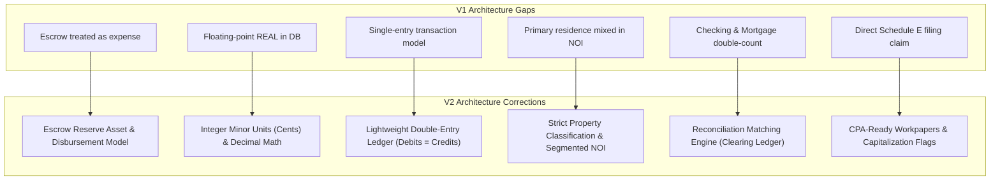

# PropTally V2 Architecture Review & Gap Analysis

**Document:** `01_ARCHITECTURE_REVIEW.md`  
**Author:** Principal Solution Architect & Financial Systems Architect  
**Status:** Architecture Review Complete  
**Date:** October 2026  
**Context:** Reassessment of PropTally Technical Specification V1 (`ARCHITECTURE.md`)

---

## 1. Executive Summary

PropTally is a bespoke financial management, cash flow reconciliation, and tax workpaper preparation platform designed for real estate investor Portfolio Owner. The client currently manages three properties: two residential rental investments and one primary residence in McHenry and Kane Counties, Illinois.

The initial architecture specification (V1) successfully verified the feasibility of extracting vector PDF statements from five financial institutions and correctly identified that mortgage payments contain distinct economic components (Principal, Interest, Escrow).

However, an in-depth financial systems and architectural audit reveals critical structural flaws in the V1 design:
1. **Flawed Escrow Accounting:** V1 treated escrow payment contributions as immediate operating expenses, misrepresenting cash flow, balance sheet assets, and Schedule E tax deductions.
2. **Double-Counting & Settlement Ambiguity:** V1 did not formalize the relationship between loan servicer billing statements (debt records) and bank account ACH debits (cash settlement records), risking double-counting of expenses.
3. **Fragile Data Types & Single-Entry Schema:** Financial values were modeled as SQLite floating-point `REAL` columns, which suffer from rounding errors. The single-entry model lacked balancing invariants, transaction splitting, and historical auditability.
4. **Primary Residence Contamination:** Primary residence debt and maintenance were not cleanly isolated from rental operating calculations, skewing portfolio Net Operating Income (NOI).
5. **Tax Compliance Overreach:** V1 claimed to produce IRS Schedule E reports directly without incorporating depreciation, capital expenditure capitalization rules, or CPA review workflows.

This document classifies all known project facts, identifies core deficiencies, and lays out the fundamental architectural corrections delivered in Specification V2.

---

## 2. Fact Classification & Evidence Registry

In accordance with architectural review standards, all information from source documents, exploration logs, and client requests is classified into strict evidentiary categories:

| Fact / Requirement | Source / Evidence | Classification |
| :--- | :--- | :--- |
| **Westbrook Rental:** 12307 Larkspur St, Westbrook, IL 60196 | Stated on Rocket Mortgage statements (`0700000001`) | **CONFIRMED** |
| **Harborview Rental:** 2718 Foxglove Ct, Harborview, IL 60197 | Stated on PNC Escrow Analysis & Form 1098 (`0700000002`) | **CONFIRMED** |
| **Primary Residence:** 3345 Elderberry Dr, Cedar Grove, IL 60198 | Stated on CrossCountry statements (`0700000003`) & borrower mailing address | **CONFIRMED** |
| **Rocket Loan #0700000001:** Secures Westbrook property | Verified on Page 1 of Rocket statements | **CONFIRMED** |
| **PNC Loan #0700000002:** Secures Harborview property | Verified on PNC Escrow Analysis & 1098 Box 8 | **CONFIRMED** |
| **CrossCountry Loan #0700000003:** Secures Cedar Grove property | Verified on Page 1 of CCM statements | **CONFIRMED** |
| **Bank of America Checking (Acct ending 9456):** Operational cash hub | Direct debit clearing for PNC, CCM, Rocket, and credit cards | **CONFIRMED** |
| **Bank of America Credit Card (Acct ending 9306):** Operating expenses | Monthly ledgers with Home Depot, PayPal, local vendors | **CONFIRMED** |
| **Apple Card (Paid from 9456):** Operational expenses | Monthly ledgers paid via ACH transfer from Checking `...9456` | **CONFIRMED** |
| **Tenant Riley Alvarez:** Pays $2,600/mo via Zelle for Alder | Zelle memos: *"pro-rent 12307 Larkspur"*, *"Alder rent"* | **CONFIRMED** |
| **Digital Vector PDFs:** Statements have native text & tables | 100% vector fonts across all sample PDFs, 0% scanned paper | **CONFIRMED** |
| **On-Premise GPU Server:** Linux box with RTX 3060/4070/5060 GPUs | Stated by client as available local compute resource | **CONFIRMED** |
| **Harborview Tenant & Rent Terms:** How Maple rent is collected | ATM/branch deposits observed; no formal tenant memo confirmed | **OBSERVED** |
| **Credit Card Expense Allocations:** Which card charges are rental vs personal | Home Depot and contractor charges mixed with personal expenses | **OBSERVED** |
| **Primary Residence Utility/Snow Treatment:** Not deductible under Schedule E | Zelle snow removal paid from checking | **OBSERVED** |
| **100% Air-Gapped Operation:** Client mentioned air-gapped / local only | Remote access via Tailscale requested; therefore network-connected, not air-gapped | **ASSUMED (INCORRECT)** |
| **Escrow Contribution as Tax Deduction:** V1 treated escrow as expense | Escrow is a pre-paid asset transfer; tax deduction occurs upon county disbursement | **ASSUMED (FLAWED)** |
| **Property Purchase Price & Land/Building Allocation:** For depreciation | Not present in mortgage statements or bank statements | **NEEDS CLIENT INPUT** |
| **Security Deposit Treatment:** Riley Alvarez paid deposit in Jan 2026 | Security deposits are liabilities, not rental income | **NEEDS CPA VALIDATION** |
| **Capital Improvement vs Repair Thresholds:** $2,500 de minimis safe harbor | Home Depot & contractor charges must follow IRS capitalization rules | **NEEDS CPA VALIDATION** |

---

## 3. Strengths of Architecture V1

The initial exploration and architecture V1 established important foundations that are preserved in V2:
1. **Accurate Document Identification:** Correctly inventoried the client’s real-world statement library across five institutions (Rocket, PNC, CrossCountry, Bank of America, Apple).
2. **Recognition of Mortgage Complexity:** Identified the core failure of off-the-shelf personal finance tools: the failure to decompose mortgage drafts into principal, interest, and escrow.
3. **High-Speed Native Extraction:** Successfully bench-tested PyMuPDF (`fitz`), proving that sub-second extraction without cloud OCR APIs is achievable on native bank PDFs.
4. **Privacy-First Orientation:** Maintained a firm requirement that raw financial statements and customer banking records must never leave the client’s local infrastructure.

---

## 4. Identified Gaps & Deficiencies in V1

### 4.1 Fatal Accounting Flaw: Escrow Contribution vs. Disbursement
* **V1 Error:** V1 categorized the escrow portion of the monthly mortgage payment directly as an operating expense.
* **The Reality:** When a borrower pays $841.32 in escrow to PNC, PNC deposits those funds into an escrow trust reserve account. The borrower retains beneficial ownership of those funds. It is a balance sheet transfer:
  $$\text{Asset (Cash)} \longrightarrow \text{Asset (Servicer Escrow Reserve)}$$
  The economic and tax expense occurs **only when the servicer disburses funds** to the County Treasurer for property taxes or to the insurance carrier for hazard insurance.
* **Impact of V1 Error:** 
  - Causes artificial monthly expense volatility.
  - Distorts annual Schedule E tax deductions (borrower may contribute $10,000 to escrow, but servicer only disburses $8,500 in taxes).
  - Fails to track escrow shortages, surpluses, and annual escrow adjustments.

### 4.2 Settlement Conflict & Double-Counting
* **V1 Error:** V1 designed separate parsers for mortgage statements and checking statements, but did not formalize how they reconcile.
* **The Reality:** 
  - Mortgage Statement: *"Amount Due: $1,801.48 (Principal $520.70, Interest $439.46, Escrow $841.32)"*
  - Checking Statement: *"01/02/26 PNC LENDING DES:PAYMENT ID:0700000002: -$1,801.48"*
  If both are ingested without a formal settlement ledger, the system records **$3,602.96** in cash outflows.
* **V2 Correction:** The checking debit is a cash clearing event that settles the mortgage billing liability. Only the decomposed mortgage statement posts to the expense, asset, and liability ledgers.

### 4.3 Floating-Point Currency (`REAL`) in Database Schema
* **V1 Error:** V1 specified `REAL` columns (IEEE 754 floating-point) in SQLite for balances, payments, and splits.
* **The Reality:** Floating-point arithmetic produces non-deterministic rounding artifacts (e.g. `$1,801.48 - $520.70 - $439.46 = $841.3199999999999`). In financial systems, every cent must balance.
* **V2 Correction:** Enforce exact integer minor units (integer cents, `INTEGER` in SQLite) or fixed-precision `NUMERIC(14, 2)` backed by Python `decimal.Decimal`.

### 4.4 Inability to Split Transactions Across Properties & Categories
* **V1 Error:** V1 assigned a single `property_id` and single category per transaction row.
* **The Reality:** Landlords regularly make single purchases at Home Depot, Menards, or Lowes that contain supplies for Property A, tools for Property B, and personal household items.
* **V2 Correction:** Implement a 1-to-many `transaction_splits` model where split lines sum exactly to the parent transaction amount without modifying the original immutable imported record.

### 4.5 Primary Residence Mixed with Rental Calculations
* **V1 Error:** V1 grouped all three properties together in general reporting without strict accounting boundaries.
* **The Reality:** CrossCountry Loan #`0700000003` secures the client’s primary residence (`3345 Elderberry Dr`). Including its $3,857.96 monthly mortgage or lawn care expenses in rental calculations destroys Net Operating Income (NOI) accuracy and violates IRS Schedule E rules.
* **V2 Correction:** Explicit property classification (`RENTAL_INVESTMENT` vs `PRIMARY_RESIDENCE`). Primary residence debt and equity are tracked on the balance sheet, but excluded from rental operating statements.

### 4.6 Lack of Double-Entry Ledger Invariants
* **V1 Error:** V1 relied on loose "transaction tables" with positive and negative numbers.
* **The Reality:** Without balanced debits and credits, reconciliation errors go unnoticed. For instance, paying off a credit card balance from checking must reduce cash and reduce credit card liabilities, not register as an expense.
* **V2 Correction:** Implement a lightweight double-entry ledger service where every posted financial event enforces:
  $$\sum \text{Debits} = \sum \text{Credits}$$

### 4.7 Premature Tax Determination & Missing Depreciation
* **V1 Error:** V1 promised to generate "IRS Schedule E Reports".
* **The Reality:** Schedule E cannot be legally or accurately generated without depreciation schedules (MACRS 27.5-year residential rental property, requiring purchase price, closing costs, and land-to-building basis allocation). Furthermore, capital improvements (new roof, HVAC) cannot be expensed on Line 14 (Repairs).
* **V2 Correction:** Position PropTally as a **CPA-Ready Tax Workpaper Platform**. It aggregates verified operational numbers into Schedule E categories and flags items needing CPA review (e.g., $2,500 de minimis safe harbor checks).

### 4.8 Naive Duplicate Detection
* **V1 Error:** V1 relied solely on file SHA-256 hashing for deduplication.
* **The Reality:** If a client downloads an updated statement reprint, or re-downloads a statement with slightly different PDF metadata, the file SHA-256 changes even though all underlying transactions are identical.
* **V2 Correction:** Dual-layer deduplication: Layer 1 is file SHA-256; Layer 2 is business-level transaction deduplication based on account ID, date, amount, and reference number.

### 4.9 Mischaracterized Security & Backup Model
* **V1 Error:** V1 claimed the system was "air-gapped" while simultaneously specifying remote LAN/Tailscale access. It also proposed `backup.sh` copying live SQLite files.
* **The Reality:** Copying a live SQLite file during write transactions causes database corruption. Tailscale access means network connectivity, requiring explicit application-level authentication.
* **V2 Correction:** Proper terminology: *Self-hosted, privacy-first local financial platform*. Implement SQLite Online Backup API (`sqlite3_backup`), session authentication tokens, and explicit local network interface binding.

---

## 5. Architectural Redesign Summary (V2 Changes)

---

## 6. Deferred Capabilities (Scope Governance)

To maintain focus on single-client excellence and avoid overengineering, the following capabilities are explicitly deferred from the initial implementation:

| Capability | Rationale for Deferral | Future Path |
| :--- | :--- | :--- |
| **Direct Bank Plaid / Finicity API Sync** | Violates privacy mandate; client prefers statement-driven auditability | Defer indefinitely unless client explicitly requests cloud aggregator |
| **Automated Tax Filing (E-File)** | High regulatory risk; PropTally prepares CPA workpapers, not tax returns | Export standard Schedule E workbook to CPA |
| **Automated Depreciation Calculation** | Requires formal cost segregation and CPA asset basis verification | Model depreciation inputs as CPA overrides |
| **Multi-Tenant SaaS Infrastructure** | Unnecessary complexity for a bespoke single-client application | Modular monolith with clean domain interfaces |
| **Distributed Task Queue (Celery/Redis)** | Statement upload workload is low-volume (10-20 PDFs/month); async Python background worker is sufficient | In-process Python worker / SQLite task queue |

---

## 7. Key Technical Decisions Matrix

| Domain | V1 Approach | V2 Approach | Architectural Benefit |
| :--- | :--- | :--- | :--- |
| **Application Architecture** | Monolithic script bundle | Clean Modular Monolith (FastAPI + React) | Strict domain isolation, simple single-server deployment |
| **Financial Ledger** | Ad-hoc transaction table | Lightweight Double-Entry Journal Engine | Enforces mathematical balancing; eliminates double-counting |
| **Currency Representation** | Floating-point `REAL` | Integer Cents (`INTEGER`) + `Decimal` | Zero rounding error; exact penny accounting |
| **Escrow Modeling** | Immediate expense | Balance sheet reserve asset + disbursement expense | True NOI; accurate property tax tracking |
| **Transaction Splitting** | Single property/category per row | Parent transaction + child split allocations | Handles multi-property purchases and personal allocations |
| **Ingestion Pipeline** | Ad-hoc script execution | 11-stage state machine with review queue | Auditable processing, no partial dirty records |
| **Reconciliation** | Implicit during parse | Explicit matching engine with review states | Separates document ingestion from ledger commitment |
| **AI Boundaries** | Broad assistant | Guarded read-only tool layer; zero calculation authority | 100% deterministic math; zero hallucination risk |
| **Backup & Recovery** | File copy script | SQLite Online Backup API + encrypted tarball | Guaranteed non-corrupt hot backups |

---

*End of Architecture Review.*
