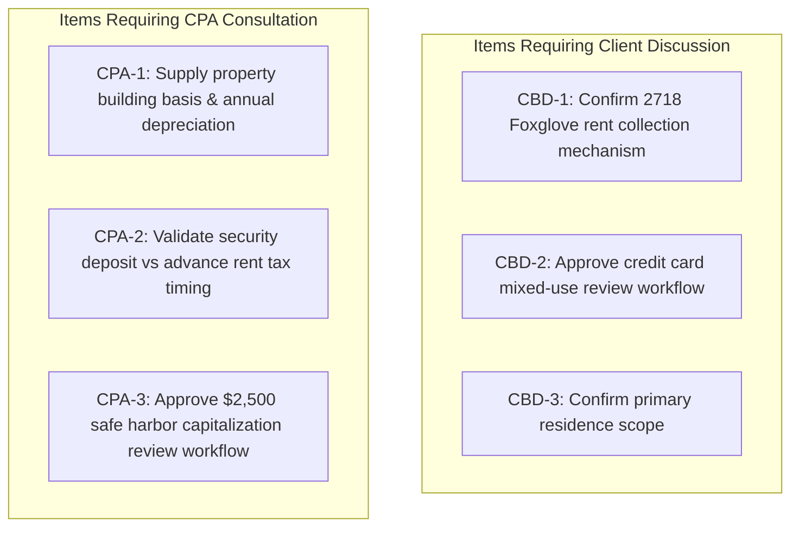

# PropTally V2.1 Requirements & Ambiguity Register

**Document:** `02_REQUIREMENTS_AND_AMBIGUITIES.md`  
**Author:** Principal Solution Architect & Financial Systems Architect  
**Status:** Approved Specification (V2.1 Corrected & Validated)  
**Date:** October 2026  
**Context:** Rigorous categorization of engineering decisions, client business decisions, CPA validation gates, and phase progression controls.

---

## 1. Governance Framework & Phase Gate Policy

> [!IMPORTANT]
> **Phase Gate Policy:**  
> **Phase 0 is NOT complete merely because recommended defaults have been documented.**  
> Technical foundations (Phase 1 parsers and Phase 2 database schemas) are permitted to proceed based on approved engineering decisions. However, **unresolved client business decisions and CPA validation items must strictly prevent the generation of finalized tax reports or automatic ledger postings.** All items awaiting client or CPA confirmation are held in a `PENDING_CONFIRMATION` review state.

### Governance Domains
1. **Architecture Decisions (Accepted by Engineering):** Technical and accounting choices fully resolved by engineering best practices.
2. **Client Business Decisions (Awaiting Client Confirmation):** Operational choices dictated by client's specific business practices.
3. **CPA Validation Items (Awaiting CPA Confirmation):** Statutory tax determinations requiring licensed tax professional review.
4. **Deferred Items:** Non-blocking operational parameters that do not alter the database schema or core engine.

---

## 2. Decision Classification & Action Registry

### 2.1 Category 1: Architecture Decisions (Accepted by Engineering)

| Decision ID | Topic | Resolution in V2.1 | Architectural Rationale |
| :--- | :--- | :--- | :--- |
| **ADR-001** | **Monolith vs Microservices** | Modular Monolith in Python (FastAPI + React) | Operational simplicity; zero distributed transaction failures. |
| **ADR-002** | **Currency Precision** | Integer Cents (`INTEGER`) + Python `Decimal` | Eliminates floating-point rounding drift down to the penny ($0.01). |
| **ADR-003** | **Accounting Model** | Strict Double-Entry Ledger ($\sum \text{Debits} == \sum \text{Credits}$) | Eliminates double-counting of bank mortgage drafts and card payoffs. |
| **ADR-004** | **Transaction Splitting** | Immutable source transactions + Child positive splits | Guarantees $\sum \text{splits} == |\text{transaction}|$; preserves audit trail. |
| **ADR-005** | **Escrow Accounting** | Escrow Reserve Asset + Movement Ledger | Separates monthly cash funding from actual county tax disbursements. |
| **ADR-006** | **Local AI Boundaries** | Local-only GPU inference; zero calculation authority | 100% privacy; deterministic calculations; zero hallucination risk. |
| **ADR-007** | **Document Vault** | SHA-256 deduplication + Coordinate provenance | Defensible tax audit trails linking every number to source PDF. |
| **ADR-008** | **Backup Strategy** | SQLite Online Backup API (`sqlite3_backup`) | Eliminates live WAL corruption hazards during hot backups. |

---

### 2.2 Category 2: Client Business Decisions (Awaiting Client Confirmation)

#### CBD-1 (P0): 582 Foxglove Ct Rent Inflow Mechanism
* **Issue:** How does client collect rent for 582 Foxglove Ct (Harborview)?
* **Observation:** Sample checking statements show recurring ATM cash deposits in Millbrook ($850, $500, $720, $470, $810).
* **Engineering Guardrail:** The system **will not auto-post** cash deposits as rental income. All cash deposits route to an `Unassigned Inflow Review Queue` until client confirms the property attribution.
* **Client Action:** client to confirm whether ATM cash deposits represent Maple rent, personal cash, or business reimbursements.

#### CBD-2 (P1): Credit Card Mixed Personal vs. Rental Spending
* **Issue:** Bank of America Visa (`...9306`) and Apple Card contain mixed personal charges (auto body repair, restaurants, eBay) alongside hardware store purchases.
* **Engineering Guardrail:** All card imports default to `Unassigned / Personal Draw`. Only transactions matching verified rules (e.g. Home Depot tagged to Alder) can be allocated to rental OpEx. Multi-property purchases must be split using the splitting modal.
* **Client Action:** client to confirm if card charges should default to review triage.

#### CBD-3 (P1): Primary Residence (Cedar Grove) Accounting Scope
* **Issue:** How should the Cedar Grove primary residence (`1017 Elderberry Dr`) and its CrossCountry mortgage be treated?
* **Engineering Guardrail:** Cedar Grove is tracked on the balance sheet for debt amortization and total equity, but is **strictly isolated and excluded** from rental Net Operating Income (NOI) and Schedule E workpapers.
* **Client Action:** client to confirm this presentation scope.

---

### 2.3 Category 3: CPA Validation Items (Awaiting CPA Confirmation)

#### CPA-1 (P0): Property Basis, Acquisition Costs & Depreciation Schedules
* **Issue:** Residential rental properties require 27.5-year MACRS straight-line depreciation. Mortgage statements do not contain purchase price or land/building allocations.
* **Engineering Guardrail:** PropTally calculates and reports **"Pre-Depreciation Net Operating Income"**. Schedule E Line 18 (Depreciation) is populated strictly via a dedicated CPA input row in `tax_mappings` / `schedule_e_reports`.
* **CPA Action:** CPA to supply historical depreciation figures or review purchase closing disclosures.

#### CPA-2 (P0): Security Deposit vs. Advance Rent Treatment
* **Issue:** Riley Alvarez paid $4,483.00 on 01/12/2026, comprising a $2,000 security deposit, $483 prorated January rent, and $2,000 February rent.
* **Engineering Guardrail:** The $2,000 deposit is segregated into Liability `2210 Tenant Security Deposits Held` (non-taxable trust liability). Only the $2,483 rent portion is credited to `4010 Rental Income`.
* **CPA Action:** CPA to confirm whether advance February rent is reported in 2025 or 2026 under client's tax accounting method (cash vs. accrual).

#### CPA-3 (P1): De Minimis Safe Harbor & Capitalization Thresholds
* **Issue:** Distinguishing immediately deductible repairs from depreciable capital improvements.
* **Engineering Guardrail:** The $2,500 threshold (Treas. Reg. § 1.263(a)-1(f)) is enforced as a **review warning flag (`CAPEX_REVIEW_REQUIRED`)**, **NOT an automatic deduction rule**. Transactions $\ge \$2,500$ require explicit confirmation before posting to Schedule E Line 14.
* **CPA Action:** CPA to review any flagged expenditures $\ge \$2,500$ prior to finalizing tax workpapers.

---

### 2.4 Category 4: Deferred Items (Safely Postponed)

| Item ID | Topic | Recommended Default | Safe to Defer? |
| :--- | :--- | :--- | :--- |
| **DEF-1** | **Historical Backfill Horizon** | Baseline opening balances set as of October 1, 2025. | YES (Phase 2) |
| **DEF-2** | **Property Valuation Frequency** | Manual annual appraisal/client entry in `property_valuations`. | YES (Phase 4) |
| **DEF-3** | **Automated Mileage Tracking** | Manual entry of annual auto/travel mileage for Schedule E Line 5. | YES (Phase 4) |

---

## 3. Summary Action Matrix for Client & CPA Meeting

---

*End of Requirements & Ambiguity Register V2.1.*
