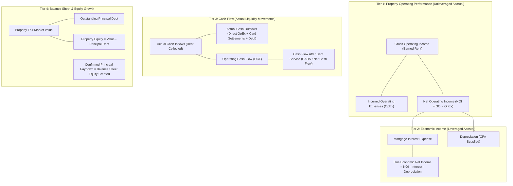
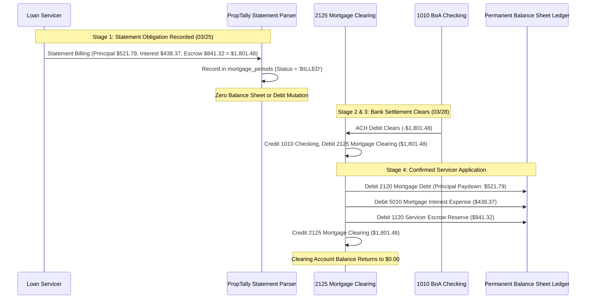

# PropTally V2.2 Financial Domain & Accounting Specification

**Document:** `03_FINANCIAL_DOMAIN_MODEL.md`  
**Author:** Principal Financial Systems Architect  
**Status:** Approved Specification (V2.2 Corrected & Validated)  
**Date:** October 2026  
**Context:** Rigorous financial metrics, post-settlement mortgage recognition, funded escrow movements, credit card cash-flow treatment, and complete reference accounting scenarios.

---

## 1. Independent Financial Metric Definitions

PropTally establishes four distinct, mathematically non-overlapping financial tiers to prevent the conflation of economic performance, liquidity movements, and debt liabilities.



### 1.1 Detailed Metric Formulations

1. **Gross Operating Income (GOI):**
   * Total earned rental revenue from residential operations during the period.
   * Includes: Scheduled rent earned, tenant late fees collected, parking/utility bill-backs earned.
   * Excludes: Refundable tenant security deposits held in trust, loan proceeds, owner capital transfers.
2. **Operating Expenses (OpEx - Accrual / Incurred):**
   * Ordinary and necessary operating expenses incurred to maintain the real estate asset.
   * Includes: Actual property taxes disbursed by the servicer/county, actual hazard insurance premiums disbursed, routine repairs (incurred via card or check), supplies, lawn/snow maintenance, management fees.
   * Strictly Excludes: Mortgage principal, mortgage interest, lender late fees, escrow reserve contributions, capital improvements.
3. **Net Operating Income (NOI):**
   $$\mathbf{NOI} = \mathbf{GOI} - \mathbf{OpEx}$$
   * Measures unleveraged property operating performance, independent of financing or capital structure.
4. **Operating Cash Flow (OCF):**
   $$\mathbf{OCF} = \text{Actual Cash Rent Collected} - \text{Direct Checking OpEx Paid} - \text{Card-Funded Rental OpEx Settled}$$
   * Measures actual liquidity generated by rental operations prior to debt service.
   * Rent counts as collected only when the same journal entry moves cash into a checking account in the same direction as the revenue; accrued rent is revenue but not cash flow.
   * **Card settlement is a transfer, not an expense.** When a deposit account pays a credit card, the ledger debits the card liability and credits the deposit account. The original purchase already recognised the expense, so nothing is expensed again. The rental share of the settled amount is taken from that settlement transaction's own allocation, and only that share reduces rental OCF.
   * **Attribution requires both a door and an expense category.** A split counts toward rental card OpEx only when it is attributed to a rental door *in the reporting scope* **and** carries an operating-expense category (`TAXES`, `INSURANCE`, `REPAIRS`, `SUPPLIES`, `SNOW_LANDSCAPING`, `MANAGEMENT`, `LEGAL`). Property attribution alone is not sufficient: `PERSONAL` is a draw, `RENT_INCOME`/`FEE` are income, and `MORTGAGE` settles a liability. Such allocations are reported as `card_settlement_non_expense_cents` rather than silently reducing rental cash flow. A settlement whose allocation does not cover the amount paid reports the remainder as `card_settlement_unattributed_cents`.
5. **Cash Flow After Debt Service (CADS / Net Cash Flow):**
   $$\mathbf{CADS} = \mathbf{OCF} - \text{Actual Bank Debt Service}$$
   * Where $\text{Actual Bank Debt Service} = \text{Principal Paid} + \text{Interest Paid} + \text{Lender Fees Paid}$.
   * **Escrow contributions are NOT debt service.** They are a transfer from checking into a servicer-held reserve (an asset), so they are reported separately as a cash movement and never reduce CADS. See the matrix entry below.
   * Represents the actual net cash surplus added to the investor's checking account for the period, before voluntary reserve funding.
   * **Recognition: only a confirmed payment is debt service.** Principal and interest are counted when an application is backed by a real bank payment, which is either a single entry that pays the servicer from a deposit account, or a servicer application that draws on a mortgage clearing account a settlement has already funded. The two stages are therefore recognised once, from the application.
   * **The funded cash must cover the whole payment applied, not merely the clearing credit.** Recognition requires $ \text{payment} = \text{principal} + \text{interest} + \text{positive escrow contribution} \le \text{clearing credit} \le \text{funded balance} $. An entry that credits a small clearing amount while debiting a much larger principal and interest is not funded and recognises nothing: the funding, the clearing movement and the application stay linked rather than being compared as unrelated totals.
   * **Escrow is measured gross, never net.** A credit to escrow is a refund, release or adjustment, not funding, so it never reduces the amount of principal and interest that must be covered. An entry that both applies a payment and credits escrow cannot have that relationship established from the ledger, so it fails closed — recognising nothing rather than inferring that the credit funded principal or interest.
   * **Funding is released only by a standalone bank-to-clearing settlement.** The funding entry is matched against a strict allowlist: debits to mortgage clearing accounts and credits to an eligible bank account, and nothing else. A mortgage principal or interest line, an escrow movement in either direction, or any third account makes the entry ambiguous, and it releases no funding — otherwise a mixed entry could fund a later application. The bank credit must cover the clearing debits.
   * **Partial coverage is never apportioned on an invented basis.** When funded cash cannot cover the payment applied, nothing is recognised for that application and the unsupported principal and interest is reported as `unfunded_applied_debt_service_cents`. Funding is consumed as it is drawn, so the same money cannot support two applications, and funding drawn by an unsupported application is not returned to the pool.
   * A **direct payment** must be a pure mortgage-payment entry whose bank outflow covers the whole payment; an unrelated outflow in the same entry does not establish a mortgage payment.
   * Consequence by scenario:

     | Event | Debt service |
     | :--- | :--- |
     | Servicer statement received, not paid | None — an obligation, not a payment |
     | Bank payment settled, not yet applied | None; the cash sits in the clearing account until applied |
     | Clearing funding mixed with an application, escrow or a third account | No funding released; the entry is ambiguous |
     | Servicer applies principal and interest, funded | Counted once |
     | Application larger than the funded cash | None recognised; the unsupported amount is reported |
     | One funded balance, two applications | Counted once — funding is consumed as drawn |
     | Principal/interest posted against clearing with no funding | None; reported as `unfunded_applied_debt_service_cents` |
     | Escrow credit (refund or release) in the payment entry | None — it cannot reduce the funding requirement |
     | Escrow contribution funded as part of the payment | Recognised as escrow funding; excluded from debt service |
     | Escrow release recorded independently of the payment | No effect on debt service |
     | Payment or application reversed | Not counted; void entries are neither recognised nor reported |
     | Unrelated outflow beside a mortgage debit | Not a mortgage payment |
6. **True Economic Net Income:**
   $$\mathbf{Economic\ Net\ Income} = \mathbf{NOI} - \text{Mortgage Interest Expense} - \text{Depreciation (CPA Supplied)}$$
   * Leveraged bottom-line economic profitability.
7. **Property Equity:**
   $$\mathbf{Property\ Equity} = \text{Dated Property Market Valuation} - \text{Current Outstanding Principal Debt Balance}$$

---

## 2. Component Treatment Matrix Across All Metrics

| Financial Component | Gross Operating Income (GOI) | Operating Expenses (OpEx) | Net Operating Income (NOI) | Operating Cash Flow (OCF) | Cash Flow After Debt Service (CADS) | Economic Net Income | Balance Sheet Equity | IRS Schedule E Taxable Net |
| :--- | :---: | :---: | :---: | :---: | :---: | :---: | :---: | :---: |
| **Rent Collected** | **INCLUDED** | Excluded | **INCLUDED (+)** | **INCLUDED (+)** | **INCLUDED (+)** | **INCLUDED (+)** | Excluded | **INCLUDED (+)** (Line 3) |
| **Security Deposit Received** | Excluded | Excluded | Excluded | Excluded (Liability) | Excluded | Excluded | Excluded | Excluded (Trust liability) |
| **Mortgage Principal Paid** | Excluded | Excluded | Excluded | Excluded | **INCLUDED (-)** | Excluded | **INCREASES (+)** (Liability drop) | Excluded (Balance sheet only) |
| **Mortgage Interest Paid** | Excluded | Excluded | Excluded | Excluded | **INCLUDED (-)** | **INCLUDED (-)** | Excluded | **INCLUDED (-)** (Line 12) |
| **Monthly Escrow Contribution** | Excluded | **EXCLUDED** | **EXCLUDED** | Excluded | **EXCLUDED** (Reported separately as a reserve transfer, not debt service) | Excluded (Asset transfer) | Excluded (Asset transfer) | **EXCLUDED** (Not tax event) |
| **County Tax Disbursed (from Escrow)** | Excluded | **INCLUDED (-)** | **INCLUDED (-)** | **EXCLUDED** (No bank cash out) | **EXCLUDED** (No bank cash out) | **INCLUDED (-)** | Excluded | **INCLUDED (-)** (Line 16) |
| **Hazard Ins. Disbursed (from Escrow)**| Excluded | **INCLUDED (-)** | **INCLUDED (-)** | **EXCLUDED** (No bank cash out) | **EXCLUDED** (No bank cash out) | **INCLUDED (-)** | Excluded | **INCLUDED (-)** (Line 9) |
| **Direct Checking OpEx (<$2,500)** | Excluded | **INCLUDED (-)** | **INCLUDED (-)** | **INCLUDED (-)** | **INCLUDED (-)** | **INCLUDED (-)** | Excluded | **INCLUDED (-)** (Line 14/19) |
| **Credit Card Rental OpEx (Swipe)** | Excluded | **INCLUDED (-)** | **INCLUDED (-)** | Excluded (No bank cash yet) | Excluded (No bank cash yet) | **INCLUDED (-)** | Excluded | **INCLUDED (-)** (Line 14/19) |
| **Credit Card Bank Payoff (Rental Portion)**| Excluded | Excluded (Already in OpEx)| Excluded | **INCLUDED (-)** (Cash settled) | **INCLUDED (-)** (Cash settled) | Excluded | Excluded (Liability drop) | Excluded (Liability drop) |
| **Credit Card Bank Payoff (Personal Portion)**| Excluded | Excluded | Excluded | Excluded (Non-rental) | Excluded (Personal draw) | Excluded | Excluded (Equity draw) | Excluded |
| **Capital Improvement ($\ge$ $2,500)** | Excluded | Excluded | Excluded | **INCLUDED (-)** (Cash out) | **INCLUDED (-)** (Cash out) | Excluded (Depreciated) | **INCREASES (+)** (Asset basis) | Excluded (CapEx / Depreciate) |
| **Depreciation** | Excluded | Excluded | Excluded | Excluded (Non-cash) | Excluded (Non-cash) | **INCLUDED (-)** | Excluded | **INCLUDED (-)** (Line 18) |

---

## 3. Credit Card Expenses & Cash Flow Mechanics

Credit cards (BoA Visa `...9306` and Apple Card) introduce a timing difference between when an expense is incurred and when cash leaves the checking account:

### 3.1 Two Reporting Perspectives
1. **Accrual / Property Operating Lens (Incurred Date):**
   * When a $250 plumbing repair is charged at Home Depot, it is immediately recognized in **OpEx** and reduces **NOI** for that month, matched by an increase in credit card liability (`2010 BoA Visa`).
2. **Cash Liquidity Lens (Cash Settlement Date):**
   * On the swipe date, checking account cash is unchanged ($0.00 cash outflow).
   * When checking drafts $500 to pay the credit card bill, PropTally allocates the cash outflow according to the underlying transactions being settled:
     * $400 is allocated to **Settled Rental Operating Expenses** (deducted in OCF and CADS for that cash period).
     * $100 is allocated to **Personal Owner Drawings** (excluded from rental cash flow; tracked as equity draw).

$$\mathbf{OCF}_{\text{Cash Period}} = \text{Cash Rent In} - \text{Direct Checking OpEx} - \sum \text{Card Payoff Allocated to Rental OpEx}$$

$$\mathbf{CADS}_{\text{Cash Period}} = \mathbf{OCF}_{\text{Cash Period}} - \text{Bank Mortgage Debt Service}$$

---

## 4. Mortgage Lifecycle & Post-Settlement Recognition

> [!CRITICAL]
> **Post-Settlement Recognition Policy:**  
> A mortgage statement represents what the servicer says is due, **NOT confirmation that payment occurred**.  
> The system **must never reduce mortgage principal liabilities or increase escrow reserve assets upon statement parsing**.  
> Principal debt reduction and escrow reserve additions are posted **strictly upon confirmed bank settlement and servicing application**.

### 4.1 The Four Discrete Lifecycle Stages



1. **Stage 1: Statement Obligation Recorded (`mortgage_periods`):**
   * Extracted from monthly statement (Rocket, PNC, CCM).
   * Stored in `mortgage_periods` with status `BILLED`.
   * **Accounting Impact: None.** No debits or credits are posted to Mortgage Debt or Escrow Reserve.
2. **Stage 2: Payment Initiation:**
   * Payment scheduled or auto-debit initiated. Status: `PENDING_SETTLEMENT`.
3. **Stage 3: Bank Cash Settlement:**
   * Checking account ACH withdrawal clears.
   * **Journal Entry (Cash Outflow):**
     * `Debit: 2125 Mortgage Clearing: [Servicer]` ($1,801.48)
     * `Credit: 1010 BoA Checking` ($1,801.48)
4. **Stage 4: Confirmed Servicing Application:**
   * Settlement is matched to the statement breakdown.
   * **Journal Entry (Application to Debt, Expense & Escrow):**
     * `Debit: 2120 Mortgage Debt: Principal Reduction` ($521.79)
     * `Debit: 5010 Mortgage Interest Expense` ($438.37)
     * `Debit: 1120 Servicer Escrow Reserve Asset` ($841.32)
     * `Credit: 2125 Mortgage Clearing: [Servicer]` ($1,801.48)
   * The clearing account nets to `$0.00`.
   * An entry is added to `escrow_movements` for the funded $841.32 contribution.

---

## 5. Double-Entry Ledger Enforcement Architecture

### 5.1 Journal Posting Lifecycle
`DRAFT` $\longrightarrow$ `BALANCED` $\longrightarrow$ `POSTED` (Immutable)

1. **Atomic Python Validation:**
   Before marking any entry `POSTED`, the application posting service executes within an explicit database write transaction:
   ```sql
   SELECT sum(debit_cents), sum(credit_cents), count(*)
   FROM journal_entry_lines
   WHERE journal_entry_id = :id;
   ```
   If `count == 0`, `sum(debits) != sum(credits)`, or `sum(debits) <= 0`, an `UnbalancedJournalEntryError` is raised, rolling back the transaction.
2. **Reversals are Independent Entries:**
   A posted journal entry is **never updated or mutated**. When a reversal occurs:
   * The original entry retains `status = 'POSTED'` and remains **100% physically immutable** (no header fields or line items are mutated; direct SQL updates are prohibited by database triggers). Reversal status is derived solely from the presence of a posted compensating entry referencing `reversal_of_id`.
   * A separate, new compensating entry is created with `entry_type = 'REVERSAL'`, referencing `reversal_of_id`, exactly inverting debits and credits.
3. **Database Triggers:**
   * SQL trigger `prevent_posted_lines_insert` rejects inserting lines into a posted entry.
   * SQL trigger `prevent_posted_entry_update` rejects updating header fields of a posted entry.
   * SQL trigger `prevent_posted_entry_delete` rejects deleting a posted entry.

---

## 6. Reconciliation Allocation Engine & Enforcement Rules

PropTally V2.2 enforces strict executable allocation limits on `reconciliation_allocations`:

### 6.1 Capacity Invariant Formulas
For any source transaction $S$:

$$\text{Available Source Cents} = |S\text{.amount\_cents}| - \sum_{\text{confirmed}} \text{allocation.allocated\_cents}$$

$$\text{Available Target Cents} = \text{Target.total\_cents} - \sum_{\text{confirmed}} \text{allocation.allocated\_cents}$$

### 6.2 Executable Allocation Rules
1. **Validation Barrier:** Before confirming any allocation, the service verifies that $\text{allocated\_cents} \le \text{Available Source Cents}$ AND $\text{allocated\_cents} \le \text{Available Target Cents}$.
2. **Write Serialization:** Confirming allocations executes under SQLite `BEGIN IMMEDIATE` or `BEGIN EXCLUSIVE` transactions, serializing writes and eliminating race conditions.
3. **Status Semantics:**
   * `PROPOSED`: Staged candidate; does not permanently decrement source balance, but reserves capacity during interactive review.
   * `CONFIRMED`: Permanent active allocation; decrements available source and target capacity.
   * `REVERSED`: Inactivated allocation; immediately restores capacity to source and target.
   * `REJECTED`: Discarded candidate; consumes $0$ capacity; retained for audit logging.
4. **Additional Principal Overpayments:** If a bank payment exceeds the statement total due, the excess **cannot be allocated to the monthly billing target**. It must be explicitly created as a separate allocation with `target_type = 'ADDITIONAL_PRINCIPAL'`, routing directly to reduce mortgage debt liability.

---

## 7. Posting Authorization vs. Matching Confidence

> [!IMPORTANT]
> **Decoupling Matching from Posting Authorization:**  
> A matching confidence of 1.0 means the algorithm is mathematically certain that two records refer to the same event.  
> It does **NOT** grant authorization to post the transaction to the accounting ledger if client business controls or CPA tax gates require human review.

### Decision Matrix

| Matching Confidence | Business / Tax Gate | Resulting Status | Action Taken |
| :---: | :---: | :---: | :--- |
| **1.0 (Exact)** | Pre-Approved Deterministic Rule (e.g. Riley Alvarez rent) | `AUTO_POSTED` | Posts immediately to ledger & updates vault. |
| **1.0 (Exact)** | Unassigned Cash / Client Gate (CBD-1 Maple ATM deposit) | `NEEDS_CLIENT_REVIEW` | Holds in review queue; **blocked from ledger**. |
| **1.0 (Exact)** | Safe Harbor CapEx Gate (CPA-3 invoice $\ge \$2,500$) | `NEEDS_CPA_REVIEW` | Staged in review queue; **blocked from Schedule E**. |
| **< 1.0 (Ambiguous)**| Any | `NEEDS_TRIAGE` | Displays in Reconciliation Center for manual assignment. |

---

## 8. Eight Worked Reference Scenarios

Below are the complete, end-to-end worked scenarios demonstrating exact database state transitions, journal entries, and reporting impacts.

---

### Scenario 1: Standard Mortgage Payment (Post-Settlement Recognition)
* **Context:** PNC Mortgage statement received March 25 (Due May 01) for $1,801.48 (Principal $521.79, Interest $438.37, Escrow $841.32). Bank ACH clears March 28.
* **Step 1 (03/25 - Statement Receipt):**
  * Recorded in `mortgage_periods`: `loan_id = 'loan_pnc'`, `due_date = '2026-05-01'`, `principal = 52179`, `interest = 43837`, `escrow = 84132`, `total = 180148`, `status = 'BILLED'`.
  * **Journal Entries: NONE.** Mortgage principal and escrow assets are **not modified**.
* **Step 2 (03/28 - Bank Settlement Clears Checking):**
  * BoA Checking records debit of -$1,801.48.
  * **Journal Entry 1 (Cash Settlement):**

| Account Code & Name | Debit ($) | Credit ($) |
| :--- | :---: | :---: |
| **2125 Mortgage Clearing: PNC** | $1,801.48 | — |
| **1010 BoA Checking (`...9456`)** | — | $1,801.48 |
| **TOTALS** | **$1,801.48** | **$1,801.48** |

* **Step 3 (Reconciliation & Application Confirmation):**
  * Allocation created linking bank debit to `mortgage_periods` record.
  * **Journal Entry 2 (Confirmed Servicing Application):**

| Account Code & Name | Debit ($) | Credit ($) |
| :--- | :---: | :---: |
| **2120 Mortgage Debt: PNC** | $521.79 | — |
| **5010 Mortgage Interest Expense** | $438.37 | — |
| **1120 Servicer Escrow Reserve: PNC** | $841.32 | — |
| **2125 Mortgage Clearing: PNC** | — | $1,801.48 |
| **TOTALS** | **$1,801.48** | **$1,801.48** |

* **Step 4 (Escrow Movement Ledger):**
  * Insert into `escrow_movements`: `movement_type = 'CONTRIBUTION'`, `amount_cents = 84132`, `running_calculated_balance_cents = 336528`.
* **Reporting Impact:**
  * Bank Debt Service (CADS): -$960.16 (principal $521.79 + interest $438.37) | Escrow reserve funding: -$841.32 (reported separately, not in CADS) | NOI Impact: $0.00 | Schedule E Line 12: +$438.37 | Equity Created: +$521.79.

---

### Scenario A: Mortgage Payment Rejected / Returned (No Premature Recognition)
* **Step 1 (03/25):** PNC Statement received ($1,801.48). Staged in `mortgage_periods` as `BILLED`. Zero journal entries.
* **Step 2 (03/28):** Bank debits -$1,801.48. Entry 1 from Scenario 1 posts (Cash out, Clearing debited).
* **Step 3 (03/30):** Bank reverses ACH debit due to administrative hold (Credits $1,801.48 back to checking).
  * **Journal Entry (Reversal Entry):**

| Account Code & Name | Debit ($) | Credit ($) |
| :--- | :---: | :---: |
| **1010 BoA Checking (`...9456`)** | $1,801.48 | — |
| **2125 Mortgage Clearing: PNC** | — | $1,801.48 |
| **TOTALS** | **$1,801.48** | **$1,801.48** |

* **Verification of Invariants:**
  * Clearing account `2125` balance is `$0.00`.
  * Checking balance is restored.
  * **Mortgage Debt was NEVER reduced.**
  * **Escrow Asset was NEVER funded.**
  * Zero premature or phantom entries.
* **Step 4 (04/02):** Payment successfully re-initiated and clears with a $30 bank fee:
  * Posts final settlement and application (Entries 1 & 2 from Scenario 1 + Bank fee).

---

### Scenario B: Credit-Card-Funded Property Expense & Cash Flow Settlement
* **Event 1 (May 05):** $500.00 charged at Home Depot on BoA Visa (`...9306`):
  * $250 allocated to Alder (Repairs)
  * $150 allocated to Maple (Supplies)
  * $100 allocated to Cedar Grove home (Personal Draw)
* **Journal Entry 1 (Incurred Expense on Card):**

| Account Code & Name | Debit ($) | Credit ($) |
| :--- | :---: | :---: |
| **5040 Repairs: 12307 Larkspur St** | $250.00 | — |
| **5050 Supplies: 2718 Foxglove Ct** | $150.00 | — |
| **5090 Personal Drawings** | $100.00 | — |
| **2010 BoA Visa Liability (`...9306`)** | — | $500.00 |
| **TOTALS** | **$500.00** | **$500.00** |

* **Operating Impact on Incurred Date (May 05):**
  * Alder NOI: -$250.00 | Maple NOI: -$150.00
  * Checking Cash Flow (May 05): $0.00 (Zero checking cash movement).
* **Event 2 (May 22):** Checking drafts $500.00 to pay BoA Visa bill:
* **Journal Entry 2 (Card Settlement):**

| Account Code & Name | Debit ($) | Credit ($) |
| :--- | :---: | :---: |
| **2010 BoA Visa Liability (`...9306`)** | $500.00 | — |
| **1010 BoA Checking (`...9456`)** | — | $500.00 |
| **TOTALS** | **$500.00** | **$500.00** |

* **Cash Flow Impact on Settlement Date (May 22):**
  * Rental Settled OpEx Outflow: -$400.00 (deducted in OCF and CADS).
  * Personal Cash Draw: -$100.00 (excluded from rental metrics).
  * Net Checkbook Outflow: -$500.00. Zero duplicate expenses posted.

---

### Scenario C: Escrow Contribution Not Collected (Failed & Retried)
* **Step 1 (Oct 10):** PNC Statement billed with $841.32 escrow contribution. Staged in `mortgage_periods`.
* **Step 2 (Oct 15):** Checking draft fails.
  * Escrow Movement Ledger: **Zero entries added.**
  * Running calculated escrow balance: Unchanged.
* **Step 3 (Oct 25):** Payment successfully settles.
  * Escrow contribution funded: Insert into `escrow_movements` (+$841.32).
  * Calculated balance increases from $2,523.96 to $3,365.28 **only upon confirmed settlement**.

---

### Scenario 2: Credit Card Split Invariant Verification
* Parent: BoA Visa charge -$500.00 (`direction = 'OUTFLOW'`).
* Split 1: $250.00 (Alder) | Split 2: $150.00 (Maple) | Split 3: $100.00 (Personal).
* Sum of splits: $\$250 + \$150 + \$100 = \$500 == |-500|$.
* Invariant satisfied; `transaction_processing_states.allocation_status` set to `FULLY_ALLOCATED`.

---

### Scenario 3: Partial Allocation ($1,000 Inflow: $600 & $300 Assigned, $100 Residual)
* Checking receives +$1,000.00 deposit (`direction = 'INFLOW'`).
* User assigns $600 to Maple Rent and $300 to Alder Late Fee.
* $\sum \text{splits} = 90000 \text{ cents} < 100000 \text{ cents}$.
* Status: `PARTIALLY_ALLOCATED` (`residual_cents = 10000`).
* **Rule Enforced:** The entry **cannot post to permanent property income ledgers** until the $100 residual is assigned. Staged in review queue.

---

### Scenario 4: County Property Tax Disbursement ($4,289.20 from Escrow)
* Escrow Reserve Asset (`1120`) has $4,206.60 balance.
* Servicer pays McHenry County Collector $4,289.20.
* **Journal Entry (Disbursement Event):**

| Account Code & Name | Debit ($) | Credit ($) |
| :--- | :---: | :---: |
| **5020 Property Tax Expense: Maple** | $4,289.20 | — |
| **1120 Servicer Escrow Reserve: PNC** | — | $4,289.20 |
| **TOTALS** | **$4,289.20** | **$4,289.20** |

* Escrow movement recorded: `amount_cents = -428920`, `running_calculated_balance = -8260` (-$82.60 shortage).
* Cash Flow (CADS) Impact: **$0.00** (Not paid from checking).
* NOI Impact: **-$4,289.20** (Recognized as tax OpEx).
* Schedule E Line 16: **+$4,289.20** deduction.

---

### Scenario 6: Duplicate Statement Reprocessing with Newer Parser Version
* **PLANNED — not implemented in the local ingestion release.**
* An identical SHA-256 is currently skipped; `--force-reextract` is not available.
* A future re-extraction must create a new `ExtractionVersion` and must not change approved historical records, transactions, splits, or posted journal entries.

---

*End of Financial Domain & Accounting Specification V2.2.*
