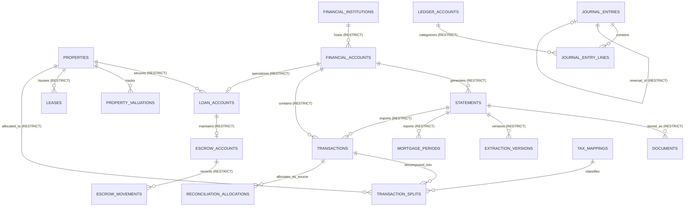

# PropTally V2.2 Database & Ledger Architecture

**Document:** `04_DATABASE_DESIGN.md`  
**Author:** Principal Database Architect & Senior Python Engineer  
**Status:** Approved Specification (V2.2 Corrected & Validated)  
**Date:** October 2026  
**Context:** Relational database schema, strict immutability triggers, allocation limit validation, extraction versioning, and SQLite single-writer concurrency controls.

---

## 1. Database Invariants & Structural Guardrails

The PropTally V2.2 database enforces the following structural rules:

1. **Exact Financial Precision:** All monetary amounts are stored as **exact integer minor currency units (cents)** in `INTEGER` columns. Floating-point types (`REAL`/`FLOAT`) are prohibited.
2. **Immutable Imported Transactions:** The `transactions` table contains strictly immutable raw data imported from statements. Mutable allocation and reconciliation states are stored in separate tables (`transaction_splits`, `reconciliation_allocations`).
3. **No Cascading Deletion of Financial History:** Cascading deletes (`ON DELETE CASCADE`) are strictly removed from all financial entities (`documents`, `statements`, `transactions`, `journal_entries`, `loan_accounts`). Deleting an account or property with financial history is blocked with `ON DELETE RESTRICT`.
4. **Enforced Double-Entry Immutability:** Once a `journal_entries` record reaches status `'POSTED'`, database triggers reject all `INSERT`, `UPDATE`, and `DELETE` operations on both the entry header and lines. Corrections must use independent compensating reversal entries.
5. **Enforced Allocation Limits:** Total confirmed allocations cannot exceed source funds or target obligation capacities, validated under atomic serialized write transactions.
6. **Separation of Billed vs. Applied Mortgage Amounts:** The schema tracks what the servicer billed versus what has been confirmed settled and applied to debt and escrow.
7. **Immutable Extraction Versioning:** Version history is retained for imported statements. Parser re-extraction (`--force-reextract`) is **PLANNED**; it is not implemented in the current local ingestion release. A future parser run must attach another extraction record/version to the existing SHA-256-deduplicated `Document`, rather than duplicate the document row.
8. **Approval Auditability:** Extraction approval currently uses mutable `approval_status` and `approved_at` fields. This is an explicit local workflow gate, not append-only audit evidence or verified human identity. A separate immutable approval record is deferred until the application has a reliable approver identity and revocation/re-approval semantics.

---

## 2. Updated Entity-Relationship Diagram (ERD)



---

## 3. Normalized Relational Schema (DDL)

### 3.1 Properties, Valuations & Leases

```sql
-- Core real estate assets (doors)
CREATE TABLE properties (
    id TEXT PRIMARY KEY,                       -- e.g. "prop_tinsley_huntley"
    name TEXT NOT NULL,                        -- e.g. "12307 Larkspur St"
    address_line1 TEXT NOT NULL,
    address_line2 TEXT,
    city TEXT NOT NULL,
    state TEXT NOT NULL DEFAULT 'IL',
    zip_code TEXT NOT NULL,
    property_type TEXT NOT NULL,               -- 'RENTAL_INVESTMENT' | 'PRIMARY_RESIDENCE'
    acquisition_date DATE,
    purchase_price_cents INTEGER,              -- Cost basis in integer cents
    land_basis_cents INTEGER,                  -- Non-depreciable land portion
    building_basis_cents INTEGER,              -- Depreciable building basis
    is_active BOOLEAN NOT NULL DEFAULT 1,
    created_at TIMESTAMP NOT NULL DEFAULT CURRENT_TIMESTAMP
);

-- Historical property valuations for equity tracking
CREATE TABLE property_valuations (
    id TEXT PRIMARY KEY,
    property_id TEXT NOT NULL REFERENCES properties(id) ON DELETE RESTRICT,
    valuation_date DATE NOT NULL,
    estimated_value_cents INTEGER NOT NULL,    -- Fair Market Value in cents
    valuation_source TEXT NOT NULL,            -- 'PURCHASE_PRICE', 'APPRAISAL', 'CLIENT_MANUAL'
    notes TEXT,
    created_at TIMESTAMP NOT NULL DEFAULT CURRENT_TIMESTAMP
);

-- Tenant lease agreements. Rent attribution reads this term: a payment is
-- attributed to a lease only when its date falls inside start_date..end_date, so a
-- previous tenant's payments are never reassigned to the tenant who followed.
CREATE TABLE leases (
    id TEXT PRIMARY KEY,
    property_id TEXT NOT NULL REFERENCES properties(id) ON DELETE RESTRICT,
    tenant_name TEXT NOT NULL,                 -- e.g. "Riley Alvarez"
    start_date DATE NOT NULL,
    end_date DATE,
    monthly_rent_cents INTEGER NOT NULL,       -- e.g. 260000 ($2,600.00)
    security_deposit_cents INTEGER NOT NULL,   -- e.g. 200000 ($2,000.00)
    is_active BOOLEAN NOT NULL DEFAULT 1,
    created_at TIMESTAMP NOT NULL DEFAULT CURRENT_TIMESTAMP
);

-- The bridge between what a bank prints and who actually pays. Written when a
-- person confirms a rent inflow; later payments from the same remitter are
-- attributed to that door without asking again. alias_key is the remitter
-- normalised (lower case, single-letter initials and company suffixes dropped),
-- so "TYLER J SAXSMA", "Tyler Saxsma" and "SAXSMA, TYLER" share one identity.
CREATE TABLE tenant_aliases (
    id TEXT PRIMARY KEY,                       -- "alias_<sha1(alias_key)[:16]>"
    alias_key TEXT NOT NULL,                   -- normalised remitter
    display_name TEXT NOT NULL,                -- as the bank printed it
    tenant_name TEXT NOT NULL,                 -- as the lease records it
    property_id TEXT NOT NULL REFERENCES properties(id) ON DELETE RESTRICT,
    lease_id TEXT REFERENCES leases(id) ON DELETE SET NULL,
    created_at TIMESTAMP NOT NULL DEFAULT CURRENT_TIMESTAMP
);
CREATE INDEX ix_tenant_aliases_alias_key ON tenant_aliases (alias_key);

-- A payment a person has ruled out as rent received. The rent workbench derives
-- candidates from bank wording and confirmed remitters; an amount equal to a
-- door's rent is a hint, not evidence. A dismissal removes the suggestion only:
-- the transaction stays in the review queue for its real classification.
CREATE TABLE rent_candidate_dismissals (
    transaction_id TEXT PRIMARY KEY REFERENCES transactions(id) ON DELETE CASCADE,
    reason TEXT,
    created_at TIMESTAMP NOT NULL DEFAULT CURRENT_TIMESTAMP
);
```

### 3.2 Financial Accounts, Loans & Funded Escrow Movement Ledger

```sql
-- Financial Institutions (Lenders, Banks, Card Issuers)
CREATE TABLE financial_institutions (
    id TEXT PRIMARY KEY,                       -- e.g. "inst_rocket", "inst_pnc", "inst_bofa"
    name TEXT NOT NULL,
    routing_number TEXT,
    website TEXT,
    created_at TIMESTAMP NOT NULL DEFAULT CURRENT_TIMESTAMP
);

-- Financial Accounts
CREATE TABLE financial_accounts (
    id TEXT PRIMARY KEY,                       -- e.g. "acct_bofa_chk_9456"
    institution_id TEXT NOT NULL REFERENCES financial_institutions(id) ON DELETE RESTRICT,
    account_name TEXT NOT NULL,
    account_type TEXT NOT NULL,                -- 'CHECKING', 'CREDIT_CARD', 'MORTGAGE'
    account_number_masked TEXT NOT NULL,       -- e.g. "...9456"
    currency TEXT NOT NULL DEFAULT 'USD',
    is_active BOOLEAN NOT NULL DEFAULT 1,
    created_at TIMESTAMP NOT NULL DEFAULT CURRENT_TIMESTAMP
);

-- Mortgage Loan Details & Amortization
CREATE TABLE loan_accounts (
    id TEXT PRIMARY KEY,                       -- e.g. "loan_pnc_1000000002"
    financial_account_id TEXT NOT NULL UNIQUE REFERENCES financial_accounts(id) ON DELETE RESTRICT,
    property_id TEXT NOT NULL REFERENCES properties(id) ON DELETE RESTRICT,
    loan_number TEXT NOT NULL UNIQUE,          -- e.g. "0700000002"
    origination_date DATE,
    original_principal_cents INTEGER,
    term_months INTEGER DEFAULT 360,
    current_interest_rate_bps INTEGER,         -- Legacy name; thousandths of percent: 2500 = 2.500%
    is_active BOOLEAN NOT NULL DEFAULT 1,
    created_at TIMESTAMP NOT NULL DEFAULT CURRENT_TIMESTAMP
);

-- Servicer Escrow Reserve Accounts
CREATE TABLE escrow_accounts (
    id TEXT PRIMARY KEY,
    loan_account_id TEXT NOT NULL UNIQUE REFERENCES loan_accounts(id) ON DELETE RESTRICT,
    opening_balance_cents INTEGER NOT NULL DEFAULT 0,
    last_analysis_date DATE,
    projected_annual_tax_cents INTEGER DEFAULT 0,
    projected_annual_insurance_cents INTEGER DEFAULT 0,
    projected_shortage_cents INTEGER DEFAULT 0,
    monthly_shortage_payment_cents INTEGER DEFAULT 0,
    updated_at TIMESTAMP NOT NULL DEFAULT CURRENT_TIMESTAMP
);

-- Auditable Escrow Movement Ledger (Records ONLY confirmed funded events)
CREATE TABLE escrow_movements (
    id TEXT PRIMARY KEY,
    escrow_account_id TEXT NOT NULL REFERENCES escrow_accounts(id) ON DELETE RESTRICT,
    movement_date DATE NOT NULL,
    movement_type TEXT NOT NULL,               -- 'CONTRIBUTION', 'TAX_DISBURSEMENT', 'INSURANCE_DISBURSEMENT', 'REFUND', 'INTEREST_EARNED', 'SHORTAGE_ADJUSTMENT'
    amount_cents INTEGER NOT NULL,             -- Signed: positive for additions, negative for disbursements
    running_calculated_balance_cents INTEGER NOT NULL,
    statement_id TEXT REFERENCES statements(id) ON DELETE RESTRICT,
    description TEXT,
    provenance_notes TEXT,
    created_at TIMESTAMP NOT NULL DEFAULT CURRENT_TIMESTAMP
);
```

### 3.3 Documents, Extraction Versions & Immutable Transactions

```sql
-- Ingested raw files
CREATE TABLE documents (
    id TEXT PRIMARY KEY,
    file_sha256 TEXT NOT NULL UNIQUE,          -- Cryptographic duplicate prevention
    original_filename TEXT NOT NULL,
    storage_path TEXT NOT NULL,                -- Relative vault path
    file_size_bytes INTEGER NOT NULL,
    mime_type TEXT NOT NULL DEFAULT 'application/pdf',
    uploaded_at TIMESTAMP NOT NULL DEFAULT CURRENT_TIMESTAMP
);

-- Parsed financial statements
CREATE TABLE statements (
    id TEXT PRIMARY KEY,
    document_id TEXT NOT NULL REFERENCES documents(id) ON DELETE RESTRICT,
    financial_account_id TEXT NOT NULL REFERENCES financial_accounts(id) ON DELETE RESTRICT,
    statement_type TEXT NOT NULL,              -- 'MORTGAGE', 'CHECKING', 'CREDIT_CARD', 'ESCROW_ANALYSIS', 'FORM_1098'
    active_parser_name TEXT NOT NULL,
    active_parser_version TEXT NOT NULL,
    period_start_date DATE,
    period_end_date DATE,
    statement_date DATE NOT NULL,
    opening_balance_cents INTEGER,
    closing_balance_cents INTEGER,
    ingestion_status TEXT NOT NULL,            -- 'COMMITTED' only after approved import; 'NEEDS_REVIEW', 'REJECTED'
    created_at TIMESTAMP NOT NULL DEFAULT CURRENT_TIMESTAMP
);

-- Recoverable parser output, including incomplete documents without a statement date.
CREATE TABLE document_extractions (
    id TEXT PRIMARY KEY,
    document_id TEXT NOT NULL REFERENCES documents(id) ON DELETE RESTRICT,
    parser_name TEXT NOT NULL,
    parser_version TEXT NOT NULL,
    validation_status TEXT NOT NULL,            -- 'EXTRACTED', 'VALIDATED', 'NEEDS_REVIEW'
    approval_status TEXT NOT NULL,              -- 'PENDING', 'APPROVED'
    extracted_data_json JSON NOT NULL,
    approved_at TIMESTAMP,
    imported_statement_id TEXT REFERENCES statements(id) ON DELETE RESTRICT,
    created_at TIMESTAMP NOT NULL DEFAULT CURRENT_TIMESTAMP
);

-- Versioned Extraction Records (Preserves re-extraction history)
CREATE TABLE extraction_versions (
    id TEXT PRIMARY KEY,
    statement_id TEXT NOT NULL REFERENCES statements(id) ON DELETE RESTRICT,
    parser_name TEXT NOT NULL,
    parser_version TEXT NOT NULL,
    extracted_at TIMESTAMP NOT NULL DEFAULT CURRENT_TIMESTAMP,
    extracted_data JSON NOT NULL,
    is_active BOOLEAN NOT NULL DEFAULT 1
);

-- Mortgage Statement Breakdown Records (Billed vs. Applied Separation)
CREATE TABLE mortgage_periods (
    id TEXT PRIMARY KEY,
    statement_id TEXT NOT NULL REFERENCES statements(id) ON DELETE RESTRICT,
    loan_account_id TEXT NOT NULL REFERENCES loan_accounts(id) ON DELETE RESTRICT,
    payment_due_date DATE NOT NULL,
    statement_date DATE NOT NULL,
    -- Billed amounts (What servicer says is due)
    principal_billed_cents INTEGER NOT NULL,
    interest_billed_cents INTEGER NOT NULL,
    escrow_billed_cents INTEGER NOT NULL,
    fees_billed_cents INTEGER NOT NULL DEFAULT 0,
    total_amount_billed_cents INTEGER NOT NULL,
    -- Confirmed applied amounts (Populated ONLY upon verified cash settlement)
    principal_applied_cents INTEGER NOT NULL DEFAULT 0,
    interest_applied_cents INTEGER NOT NULL DEFAULT 0,
    escrow_applied_cents INTEGER NOT NULL DEFAULT 0,
    total_amount_applied_cents INTEGER NOT NULL DEFAULT 0,
    outstanding_principal_cents INTEGER NOT NULL,
    reported_escrow_balance_cents INTEGER,
    interest_rate_bps INTEGER NOT NULL,        -- Legacy name; thousandths of percent (e.g. 3125 = 3.125%)
    status TEXT NOT NULL DEFAULT 'BILLED',     -- 'BILLED', 'PARTIALLY_SETTLED', 'FULLY_SETTLED'
    created_at TIMESTAMP NOT NULL DEFAULT CURRENT_TIMESTAMP,
    CONSTRAINT check_billed_sum CHECK (
        principal_billed_cents + interest_billed_cents + escrow_billed_cents + fees_billed_cents = total_amount_billed_cents
    )
);

-- Strictly IMMUTABLE imported transactions (Raw import state only)
CREATE TABLE transactions (
    id TEXT PRIMARY KEY,
    statement_id TEXT NOT NULL REFERENCES statements(id) ON DELETE RESTRICT,
    financial_account_id TEXT NOT NULL REFERENCES financial_accounts(id) ON DELETE RESTRICT,
    transaction_date DATE NOT NULL,
    posting_date DATE,
    amount_cents INTEGER NOT NULL,             -- Signed: positive = credit/deposit, negative = debit/withdrawal
    direction TEXT NOT NULL,                   -- 'INFLOW' | 'OUTFLOW'
    raw_description TEXT NOT NULL,
    reference_number TEXT,
    created_at TIMESTAMP NOT NULL DEFAULT CURRENT_TIMESTAMP,
    CONSTRAINT check_direction CHECK (
        (amount_cents > 0 AND direction = 'INFLOW') OR (amount_cents < 0 AND direction = 'OUTFLOW')
    )
);

-- Mutable Transaction Splits (Allocations across properties and categories)
CREATE TABLE transaction_splits (
    id TEXT PRIMARY KEY,
    transaction_id TEXT NOT NULL REFERENCES transactions(id) ON DELETE RESTRICT,
    property_id TEXT REFERENCES properties(id) ON DELETE RESTRICT, -- NULL for personal/unassigned
    category TEXT NOT NULL,                    -- 'RENT_INCOME', 'REPAIRS', 'SUPPLIES', 'TAXES', 'PERSONAL'
    amount_cents INTEGER NOT NULL,             -- Strictly positive integer
    schedule_e_line INTEGER,                   -- e.g. 3, 12, 14, 16, 19
    tax_review_status TEXT NOT NULL DEFAULT 'UNCLASSIFIED', -- 'UNCLASSIFIED', 'AUTO_SUGGESTED', 'CLIENT_CONFIRMED', 'CAPEX_REVIEW_REQUIRED', 'CPA_APPROVED'
    notes TEXT,
    created_at TIMESTAMP NOT NULL DEFAULT CURRENT_TIMESTAMP,
    CONSTRAINT check_split_positive CHECK (amount_cents > 0)
);

-- Processing & Allocation Status for Transactions
CREATE TABLE transaction_processing_states (
    transaction_id TEXT PRIMARY KEY REFERENCES transactions(id) ON DELETE RESTRICT,
    allocation_status TEXT NOT NULL DEFAULT 'UNALLOCATED', -- 'UNALLOCATED', 'PARTIALLY_ALLOCATED', 'FULLY_ALLOCATED'
    allocated_cents INTEGER NOT NULL DEFAULT 0,
    residual_cents INTEGER NOT NULL,           -- Must = abs(transaction.amount_cents) - allocated_cents
    is_reconciled BOOLEAN NOT NULL DEFAULT 0,
    updated_at TIMESTAMP NOT NULL DEFAULT CURRENT_TIMESTAMP
);
```

### 3.4 Double-Entry Ledger & Rigorous Immutability Triggers

```sql
-- Double-Entry Chart of Accounts
CREATE TABLE ledger_accounts (
    code INTEGER PRIMARY KEY,                  -- e.g. 1010, 2120, 5010
    name TEXT NOT NULL,
    account_type TEXT NOT NULL,                -- 'ASSET', 'LIABILITY', 'EQUITY', 'INCOME', 'EXPENSE'
    normal_balance TEXT NOT NULL               -- 'DEBIT' | 'CREDIT'
);

-- Journal Entries (Header)
CREATE TABLE journal_entries (
    id TEXT PRIMARY KEY,
    entry_date DATE NOT NULL,
    entry_type TEXT NOT NULL,                  -- 'OPENING_BALANCE', 'MORTGAGE_BILLING', 'CASH_SETTLEMENT', 'EXPENSE_POST', 'ESCROW_DISBURSEMENT', 'REVERSAL'
    status TEXT NOT NULL DEFAULT 'DRAFT',      -- 'DRAFT', 'BALANCED', 'POSTED'
    is_reversed BOOLEAN NOT NULL DEFAULT 0,    -- 1 if a subsequent reversal entry exists
    idempotency_key TEXT UNIQUE,               -- Prevents duplicate posting
    reversal_of_id TEXT REFERENCES journal_entries(id) ON DELETE RESTRICT,
    description TEXT NOT NULL,
    posted_at TIMESTAMP,
    created_at TIMESTAMP NOT NULL DEFAULT CURRENT_TIMESTAMP
);

-- Journal Entry Lines
CREATE TABLE journal_entry_lines (
    id TEXT PRIMARY KEY,
    journal_entry_id TEXT NOT NULL REFERENCES journal_entries(id) ON DELETE RESTRICT,
    ledger_account_code INTEGER NOT NULL REFERENCES ledger_accounts(code) ON DELETE RESTRICT,
    property_id TEXT REFERENCES properties(id) ON DELETE RESTRICT,
    debit_cents INTEGER NOT NULL DEFAULT 0,
    credit_cents INTEGER NOT NULL DEFAULT 0,
    description TEXT,
    CHECK (debit_cents >= 0 AND credit_cents >= 0),
    CHECK ((debit_cents > 0 AND credit_cents = 0) OR (credit_cents > 0 AND debit_cents = 0))
);

-- TRIGGERS: Enforce Absolute Immutability on POSTED Journal Entries & Lines

-- 1. Prevent inserting lines into a POSTED journal entry
CREATE TRIGGER prevent_posted_lines_insert
BEFORE INSERT ON journal_entry_lines
FOR EACH ROW
WHEN (SELECT status FROM journal_entries WHERE id = NEW.journal_entry_id) = 'POSTED'
BEGIN
    SELECT RAISE(ABORT, 'ImmutableLedgerError: Cannot insert lines into a POSTED journal entry.');
END;

-- 2. Prevent updating lines of a POSTED journal entry
CREATE TRIGGER prevent_posted_lines_update
BEFORE UPDATE ON journal_entry_lines
FOR EACH ROW
WHEN (SELECT status FROM journal_entries WHERE id = OLD.journal_entry_id) = 'POSTED'
BEGIN
    SELECT RAISE(ABORT, 'ImmutableLedgerError: Cannot update lines of a POSTED journal entry.');
END;

-- 3. Prevent deleting lines of a POSTED journal entry
CREATE TRIGGER prevent_posted_lines_delete
BEFORE DELETE ON journal_entry_lines
FOR EACH ROW
WHEN (SELECT status FROM journal_entries WHERE id = OLD.journal_entry_id) = 'POSTED'
BEGIN
    SELECT RAISE(ABORT, 'ImmutableLedgerError: Cannot delete lines of a POSTED journal entry.');
END;

-- 4. Prevent updating header of a POSTED journal entry (except marking is_reversed)
CREATE TRIGGER prevent_posted_entry_update
BEFORE UPDATE ON journal_entries
FOR EACH ROW
WHEN OLD.status = 'POSTED' AND (
    NEW.id != OLD.id OR
    NEW.entry_date != OLD.entry_date OR
    NEW.entry_type != OLD.entry_type OR
    NEW.status != OLD.status OR
    NEW.idempotency_key != OLD.idempotency_key OR
    NEW.reversal_of_id != OLD.reversal_of_id OR
    NEW.description != OLD.description
)
BEGIN
    SELECT RAISE(ABORT, 'ImmutableLedgerError: Cannot update immutable fields of a POSTED journal entry.');
END;

-- 5. Prevent deleting a POSTED journal entry
CREATE TRIGGER prevent_posted_entry_delete
BEFORE DELETE ON journal_entries
FOR EACH ROW
WHEN OLD.status = 'POSTED'
BEGIN
    SELECT RAISE(ABORT, 'ImmutableLedgerError: Cannot delete a POSTED journal entry.');
END;
```

### 3.5 Multi-Allocation Reconciliation Model & Capacity Limits

```sql
-- Reconciliation Sessions
CREATE TABLE reconciliation_sessions (
    id TEXT PRIMARY KEY,
    session_date TIMESTAMP NOT NULL DEFAULT CURRENT_TIMESTAMP,
    status TEXT NOT NULL DEFAULT 'OPEN',       -- 'OPEN', 'COMPLETED'
    created_by TEXT NOT NULL DEFAULT 'system'
);

-- Multi-Allocation Reconciliation Ledger
CREATE TABLE reconciliation_allocations (
    id TEXT PRIMARY KEY,
    session_id TEXT NOT NULL REFERENCES reconciliation_sessions(id) ON DELETE RESTRICT,
    source_transaction_id TEXT NOT NULL REFERENCES transactions(id) ON DELETE RESTRICT,
    target_type TEXT NOT NULL,                 -- 'MORTGAGE_PERIOD', 'CREDIT_CARD_PAYMENT', 'ADDITIONAL_PRINCIPAL', 'EXPENSE_SPLIT'
    target_mortgage_period_id TEXT REFERENCES mortgage_periods(id) ON DELETE RESTRICT,
    target_transaction_id TEXT REFERENCES transactions(id) ON DELETE RESTRICT,
    allocated_cents INTEGER NOT NULL,          -- Positive integer amount allocated
    status TEXT NOT NULL DEFAULT 'PROPOSED',   -- 'PROPOSED', 'CONFIRMED', 'REVERSED', 'REJECTED'
    matched_by TEXT NOT NULL,                  -- 'DETERMINISTIC_RULE', 'USER_CONFIRMED'
    variance_cents INTEGER NOT NULL DEFAULT 0,
    notes TEXT,
    created_at TIMESTAMP NOT NULL DEFAULT CURRENT_TIMESTAMP,
    CONSTRAINT check_alloc_positive CHECK (allocated_cents > 0),
    CONSTRAINT check_target_presence CHECK (
        (target_type = 'MORTGAGE_PERIOD' AND target_mortgage_period_id IS NOT NULL) OR
        (target_type != 'MORTGAGE_PERIOD' AND target_transaction_id IS NOT NULL) OR
        (target_type = 'ADDITIONAL_PRINCIPAL' AND target_mortgage_period_id IS NOT NULL)
    )
);
```

### 3.6 Tax Mapping Versioning & Audit Trail

```sql
-- Tax Category Mappings (Versioned by Tax Year)
CREATE TABLE tax_mappings (
    id TEXT PRIMARY KEY,
    tax_year INTEGER NOT NULL,                 -- e.g. 2025, 2026
    category_code TEXT NOT NULL,               -- e.g. 'MORTGAGE_INTEREST', 'REPAIRS'
    schedule_e_line INTEGER NOT NULL,          -- e.g. 12, 14, 16, 18, 19
    description TEXT NOT NULL,
    requires_cpa_review BOOLEAN NOT NULL DEFAULT 0,
    created_at TIMESTAMP NOT NULL DEFAULT CURRENT_TIMESTAMP,
    UNIQUE (tax_year, category_code)
);

-- Comprehensive Audit Trail
CREATE TABLE audit_log (
    id TEXT PRIMARY KEY,
    entity_name TEXT NOT NULL,
    entity_id TEXT NOT NULL,
    action TEXT NOT NULL,                      -- 'INSERT', 'UPDATE', 'SPLIT', 'RECONCILE', 'REVERSE'
    changed_by TEXT NOT NULL DEFAULT 'system',
    old_values JSON,
    new_values JSON,
    reason TEXT,
    created_at TIMESTAMP NOT NULL DEFAULT CURRENT_TIMESTAMP
);
```

---

## 4. SQLite Concurrency, Serialization & Posting Validation

### 4.1 Python Atomic Posting Validation
```python
def post_journal_entry(conn: sqlite3.Connection, entry_id: str) -> None:
    """Validates debits == credits in an atomic transaction before setting POSTED."""
    cursor = conn.cursor()
    cursor.execute("BEGIN IMMEDIATE;")
    try:
        cursor.execute(
            """
            SELECT sum(debit_cents), sum(credit_cents), count(*)
            FROM journal_entry_lines
            WHERE journal_entry_id = ?
            """,
            (entry_id,)
        )
        total_debits, total_credits, line_count = cursor.fetchone()
        
        if line_count == 0:
            raise ValueError(f"Entry {entry_id} has no lines.")
        if total_debits is None or total_credits is None:
            raise ValueError("Invalid null line amounts.")
        if total_debits != total_credits:
            raise ValueError(f"Unbalanced entry: debits={total_debits}, credits={total_credits}")
        if total_debits <= 0:
            raise ValueError("Entry total must be strictly positive.")
            
        cursor.execute(
            """
            UPDATE journal_entries
            SET status = 'POSTED', posted_at = CURRENT_TIMESTAMP
            WHERE id = ? AND status = 'BALANCED';
            """,
            (entry_id,)
        )
        conn.commit()
    except Exception:
        conn.rollback()
        raise
```

---

*End of Database & Ledger Architecture V2.2.*
