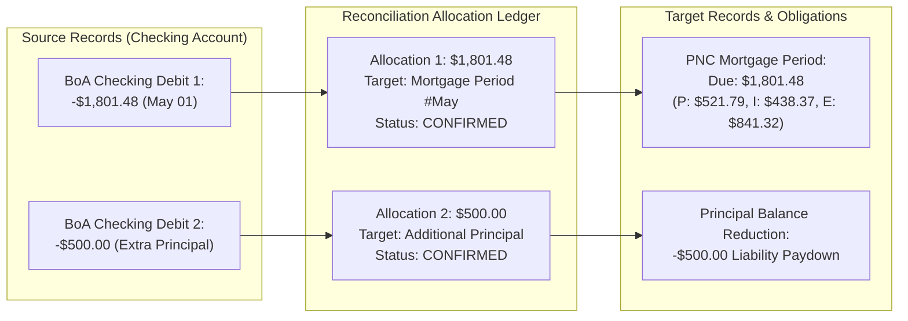

# PropTally V2.1 Ingestion Pipeline & Multi-Allocation Reconciliation Engine

**Document:** `05_INGESTION_AND_RECONCILIATION.md`  
**Author:** Senior Python Engineer & Financial Systems Architect  
**Status:** Approved Specification (V2.1 Corrected & Validated)  
**Date:** October 2026  
**Context:** Multi-allocation reconciliation matching engine, 12-stage ingestion pipeline, duplicate detection, and parser contracts.

## Current Local-Mortgage Release Status

The 12-stage pipeline below is the target architecture, not the behavior of the
current local ingestion release. The implemented release scans local PDFs,
recognizes supported monthly mortgage statements, validates extracted fields,
and persists document-linked extraction data. Its extraction states are
`EXTRACTED`, `VALIDATED`, and `NEEDS_REVIEW`; new records start with approval
status `PENDING`. Only a separate explicit approval followed by a separate
import creates an authoritative `MortgagePeriod` and may update the loan's
reported current rate. Mortgage statements never create journal entries.

There is no browser review queue. Missing required fields, including a missing
statement date, remain in `document_extractions` for future review. Re-extraction
(`--force-reextract`) and the broader checking/card parsers remain **PLANNED**.
Folder processing continues after individual PDF failures and reports the
filename and error; dry-run writes neither database rows nor vault files.

---

## 1. Unified Ingestion Lifecycle & State Machine

Every document entering PropTally—via the web upload dropzone or the filesystem hot-folder (`~/PropTally/inbox/`)—executes through the exact same 12-stage processing pipeline:

```mermaid
flowchart TD
    START["1. Document Received"] --> HASH["2. Compute SHA-256 Hash"]
    HASH --> DUP_CHECK{"3. SHA-256 Exists in Database?"}
    
    DUP_CHECK -->|Yes (Normal Mode)| DUPLICATE_STATE["State: DUPLICATE_SKIPPED"]
    DUP_CHECK -->|Yes (Force-Reextract Mode)| REEXTRACT["Re-Extract with New Parser Version"]
    DUP_CHECK -->|No| CLASSIFY["4. Fingerprint & Classify Provider"]
    
    CLASSIFY --> PARSE["5. PyMuPDF Coordinate Extraction"]
    PARSE --> VALIDATE_STRUCT["6. Structural Extraction Validation"]
    
    VALIDATE_STRUCT --> VALIDATE_FIN["7. Financial Consistency Math Checks"]
    VALIDATE_FIN --> BIZ_DUP{"8. Business Key Duplicate Check?"}
    
    BIZ_DUP -->|Duplicate Found| BIZ_DUP_STATE["State: DUPLICATE_TRANSACTIONS"]
    BIZ_DUP -->|Unique| STAGE_DATA["9. Stage in Review Buffer"]
    
    STAGE_DATA --> RECON_CANDIDATE["10. Generate Reconciliation Allocations"]
    RECON_CANDIDATE --> CONFIRM{"11. Automated Matching Threshold Satisfied?"}
    
    CONFIRM -->|High Confidence (1.0)| COMMIT["12. Post Journal Entries & Move to Vault"]
    CONFIRM -->|Ambiguous (< 1.0)| REVIEW_QUEUE["State: NEEDS_REVIEW (Web UI Queue)"]
    REVIEW_QUEUE -->|User Approves| COMMIT
```

---

## 2. Multi-Allocation Reconciliation Matching Model

PropTally V2.1 replaces rigid 1-to-1 matching with an auditable **Multi-Allocation Reconciliation Model** (`reconciliation_allocations` table). This model accommodates complex real-world financial patterns:
* **One-to-Many:** One bank ACH withdrawal settling both a primary monthly payment and an escrow shortage fee, or multiple split debts.
* **Many-to-One:** Multiple staggered bank payments (e.g., bi-weekly drafts) settling a single monthly mortgage statement.
* **Partial Settlement:** A bank payment that only partially clears an outstanding obligation, leaving a tracked residual balance in `Mortgage Clearing`.



### 2.1 Allocation Integrity Invariants & Executable Rules
1. **Source Allocation Cap:** A source transaction cannot be allocated beyond its available absolute amount:
   $$\text{Available Source Cents} = |\text{source\_transaction.amount\_cents}| - \sum_{\text{status='CONFIRMED'}} \text{allocated\_cents}$$
   $$\text{Constraint:} \quad \text{new\_allocated\_cents} \le \text{Available Source Cents}$$
2. **Target Obligation Cap:** A target obligation (e.g. mortgage period or card balance) cannot receive more allocation than its outstanding balance:
   $$\text{Available Target Cents} = \text{Target.total\_due\_cents} - \sum_{\text{status='CONFIRMED'}} \text{allocated\_cents}$$
   $$\text{Constraint:} \quad \text{new\_allocated\_cents} \le \text{Available Target Cents}$$
3. **Overpayments & Additional Principal:** If cash cleared exceeds the target obligation, the excess **cannot be allocated to the monthly billing target**. It must be created as an independent allocation with `target_type = 'ADDITIONAL_PRINCIPAL'`.
4. **Lifecycle & Capacity Accounting:**
   * `PROPOSED`: Staged candidate; reserves temporary capacity during interactive triage.
   * `CONFIRMED`: Permanent active allocation; decrements available source and target balance.
   * `REVERSED`: Inactivated allocation; restores available capacity to source and target.
   * `REJECTED`: Discarded candidate; consumes $0$ capacity.
5. **Write Serialization:** Allocation validation and confirmation execute under SQLite `BEGIN IMMEDIATE` or `BEGIN EXCLUSIVE` transaction locks to guarantee concurrent safety.

### 2.2 Decoupling Matching Confidence from Posting Authorization
> [!IMPORTANT]
> **Confidence 1.0 Does Not Equal Auto-Posting:**  
> Algorithmic matching confidence measures whether two records refer to the same event.  
> Posting authorization measures whether the event is permitted to alter the accounting ledger under client business rules and CPA tax gates.

* **Deterministic Match + Pre-Approved Rule (Riley Alvarez Rent):** Confidence = 1.0, Gate = Approved $\rightarrow$ `AUTO_POSTED`.
* **Deterministic Match + Client Approval Gate (CBD-1 Maple ATM Cash):** Confidence = 1.0, Gate = Client Required $\rightarrow$ **Held in `NEEDS_CLIENT_REVIEW` Queue (Blocked from Ledger)**.
* **Deterministic Match + CPA Approval Gate (CPA-3 CapEx $\ge \$2,500$):** Confidence = 1.0, Gate = CPA Required $\rightarrow$ **Held in `NEEDS_CPA_REVIEW` Queue (Blocked from Schedule E)**.

> [!IMPORTANT]
> **CBD-2 applies to mixed-use cards, not to every credit card.**
> Whether a card triggers review is an **account property**
> (`financial_accounts.mixed_use_status`), because the client decision concerns
> cards shared between rental and personal spending:
>
> | Card classification | Rental deduction | Gate |
> | :--- | :--- | :--- |
> | `DEDICATED_RENTAL` | Yes | None — the card is purpose-limited to rental costs |
> | `MIXED_USE` | Yes | External review required |
> | `UNCLASSIFIED` | Yes | Review required; unknown usage is never assumed to be rental-only |
>
> Classification comes from the account record. It is never inferred from a
> merchant name, a transaction description, or a category. New accounts default
> to `UNCLASSIFIED`.
>
> A bank payment that settles a credit card is itself reviewed against the card
> being paid, because the allocation of that payment decides the rental share.

> [!WARNING]
> **CPA approval is not implemented.** The CBD-2 checkbox records a
> **user self-attestation** that external review occurred
> (`USER_ATTESTED_CPA_REVIEW`). It is not proof of CPA identity or authorization
> and must not be reported as one. Real CPA authorization requires authenticated
> identity, a CPA role, an explicit approval record with a timestamp and the
> approved item/version, and immutable audit history.

> [!IMPORTANT]
> **The two gates are deliberately not interchangeable (product rule).**
> CBD-1 is a *client authorization* gate: explicit client confirmation satisfies
> it. CBD-2 is an *external review* gate over a deduction that will be claimed on
> Schedule E, and the party who benefits from the deduction must not be able to
> authorize it alone — so **client confirmation does not satisfy CBD-2**. The
> posting service requires the external-review attestation and refuses with
> `CBD-2 Policy Violation` otherwise, whatever other flags the request carries.
> A transaction that needs both gates must supply both.
>
> **CBD-2 requires a rental deduction, not merely a deduction category.** The gate
> is evaluated from the category *and* the property's classification, so a repair
> on the primary residence or unattributed spend does not open a gate it should
> not. Where a deduction category is present but not attributed to a rental door,
> the interface offers the attestation (`may_require_review`) while enforcement
> stays off until the allocation is a rental deduction.
>
> **Authorization evidence is stored independently and immutably.** Every posting
> appends a `posting_authorizations` row recording, per gate, whether it was
> *required* and whether it was *supplied*, each with its own timestamp, together
> with the journal entry it permitted and a snapshot of the allocation it applied
> to. Updates and deletes are blocked by DDL triggers. The split
> `tax_review_status` is only a summary and records both gates when both were
> given, so a self-attestation is never hidden behind a client confirmation.
> The `*_at` timestamps record when the authorization was accepted with the
> posting; the application does not capture consent earlier than that request.

---

## 3. Actual vs. Projected Escrow Disbursements

A critical distinction enforced in V2.1 is separating **projected future disbursements** from **actual historical disbursements**:

1. **Annual Escrow Analysis Statements (`PNC Escrow Oct 2025.pdf`):**
   * These documents state projected future payments (e.g. *"What we plan to pay: Insurance $783.00, Property Tax $8,578.40"*).
   * **Rule:** These numbers are classified as **`PROJECTION`**. They are stored in `escrow_accounts` for forecasting shortages, but **never posted to `escrow_movements` or the accounting ledger**.
2. **Actual Historical Disbursements:**
   * Sourced from Form 1098 Box 10, monthly billing statement transaction activity, or formal disbursement notices.
   * **Rule:** Only actual completed disbursements create entries in `escrow_movements` and post to `5020 Property Tax Expense` or `5030 Hazard Insurance Expense`.

---

## 4. Parser Extraction Contracts & Normalization

All source files in `./data/statements` are verified native vector PDFs.

### 4.1 Rocket Mortgage (`RocketMortgageParser`)
* **Fingerprint:** Text matches `"Rocket Mortgage"`, Loan Number `"0700000001"`.
* **Property:** `12307 Larkspur St, Westbrook, IL 60196`.
* **Fields Extracted:** Statement Date, Payment Due Date, Principal Due, Interest Due, Escrow Due, Fees Due, Total Due, Outstanding Principal Balance.
* **Math Validation:** `principal + interest + escrow + fees == total_amount_due`.

### 4.2 PNC Mortgage (`PNCMortgageParser`)
* **Fingerprint:** Text matches `"PNC Bank"`, Account ending in `"0708"` or `"0700000002"`.
* **Property:** `2718 Foxglove Ct, Harborview, IL 60197`.
* **Monthly Statement Contract:**
  * Extracts: Statement Date, Payment Due Date, Principal ($521.79 $\rightarrow$ `52179`), Interest ($438.37 $\rightarrow$ `43837`), Escrow ($841.32 $\rightarrow$ `84132`), Total Due ($1,801.48 $\rightarrow$ `180148`), Outstanding Principal ($210,419.62 $\rightarrow$ `21041962`), Interest Rate (2.500% $\rightarrow$ `2500`, thousandths of a percent).
* **Escrow Analysis Contract:**
  * Extracts: Review Period, Projected Annual Taxes, Projected Annual Insurance, Projected Shortage ($345.65 $\rightarrow$ `34565`), Monthly Shortage Surcharge ($28.80 $\rightarrow$ `2880`). Marked as `PROJECTION`.
* **Form 1098 Contract:**
  * Extracts: Tax Year (2025), Box 1 Mortgage Interest Received ($5,382.91 $\rightarrow$ `538291`), Box 2 Outstanding Principal ($218,117.49 $\rightarrow$ `21811749`), Box 8 Secured Property (`582 FOXGLOVE CT`).

### 4.3 CrossCountry Mortgage (`CrossCountryMortgageParser`)
* **Fingerprint:** Text matches `"CROSSCOUNTRY MORTGAGE"`, Loan Number `"0700000003"`.
* **Property:** `3345 Elderberry Dr, Cedar Grove, IL 60198` (Primary Residence).
* **Fields Extracted:** Statement Date, Payment Due Date, Principal Due, Interest Due, Escrow Due, Amount Due.

### 4.4 Bank of America Checking (`BofACheckingParser`)
* **Fingerprint:** `"Bank of America"`, `"Adv Plus Banking"`, Account `"0029 1385 9456"`.
* **Extraction Contract:**
  * Statement Period Dates, Opening Balance, Closing Balance.
  * Deposits Table: Date, Description, Amount Cents.
    * Zelle Regex: `Zelle payment from\s+(?P<sender>.+?)\s+for\s+"(?P<memo>[^"]+)"`.
    * Match rule: Sender `"JORDAN AVERY"` $\rightarrow$ Propose match to `12307 Larkspur St`.
  * Withdrawals Table: Date, Description, Amount Cents.
    * Match rules: `"CROSSCOUNTRY"`, `"PNC LENDING"`, `"ROCKET"` ACH debits.
* **Math Validation:** `opening_balance + deposits - withdrawals - fees == closing_balance`.

### 4.5 Credit Card Parsers (`BofACreditCardParser` & `AppleCardParser`)
* **BoA Visa (`...9306`):** Parses "Purchases and Adjustments" table on Page 3+.
* **Apple Card:** Parses "Transactions" table on Page 2+.
* **Rule Engine:** Hardware stores (Home Depot, Lowes, Menards) flagged with `PROPERTY_TAG_REQUIRED`.

---

## 5. Duplicate Detection & Reprocessing

1. **SHA-256 File Invariant:** Re-uploading an identical PDF results in state `DUPLICATE_SKIPPED` with zero database writes.
2. **Parser Version Upgrades (`--force-reextract`) — PLANNED:**
   * The current release skips identical SHA-256 documents and does not re-extract them.
   * A future implementation must create a new `ExtractionVersion` without changing approved historical records, immutable transactions, or posted journal entries.

---

*End of Ingestion Pipeline & Multi-Allocation Reconciliation Engine Specification V2.2.*
