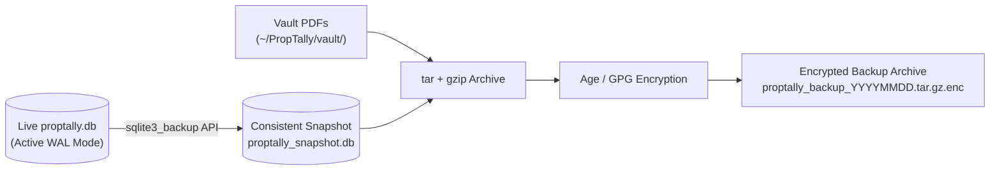

# PropTally V2 Security, Privacy & Self-Hosted Deployment Architecture

**Document:** `06_SECURITY_AND_DEPLOYMENT.md`  
**Author:** Principal Security & Infrastructure Architect  
**Status:** Approved Specification  
**Date:** October 2026  
**Context:** Security boundaries, local deployment topology, authentication, data protection, and disaster recovery for PropTally V2.

---

## 1. System Deployment Topology

PropTally is deployed as a **self-hosted, privacy-first local financial platform**. It is designed to run entirely on the client’s private infrastructure without external cloud dependencies or commercial API data egress.

```mermaid
graph TD
    subgraph LAN["Client Private Network / Tailscale Mesh"]
        CLIENT_DEV["Client Laptop / Mobile<br>(via Tailscale / Local WiFi)"]
        
        subgraph HOST["Dedicated Linux Server (NVIDIA GPUs 3060/4070/5060)"]
            NGINX["Local Reverse Proxy (Caddy / Nginx)<br>Listens: 127.0.0.1:8000 & 100.x.y.z (Tailscale)"]
            
            subgraph APP["PropTally Application (Systemd Service)"]
                API["FastAPI Backend Service"]
                SPA["React + Vite Production Static Build"]
                WORKER["watchfiles Ingestion Daemon"]
            end
            
            subgraph LOCAL_AI["Local AI Inference Engine"]
                OLLAMA["Ollama / vLLM Service<br>Port: 11434 (localhost only)"]
                GPU["NVIDIA GPU Acceleration<br>(RTX 3060 / 4070 / 5060)"]
                OLLAMA --- GPU
            end
            
            subgraph STORAGE["Local Encrypted NVMe Storage"]
                DB[("SQLite Database<br>(proptally.db in WAL mode)")]
                VAULT["Document Vault Directory<br>(~/PropTally/vault/)"]
                INBOX["Filesystem Hot Folder<br>(~/PropTally/inbox/)"]
            end
        end
    end

    CLIENT_DEV -->|HTTPS / Tailscale Auth| NGINX
    NGINX --> API
    NGINX --> SPA
    API <--> DB
    API <--> VAULT
    WORKER <--> INBOX
    WORKER --> API
    API -->|Local HTTP REST (No Internet Egress)| OLLAMA
```

---

## 2. Network Boundaries & Zero-Egress Architecture

1. **No Public Ingress:** PropTally never listens on `0.0.0.0` or exposes open ports to the public internet. It binds strictly to `127.0.0.1` and the private Tailscale interface IP.
2. **Encrypted Remote Access:** Remote access outside the home is established through **Tailscale (WireGuard-based mesh VPN)**. Tailscale provides mutual TLS and machine-level authorization.
3. **Outbound Network Egress Policy:** The application server requires zero outbound internet access for day-to-day financial operations. All PDF parsing, database operations, and AI inference execute locally on the host.

---

## 3. Authentication & Role-Based Access Control (RBAC)

Tailscale provides device identity, but application-level authentication enforces administrative security and auditability:

### 3.1 Authentication Mechanism
* **Password Hashing:** Passwords hashed using **Argon2id** (memory-hard, resistant to GPU attacks).
* **Session Management:** Secure, signed session cookies using **HTTP-only, SameSite=Strict, Secure** flags.
* **Session Lifecycle:** 12-hour active session timeout; 30-day "Remember Me" with rolling token invalidation.
* **Brute-Force Protection:** Rate limiting on the login endpoint (maximum 5 failed attempts per 15 minutes per IP).

### 3.2 Role-Based Permissions

| Role | Target User | Permissions |
| :--- | :--- | :--- |
| **`OWNER` (Admin)** | Portfolio Owner | Full read/write access. Upload statements, manage properties, confirm matches, split transactions, configure local AI, perform backups. |
| **`ACCOUNTANT` (Read-Only)** | Client's CPA / Tax Preparer | Read-only access to Tax Center, Schedule E workpapers, Form 1098 reconciliation tables, and categorized expense ledgers. Cannot upload or delete. |

---

## 4. Data Protection & Privacy Guardrails

### 4.1 Storage & Filesystem Security
* **Restricted Permissions:** Application files, database, and vault directories are created with strict POSIX permissions:
  ```bash
  chmod 700 ~/PropTally/storage
  chmod 700 ~/PropTally/storage/vault
  chmod 600 ~/PropTally/storage/proptally.db
  ```
* **Disk-Level Encryption:** Hosted on Linux NVMe partitions protected with **LUKS (dm-crypt)** full-disk encryption, ensuring data is unreadable if the physical drive is stolen.

### 4.2 Sensitive PII & Logging Sanitization
* **Zero PII in Application Logs:** Application logs must never write raw PDF text, unmasked bank account numbers, taxpayer identification numbers (SSNs/EINs), or full tenant legal names.
* **Masking Rules Enforced by Logger Filter:**
  * Account numbers: display only last 4 digits (e.g., `...9456`, `...9306`).
  * SSN / EIN: masked as `XXX-XX-XXXX` / `XX-XXXXXXX`.
  * Monetary numbers in logs: genericized to debug levels.

### 4.3 Upload & File Security
* **MIME & Magic Byte Verification:** Uploaded files must match PDF magic bytes (`%PDF-`) at byte offset 0. Files failing verification are discarded immediately.
* **Path Traversal Defense:** Uploaded filenames are sanitized; raw storage uses secure random UUIDs:
  $$\text{Storage Path} = \text{vault/} + \text{institution\_slug} + \text{/} + \text{year} + \text{/} + \text{uuid4()} + \text{.pdf}$$
* **Payload Size Limits:** Maximum upload size hard-capped at 50 MB per document.

---

## 5. Local AI Guardrails & Prompt Injection Defense

1. **Air-Gapped Local Inference:** AI queries connect strictly to the local Ollama/vLLM instance at `http://127.0.0.1:11434`. No data is ever sent to OpenAI, Anthropic, or external cloud endpoints.
2. **Deterministic-First Barrier:** The AI is strictly an **advisory tool**. It has zero write access to the database and cannot alter account balances or perform mathematical operations.
3. **Prompt Injection Mitigation:** Extracted PDF text and Zelle memos are treated as untrusted user input. Text is passed inside structured JSON tags with strict delimiter escaping:
   ```text
   <UNTRUSTED_TRANSACTION_DATA>
   {raw_text_json_escaped}
   </UNTRUSTED_TRANSACTION_DATA>
   Task: Output ONLY a valid JSON object classifying this vendor into Schedule E categories.
   ```
4. **Offline Resilience:** If the GPU server or Ollama daemon is offline or out of VRAM, the backend catches the connection error gracefully and falls back to deterministic regex categorization without crashing.

---

## 6. Backup & Disaster Recovery Architecture

Copying a live SQLite database during active write transactions risks database file corruption. PropTally implements the **SQLite Online Backup API** to guarantee consistent point-in-time snapshots:



### 6.1 Automated Backup Procedure (`scripts/backup.sh`)
1. **Database Lock-Free Snapshot:** Executes SQLite VACUUM INTO or Python `sqlite3.Connection.backup()` to create a consistent read snapshot.
2. **Vault Consolidation:** Archives the database snapshot, application configuration, and `vault/` PDF directory.
3. **Encryption:** Compresses and encrypts the archive using a local symmetric key or GPG passkey.
4. **Retention Policy:** Keeps the last 7 daily backups, 4 weekly backups, and 12 monthly backups locally, with optional rsync to an external local NAS.

### 6.2 Verified Restore Procedure (`scripts/restore.sh`)
1. Stop the PropTally systemd service.
2. Decrypt the specified backup archive:
   ```bash
   gpg --decrypt proptally_backup_20261011.tar.gz.enc | tar -xzv -C ~/PropTally/restore_temp/
   ```
3. Run integrity check on the restored database:
   ```bash
   sqlite3 ~/PropTally/restore_temp/proptally.db "PRAGMA integrity_check;"
   ```
4. Atomically swap `proptally.db` and restore vault PDFs.
5. Restart PropTally service and verify dashboard health check.

### 6.3 SQLite Single-Writer Coordination & Lock Contention
To prevent database locks between the background hot-folder ingestion daemon (`watchfiles`) and the interactive FastAPI web dashboard:
* **WAL Mode:** Write-Ahead Logging allows unlimited concurrent readers while write transactions execute.
* **Connection Scoping:** Writes are scoped into short-lived, atomic Python transactions.
* **Application-Level Retry Decorator:** Database write operations wrap with an exponential backoff decorator (`max_retries=5`, `backoff_base=0.05s`) on `sqlite3.OperationalError: database is locked`.
* **Busy Timeout:** All connection pools execute `PRAGMA busy_timeout = 10000;` on connection acquisition.

---

*End of Security, Privacy & Self-Hosted Deployment Architecture V2.1.*
