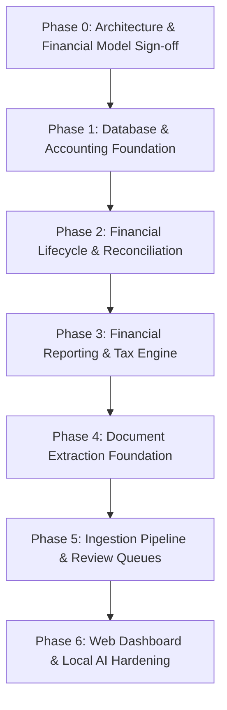

# PropTally V2.2 Phased Implementation Roadmap

**Document:** `08_IMPLEMENTATION_ROADMAP.md`  
**Author:** Principal Solution Architect & Engineering Lead  
**Status:** Approved Specification (V2.2 Corrected & Validated)  
**Date:** October 2026  
**Context:** Business-capability oriented implementation roadmap, dependency graph, technical risk mitigation, and Definition of Done (DoD).

---

## 1. Phased Delivery Overview

PropTally V2.2 adopts a **Core-First Implementation Sequence**. Rather than coupling accounting logic to parser outputs, the financial core, chart of accounts, and ledger invariants are implemented and tested first using explicit, synthetic test fixtures. Real statement parsers, ingestion pipelines, and the web interface are layered on top once the financial mathematics are proven.

---

## 2. Phase-by-Phase Execution Plan

### Phase 0: Architecture & Financial Model Sign-Off (Current Milestone)
* **Objective:** Establish unambiguous financial domain models, accounting rules, database schemas, and client validation registries.
* **Deliverables:**
  * Complete V2.2 Architecture Documentation suite in `docs/architecture/v2/`.
  * Requirements & Ambiguity Register with client/CPA action items.
  * Architecture Decision Records (ADRs 001–008).
  * Cross-Document Consistency Matrix.
* **Phase Gate Controls & Definition of Done:**
  * **Architecture Foundation Accepted:** Core engineering decisions (modular monolith, SQLite WAL, integer cents, double-entry ledger, post-settlement mortgage recognition, funded escrow movement model) are accepted.
  * **Business & Tax Gate Enforced:** Technical foundations are permitted to proceed. However, unresolved client business decisions (Maple rent method, card mixed use) and CPA items (property basis/depreciation) strictly gate finalized tax reporting and automatic ledger postings.
  * **DoD:** Phase 0 documentation accepted; open client/CPA items tracked in review queue states.

---

### Phase 1: Database & Accounting Foundation
* **Objective:** Implement the relational schema, chart of accounts, integer-cent precision models, opening balance migration, and double-entry balancing invariants using synthetic test fixtures.
* **Dependencies:** Phase 0 specifications.
* **Deliverables:**
  * SQLAlchemy / SQLModel schema definitions in `src/proptally/db/models.py`.
  * SQLite WAL mode initialization and application-level retry decorator (`with_sqlite_retry`).
  * Database triggers enforcing immutability on `POSTED` journal entries and lines.
  * Journal posting service validating $\sum \text{debits} == \sum \text{credits} > 0$ within atomic write transactions.
  * Reversal entry service generating independent compensating records.
  * Comprehensive test suite in `tests/test_accounting_foundation.py` including negative tests proving that unbalanced entries, line insertions into posted entries, or deletions are strictly rejected.
* **Definition of Done:**
  * 100% test pass rate for journal posting, immutability triggers, opening balances, and reversal entries.

---

### Phase 2: Financial Lifecycle & Reconciliation Allocation Engine
* **Objective:** Build the business logic for mortgage statement obligations, post-settlement principal/interest/escrow application, credit card purchase/settlement, and multi-allocation reconciliation.
* **Dependencies:** Phase 1 accounting foundation.
* **Deliverables:**
  * Mortgage lifecycle service (`domain.mortgages.service`) managing `BILLED` $\rightarrow$ `SETTLED` transitions.
  * Escrow movement ledger service (`domain.escrow.service`) recording funded contributions and disbursements with running balance derivation.
  * Credit card tracking service distinguishing incurred expenses from checking cash payoffs.
  * Multi-allocation reconciliation engine (`domain.reconciliation.engine`) enforcing source and target allocation capacity caps.
  * Unit test suite in `tests/test_financial_lifecycle.py` executing Scenarios 1, 2, 3, 4, A, B, and C with synthetic data.
* **Definition of Done:**
  * All 7 financial scenarios pass with exact penny balances, zero premature debt write-downs, and verified clearing accounts.

---

### Phase 3: Financial Reporting & Tax Engine
* **Objective:** Implement property-level Net Operating Income (NOI), Operating Cash Flow (OCF), Cash Flow After Debt Service (CADS), balance sheet equity, and CPA-ready Schedule E workpapers.
* **Dependencies:** Phase 2 lifecycle engine.
* **Deliverables:**
  * Property reporting service (`domain.reporting.service`) generating monthly and annual P&L.
  * Cash flow engine (`domain.accounting.cashflow`) calculating settled checkbook cash flow.
  * Equity tracker computing dated property valuations less outstanding debt.
  * Schedule E workpaper generator (`domain.tax.schedule_e`) mapping transactions to IRS lines 3, 12, 14, 16, 18, 19 with CPA review gates.
  * Excel workbook exporter (`reporting.export_excel`) producing multi-tab CPA workbooks.
* **Definition of Done:**
  * Reference calculations match manually verified financial scenarios across all metric tiers.

---

### Phase 4: Document Extraction Foundation
* **Objective:** Implement high-speed native vector PDF parsers for the six real-world statement families and test them against sample documents.
* **Dependencies:** Phase 0 extraction contracts.
* **Deliverables:**
  * Classifier and fingerprinting engine (`parsers.classifier`).
  * Dedicated parsers: Rocket Mortgage, PNC Mortgage (Monthly, Escrow Analysis, 1098), CrossCountry Mortgage, BoA Checking, BoA Credit Card, Apple Card.
  * Extraction test suite in `tests/test_parsers.py` running against all PDFs in `./data/statements`.
* **Definition of Done:**
  * 100% of sample statements parse without error and produce exact integer-cent amounts matching document totals.

---

### Phase 5: Ingestion Pipeline & Review Queues
* **Objective:** Connect parsers to the financial engine via the 12-stage ingestion pipeline, filesystem hot-folder watcher, and review queue manager.
* **Dependencies:** Phase 4 parsers and Phase 2 financial engine.
* **Deliverables:**
  * Unified ingestion service (`ingestion.pipeline`) with extraction versioning (`extraction_versions`).
  * Filesystem hot-folder watcher (`ingestion.watcher`) using `watchfiles` on `~/PropTally/inbox/`.
  * Multi-layer duplicate detection (File SHA-256 and transaction business keys).
  * Review queue manager enforcing posting authorization gates (e.g. holding unconfirmed cash deposits).
  * Secure document vault archiver (`storage/vault/`).
* **Definition of Done:**
  * Dropping statements into `inbox/` automatically classifies, extracts, and routes to ledger or review queue within $< 1$ second.

---

### Phase 6: Web Dashboard UI & Local AI Hardening
* **Objective:** Deliver the React + Vite + Tailwind CSS web dashboard, connect the local GPU server for conversational analytics, and configure production services.
* **Dependencies:** Phase 5 ingestion APIs and Phase 3 reporting services.
* **Deliverables:**
  * React SPA with 10 primary navigation views, interactive splitting modal, and split-screen reconciliation viewer.
  * Local AI copilot client (`ai.client`) connecting to Ollama/vLLM on RTX GPUs with read-only tool gates.
  * Online SQLite hot backup script (`scripts/backup.sh`) and verified restore script (`scripts/restore.sh`).
  * Single-command local runner (`run.sh`) and systemd service unit files.
* **Definition of Done:**
  * Dashboard runs locally on `http://localhost:8000`, displays reconciled portfolio metrics, executes hot backups, and answers local AI queries.

---

*End of Phased Implementation Roadmap V2.2.*
