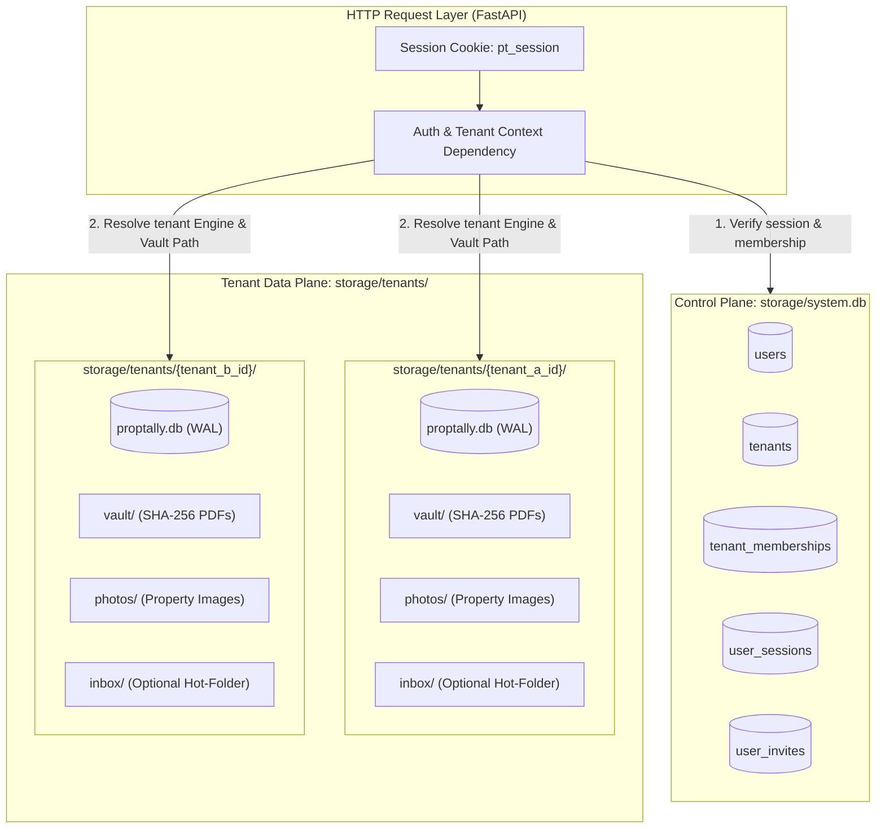
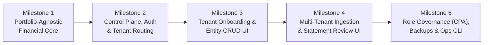

# PropTally Multi-Tenant Self-Hosted Architecture & Execution Plan

**Document:** `docs/architecture/v2/09_MULTI_TENANT_EXECUTION_PLAN.md`  
**Author:** Principal Systems & Financial Architecture  
**Status:** Draft for Review  
**Date:** October 2026  
**Context:** End-to-end technical specification and phased execution plan to transform PropTally from a bespoke single-portfolio deployment into a self-hosted, multi-tenant platform supporting multiple independent users, accounts, logins, and isolated real estate portfolios.

---

## 1. Executive Summary & Design Goals

PropTally is currently implemented as a **single-tenant, single-portfolio system**:
* There is no authentication, user identity, or session layer.
* A single SQLite database (`storage/proptally.db`) and shared filesystem directories (`storage/photos`, `storage/documents`) serve all requests.
* The initial client's specific properties (`prop_tinsley_huntley`, `prop_cimmaron_pingree`, `prop_burkey_algonquin`), loan numbers (`0700000001`–`0700000003`), bank account numbers (`...9456`, `...9306`), and Chart of Accounts (CoA) codes (`1010`–`4020`) are hardcoded across the accounting engine, PDF parsers, and web routes.

### 1.1 Target State Objectives
1. **Strict Tenant Isolation:** Each individual user (or household/entity) manages their own properties, accounts, mortgages, documents, and tax workpapers in a physically isolated SQLite database and filesystem vault (`Database-per-Tenant`).
2. **Self-Hosted Authentication & Access Control:** Zero external auth dependencies (no Auth0/Firebase/cloud OAuth required). Local Argon2id password hashing, signed/database-backed HTTP-only sessions, CSRF protection, and optional CPA/Accountant read-only or review access per portfolio.
3. **Portfolio-Agnostic Financial Core:** Any user can create arbitrary properties (`1..N` doors), bank accounts, credit cards, and mortgage loans without touching Python code, while preserving 100% of PropTally's double-entry ledger invariants, DDL immutability triggers, two-stage mortgage settlement rules, and CBD-1/CBD-2 governance gates.
4. **In-App Onboarding & Ingestion:** Full browser-based CRUD for properties, financial accounts, loans, opening balances, and statement PDF uploads/extractions—eliminating the need for CLI shell access for tenants.

---

## 2. Core Architectural Decision: Database-per-Tenant Isolation

PropTally uses **SQLite in WAL mode** with strict balance and immutability invariants. For a self-hosted multi-tenant server (supporting 2 to ~500 individual investors on a single Linux box), **Database-per-Tenant + Control-Plane `system.db`** is selected over a single shared SQLite database with `tenant_id` columns.

### 2.1 Tradeoff Comparison

| Dimension | Database-per-Tenant (Selected) | Shared SQLite DB (`tenant_id` on every table) |
| :--- | :--- | :--- |
| **Data Leakage Risk** | **Near-Zero.** FastAPI resolves the tenant's SQLite file at request entry; domain queries cannot accidentally read another tenant's rows. | **High.** Every `select()` across 21 tables, `metrics.py`, `schedule_e.py`, and all 6 routers must include `.where(Model.tenant_id == tid)`. One omission leaks financial PII. |
| **SQLite Write Concurrency** | **Independent per user.** User A importing 48 PDFs or posting splits never blocks User B's SQLite write lock. | **Global serialization.** All tenants contend on a single file lock during `BEGIN IMMEDIATE` transactions. |
| **Unique Constraints** | `Document.file_sha256`, `LoanAccount.loan_number`, `LedgerAccount.code`, and `JournalEntry.idempotency_key` (`OPENING_BALANCE:YYYY-MM-DD`) work unmodified per tenant. | Requires dropping and rebuilding every `UNIQUE` and primary-key constraint into composite `(tenant_id, ...)` keys. |
| **Backups, Export & Deletion** | Single-command per-tenant snapshot (`VACUUM INTO` + `tar` of `storage/tenants/<tenant_id>/`). Users can download or wipe their entire portfolio cleanly. | Requires complex multi-table filtered exports and cascading deletes across immutable ledger triggers. |

### 2.2 Multi-Tenant Storage Topology

---

## 3. Codebase Audit: Current Single-Tenant Couplings to Eliminate

Before multiple users can manage their own portfolios, every hardcoded reference to the initial client's portfolio must be replaced with database-driven lookups:

| File & Location | Current Single-Tenant Coupling | Required Multi-Tenant Generalization |
| :--- | :--- | :--- |
| `src/proptally/domain/accounting/coa.py:7-51` (`STANDARD_ACCOUNTS`) | Hardcodes client-specific ledger account names and codes (`1010: Bank of America Checking (...9456)`, `1510: 12307 Larkspur St`, `2110: Rocket`, `4010: Rental Income: 12307 Larkspur St`). | Separate **Standard System Accounts** (generic category codes `1010` Checking, `1210` Rent Receivable, `2010` Credit Card Liability, `3010` Owner Equity, `4010` Rental Income, `4015` Fee Income, `5010`–`5090` OpEx/Draws) from **Dynamic Entity Ledger Accounts** allocated automatically when a user creates a `FinancialAccount`, `LoanAccount`, or `Property`. |
| `src/proptally/domain/transactions/splits.py:34-42, 201-230` | `ACCOUNT_TO_LEDGER_CODE` maps literal IDs (`"acct_bofa_chk_9456": 1010`) and `_resolve_split_account_code` branches on `if property_id == "prop_cimmaron_pingree": return 4020`. | Store `ledger_account_code: int` on `FinancialAccount` and `principal_ledger_code` / `clearing_ledger_code` / `escrow_ledger_code` on `LoanAccount`. Route all `RENT_INCOME` to generic code `4010` (attributed per door via `JournalEntryLine.property_id`, which `metrics.py` and `schedule_e.py` already use). |
| `src/proptally/domain/accounting/metrics.py:52-86, 689-701` | Hardcodes tuples `CHECKING_CODES = (1010, 1020)`, `MORTGAGE_DEBT_CODES = (2110, 2120, 2130)`, and `LOAN_PRINCIPAL_CODE = {"loan_rocket_1000000001": 2110, ...}`. | Derive account-code sets dynamically from `LedgerAccount` / `FinancialAccount` / `LoanAccount` in the tenant's DB (or code ranges: `1000–1099` deposit, `1100–1199` escrow, `2000–2099` cards, `2100–2199` mortgage debt/clearing), and read `loan.principal_ledger_code`. |
| `src/proptally/web/routes/mortgages.py:29-39` & `properties.py:77-81` | Hardcodes `account_code_map` and `clearing_code_map` for the 3 initial loan IDs. | Read `loan.principal_ledger_code` and `loan.clearing_ledger_code` directly from the `LoanAccount` model. |
| `src/proptally/web/routes/properties.py:186-215` | Hardcodes `if property_id == "prop_tinsley_huntley": detected_tenant = {"name": "Tyler J. Saxsma", ...}`. | Query unverified `RENT_INCOME` transactions/splits dynamically for the property, or remove fixture-specific banner. |
| `src/proptally/web/navigation.py:43-47` & `app.py:80` | `DOOR_SHORT_LABELS` hardcodes 3 property IDs; `app.py:80` registers `templates.env.globals["nav_doors"] = lambda: navigation.get_nav_doors(engine)` bound to a single global engine. | Use `_derived_short_label(prop)` (or a `Property.short_label` column) and pass `nav_doors` via request-scoped dependency so each user only sees their own properties in the sidebar. |
| `src/proptally/web/app.py:58-60` | Mounts `app.mount("/photos", StaticFiles(directory=str(photos_dir)))` globally without authentication. | Remove public static mount for `/photos`; serve property photos through an authenticated route (`GET /properties/{property_id}/photos/{photo_id}/file`) resolved from the active tenant's photo directory. |
| `src/proptally/ingestion/parsers.py:40-53`, `bank_parsers.py:78,145-151,170-171,202,293,346-347,437-438,487-490,521-526`, `service.py:44-53,317-349` | Parsers reject PDFs unless they contain literal account/loan strings (`"0029 1385 9456"`, `"0700000001"`), and `service.py` auto-creates the 3 hardcoded properties. | Parameterize parsers to extract whatever loan number / masked account digits appear in the statement and match against the tenant's registered `LoanAccount` and `FinancialAccount` records. |
| `src/proptally/domain/transactions/suggest.py:23-46,179-180,247-248,258-259,269-270,483-497` | `DEFAULT_VENDOR_RULES` and `suggest_split_for_transaction` seed tenant-specific rules and hardcode `default_property_id` (`SAXSMA` $\rightarrow$ `prop_tinsley_huntley`, `CARPENTERSVILLE ATM` $\rightarrow$ `prop_cimmaron_pingree`). | Keep client-specific rules in `demo_seed.py` only; seed new tenants exclusively with generic merchant rules (`HOME DEPOT`, `LOWES`, `MENARDS`, `UBER`, `HERTZ`, etc.). |
| `src/proptally/web/templates/transactions.html:284-343` | Hardcodes account `<option>` values (`acct_bofa_chk_9456`, `acct_bofa_cc_9306`, `acct_apple_card`) and property `<option>` fallbacks rendered when the route supplies no options. | Populate every option list from the tenant's `FinancialAccount` / `Property` rows; delete the static fallback lists so a template can never present another tenant's accounts. |
| `src/proptally/domain/fixtures/demo_seed.py:36-230` | `seed_demo_data()` writes the three client properties, institutions, accounts, loans, leases, and opening balances with fixed IDs, and `web/app.py:39-41` runs it on every startup by default (`PROPTALLY_DEMO_SEED` default `"true"`). | Convert to an opt-in, tenant-scoped sample portfolio seeded only on explicit request; startup seeding of synthetic fixtures must never run in a multi-tenant deployment. |
| `src/proptally/web/app.py:30-32,80,99` + `src/proptally/db/connection.py:10-13` + `main.py:7-8` | One process-wide engine from `PROPTALLY_DB_PATH` (default `storage/client-portfolio.db`), bound into the module-level `app = create_app()` (`app.py:99`) and the `nav_doors` template global; `main.py` also sets that env default. | Introduce the control-plane engine plus per-tenant engine resolution; remove the module-level default app from the request path. |
| `src/proptally/domain/accounting/ledger.py:142,227` + `src/proptally/domain/transactions/splits.py:153` | Write `AuditLog.changed_by="system"` inside domain services, so the acting user is not recorded. | Add an explicit `actor_id` parameter to the posting/splitting/reversal service signatures and pass the authenticated user from the route; never let a route set actor implicitly. |

---

## 4. Phased Execution Plan & Milestones

---

### Milestone 1: Portfolio-Agnostic Domain & Ledger Core
**Objective:** Remove all hardcoded property IDs, loan IDs, bank account IDs, and static CoA mappings from the domain, ingestion, and web layers while keeping 100% of existing single-tenant and demo tests passing.

#### Scope & Deliverables
1. **Schema Additions (`src/proptally/db/models.py` & `schema.py`):**
   * Add `ledger_account_code: Optional[int]` (FK to `ledger_accounts.code`) to `FinancialAccount`.
   * Add `principal_ledger_code: Optional[int]`, `clearing_ledger_code: Optional[int]`, and `escrow_ledger_code: Optional[int]` to `LoanAccount`.
   * Add `short_label: Optional[str]` to `Property`.
   * Register idempotent column migrations in `src/proptally/db/schema.py:COLUMN_MIGRATIONS` and backfill codes for existing accounts/loans on migration.
2. **Dynamic Ledger Code Allocation (`src/proptally/domain/accounting/coa.py`):**
   * Split `CHART_OF_ACCOUNTS` into `BASE_CHART_OF_ACCOUNTS` (seeded for every tenant: generic asset/liability/equity/income/opex codes) and helper functions `allocate_financial_account_ledger_code(session, account_type, name)` and `allocate_loan_ledger_codes(session, loan_name)` that allocate sequential codes in designated ranges:
     * `1010–1099`: Deposit Accounts (`CHECKING`, `SAVINGS`)
     * `1110–1199`: Servicer Escrow Reserve Accounts
     * `1510–1599`: Property Fixed Asset Accounts
     * `2010–2099`: Credit Card Liability Accounts
     * `2110–2199` (even: Principal Debt, odd/+5: Mortgage Clearing)
     * `4010`: Rental Income (attributed by `JournalEntryLine.property_id`)
     * `4015`: Fee Income (attributed by `JournalEntryLine.property_id`)
3. **Refactor Metrics, Splits & Routes:**
   * Update `src/proptally/domain/accounting/metrics.py` to query the tenant's active deposit, escrow, card liability, mortgage debt, and clearing codes from `LedgerAccount` / `LoanAccount` / `FinancialAccount` (with fallback to the standard code ranges) instead of `LOAN_PRINCIPAL_CODE`.
   * Update `src/proptally/domain/transactions/splits.py` (`_ledger_code_for_account`, `_resolve_split_account_code`) to read `account.ledger_account_code` and map all rental income to `4010` (retaining `4020` compatibility in `RENTAL_REVENUE_CODES`).
   * Update `src/proptally/web/routes/mortgages.py` and `src/proptally/web/routes/properties.py` to use `loan.principal_ledger_code` and `loan.clearing_ledger_code`, and remove the hardcoded `Tyler J. Saxsma` / `ATM Cash Deposits` dict in `properties.py:187-215` (moving it to data-driven detection from unallocated/posted transactions).
   * Separate client-specific vendor rules (`vrule_tenant_saxsma`, `vrule_carpentersville_atm`) out of `DEFAULT_VENDOR_RULES` in `suggest.py` into `demo_seed.py`.

#### Verification Gate (M1)
* **Test-suite impact must be accounted for, not assumed away.** **23 of 29 test files** (`tests/test_*.py`) bind to the hardcoded IDs or static ledger codes being removed, so M1 cannot pass "unchanged". Measured dependencies:
  * `tests/conftest.py:8,24` imports and calls `seed_chart_of_accounts(session)` for *every* session fixture, so changing `coa.py` touches the whole suite.
  * `tests/test_demo_and_metrics.py:11,17-19,28` calls `seed_demo_data(session)` and asserts the fixed property IDs and exact `noi_cents`.
  * `tests/test_phase2_1_hardening.py` (11 references, incl. `:531` `IN (2110, 2120, 2130)`, `:546-547` `4010/4020` attributed to `prop_tinsley_huntley`/`prop_cimmaron_pingree`) and `tests/test_dashboard_evidence_labels.py:59,65` assert the *static* code ranges this milestone makes dynamic.
  * `tests/test_bank_ingestion.py:50,86` and `tests/test_ingestion.py:197-200` assert parser outputs equal the *hardcoded* account/loan IDs.
  * `tests/test_ingestion.py:213-245` asserts `_prepare_entities`-created entity IDs, which M1 rewrites.
* **Rule for those tests:** assertions that pin the client's literal IDs or the static code map are *implementation-incidental* and MUST be deleted or re-expressed through fixtures created in-test, never re-pinned to a new hardcoded value. Tests that assert financial *behaviour* (balance equilibrium, debt-service recognition in `test_debt_service_recognition.py`, settlement semantics in `test_credit_card_settlement.py`, governance in `test_posting_authorization*.py`) are retained and re-pointed at their own fixture entities.
* **Primary acceptance artifact — `tests/test_custom_portfolio.py`:** create a portfolio with completely novel entities (`prop_austin_duplex`, `acct_chase_chk_1111`, `acct_amex_2222`, `loan_wells_9999`) using only generic codes, post opening balances, split and post rent inflows, a card expense, a card settlement, and a two-stage mortgage payment, then assert exact `NOI`, `OCF`, `CADS`, `equity`, and Schedule E figures. This must fail on the pre-M1 tree and pass after.
* **Second acceptance artifact — allocation-collision test:** two independent `LoanAccount`/`FinancialAccount` rows created in the same tenant receive distinct allocated codes, and deleting one does not renumber the other (proves allocation is monotonic, not positional).

---

### Milestone 2: Control Plane Database, Authentication & Per-Tenant Engine Routing
**Objective:** Introduce `system.db` for users, tenants, memberships, and sessions; add login/registration/logout flows; and isolate every web request's database session and filesystem paths by `tenant_id`.

#### Scope & Deliverables
1. **Control Plane Schema (`src/proptally/db/system_models.py`):**
   * `User`: `id` (`usr_...`), `email` (unique, lowercase indexed), `password_hash` (Argon2id via `argon2-cffi` or `pwdlib`), `display_name`, `is_instance_admin` (bool), `is_active` (bool), `created_at`.
   * `Tenant`: `id` (`tnt_...`), `name` (e.g. `"Singh Family Properties"`), `slug`, `storage_subdir`, `is_demo` (bool), `created_at`.
   * `TenantMembership`: `id`, `user_id` (FK), `tenant_id` (FK), `role` (`OWNER` | `CPA_REVIEWER` | `READ_ONLY`), `created_at` — `UNIQUE(user_id, tenant_id)`.
   * `UserSession`: `id` (SHA-256 of 32-byte random token), `user_id` (FK), `active_tenant_id` (FK), `csrf_token`, `ip_address`, `user_agent`, `expires_at`, `created_at`, `revoked_at`. Session tokens are compared by hash, rotated on login and on privilege change, and invalidated wholesale when the owner's password changes.
   * `UserInvite`: `id`, `tenant_id` (FK), `email`, `role` (`CPA_REVIEWER` | `READ_ONLY`), `token_hash`, `invited_by_user_id`, `expires_at`, `accepted_at`, `created_at` — the table shown in the §2.2 diagram, and the only way a non-owner joins an existing tenant.
   * `PasswordResetToken`: `id`, `user_id` (FK), `token_hash`, `expires_at`, `used_at`.
   * **Dependency additions (`pyproject.toml`):** the repository currently declares no auth/crypto dependency (`grep` for `argon|passlib|bcrypt|itsdangerous|pwdlib` over `pyproject.toml` returns nothing). Add exactly one password-hashing library (Argon2id) and one cookie-signing/CSRF primitive, and pin them in `[project] dependencies`; do not hand-roll either.
2. **Tenant Engine Manager (`src/proptally/db/tenant_manager.py`):**
   * Maintains an LRU cache of SQLAlchemy `Engine` instances keyed by `tenant_id` pointing to `storage/tenants/{tenant_id}/proptally.db`.
   * On first creation of a tenant, initializes directory structure (`storage/tenants/{tenant_id}/{vault,photos,inbox}`), runs `init_schema(tenant_engine)` (including all 7 immutability triggers), and seeds `BASE_CHART_OF_ACCOUNTS` + generic `DEFAULT_VENDOR_RULES`.
3. **Authentication & Session Dependencies (`src/proptally/web/auth.py`):**
   * Cookie-based session (`pt_session`, `HttpOnly`, `SameSite=Lax`, `Secure` when behind HTTPS).
   * Rate-limited login (`POST /auth/login` — max 5 failed attempts per 15 min per IP/email).
   * Self-registration (`GET/POST /auth/register`) controlled by env flag `PROPTALLY_ALLOW_REGISTRATION=true` (default **false**: an unauthenticated endpoint that provisions a tenant must be opt-in). First registered user on a fresh server automatically becomes `is_instance_admin=True`.
   * Logout (`POST /auth/logout`, revokes the session row), password change (`POST /account/password`, re-verifies the current password and revokes all other sessions), and password reset via single-use `PasswordResetToken`. Reset delivery is operator-mediated (no SMTP dependency): the reset link is written to the operator log/console for hand-off, matching the zero-egress posture in `06_SECURITY_AND_DEPLOYMENT.md §5`.
   * Invite lifecycle: `POST /tenant/invites` (OWNER only) issues a `UserInvite`; `GET/POST /auth/invite/{token}` accepts it and creates the `TenantMembership` with the invited role. There is no other path to join a tenant.
   * **CSRF enforcement, not just a stored token:** every state-changing route requires the double-submit token from `UserSession.csrf_token`; requests failing validation are rejected before any domain call. `SameSite=Lax` alone is not treated as CSRF protection.
   * Workspace switcher (`POST /auth/switch-tenant`) for users who own multiple portfolios or CPAs invited to multiple clients.
   * Request dependencies:
     * `get_current_context(request) -> TenantRequestContext` (contains `user`, `tenant`, `role`, `tenant_session`, `vault_dir`, `photos_dir`, `csrf_token`).
     * Unauthenticated browser requests redirect `303` to `/auth/login`.
4. **Navigation & Photo Isolation (`src/proptally/web/app.py`, `routes/properties.py`):**
   * Replace global `templates.env.globals["nav_doors"]` with request-scoped `nav_doors` populated from `tenant_session`.
   * Remove `app.mount("/photos", ...)` and serve photos via `GET /properties/{property_id}/photos/{photo_id}/raw` guarded by `get_current_context`.
   * Thread `current_user.id` into audit: this requires an `actor_id` parameter on `post_journal_entry`, `post_transaction_to_ledger`, `apply_transaction_splits`, and `reverse_journal_entry`, because `AuditLog.changed_by` is currently hardcoded to `"system"` inside those services (`ledger.py:142,227`, `splits.py:153`). Routes must not be able to set the actor by writing a column.
5. **Network Exposure Hardening (`main.py`, deployment docs):**
   * `main.py:42` defaults `HOST` to `0.0.0.0` and builds dual-stack listeners on it (`main.py:18,26`). That contradicts `06_SECURITY_AND_DEPLOYMENT.md §2.1` ("binds strictly to `127.0.0.1` and the private Tailscale interface IP") and becomes a cross-tenant exposure once accounts exist. Default to loopback, require an explicit `PROPTALLY_TRUSTED_PROXY`/`HOST` opt-in for LAN binding, and document the Caddy/Nginx TLS terminator in front of it.
   * Document that `Secure` cookies and `SameSite` are only meaningful behind that terminator; the deployment guide must state the required reverse-proxy config rather than assuming it.

#### Verification Gate (M2)
* **Isolation Integration Test (`tests/test_multitenant_isolation.py`):**
  1. Register User A (`alice@example.com`) and User B (`bob@example.com`).
  2. Create a property, bank account, transaction, photo, and PDF document under User A.
  3. Authenticate as User B and assert:
     * `GET /` shows 0 properties and $0 equity/cash flow — i.e. User A's opening balances are **not visible**, not merely uncounted.
     * `GET /properties/{alice_property_id}` returns `404`.
     * `GET /documents/{alice_doc_id}/view` and `GET /properties/{alice_property_id}/photos/{photo_id}/raw` return `404`.
     * Raw SQL against User B's engine shows zero rows in `journal_entries`, `properties`, and `documents` (proves physical isolation rather than a filtered query).
* **Auth lifecycle assertions (same file):**
  * Unauthenticated `GET /` redirects `303` to `/auth/login`; unauthenticated `POST /transactions/...` does not mutate.
  * A `POST` with a missing or stale CSRF token is rejected and writes no `AuditLog` row.
  * `POST /auth/logout` makes the previous cookie unusable on the next request.
  * A `READ_ONLY` invitee gets `200` on `GET /` and `403` on a `POST` mutation.
  * `PROPTALLY_ALLOW_REGISTRATION` unset ⇒ `GET /auth/register` is unavailable and the only join path is an invite token.
* **Audit attribution:** after an authenticated posting, `AuditLog.changed_by` equals the acting user's id (not `"system"`), and no route can override it.

---

### Milestone 3: Self-Service Portfolio Setup & Onboarding UI
**Objective:** Give every new user a clean, guided browser experience to create and manage their own properties, bank/card accounts, mortgage loans, leases, and opening balances without CLI scripts or database edits.

#### Scope & Deliverables
1. **Empty-State & Onboarding Wizard (`/onboarding` or Dashboard Empty State):**
   * When a new tenant has 0 properties, `/` displays a structured 3-step onboarding checklist (or a "Load Sample Demo Portfolio" one-click button for evaluation):
     1. **Add Your First Property** (Rental Investment or Primary Residence).
     2. **Add Operational Accounts** (Checking account, Credit Cards with `DEDICATED_RENTAL` vs. `MIXED_USE` classification).
     3. **Add Mortgage Loans & Opening Balances** (Servicer, loan number, interest rate, principal & escrow opening balances).
2. **Entity Management Routes & Modals (`src/proptally/web/routes/settings.py` & `properties.py`):**
   * `POST /properties/create` & `POST /properties/{id}/edit`: Name, street address, city/state/zip, `property_type`, acquisition date, purchase price, land basis, building basis, current valuation.
   * `POST /accounts/create` & `POST /accounts/{id}/edit`: Institution name, account name, `account_type` (`CHECKING`, `SAVINGS`, `CREDIT_CARD`), last 4 digits (`account_number_masked`), `mixed_use_status`, and optional initial balance as of date (automatically invokes `record_opening_balances` / adjustment entry).
   * `POST /mortgages/create` & `POST /mortgages/{id}/edit`: Property link, institution/servicer, loan number, term months, interest rate, original principal, opening principal balance, and opening escrow balance.
   * `POST /settings/vendor-rules`: View, add, edit, or disable tenant-specific `VendorRule` patterns (e.g., mapping a tenant's Zelle name `"JANE DOE"` $\rightarrow$ `RENT_INCOME` on a specific door).

#### Verification Gate (M3)
* **End-to-End Smoke & UI Verification:**
  * Start from a fresh user registration, create 2 properties, 1 checking account, 1 mixed-use credit card, and 1 mortgage loan strictly through web forms, record opening balances, and verify the Portfolio Overview, Mortgages, and Schedule E pages render accurate balances and depreciation basis.
* **Existing web-route tests must migrate, not be abandoned.** `tests/test_client_demo_web.py`, `test_property_customizations.py`, `test_review_queue_ui.py`, `test_mobile_ui.py`, and `test_transactions_pagination_and_filter.py` all drive these routes today with an unauthenticated `TestClient` and hardcoded IDs. Introduce one shared authenticated client fixture (registered user + owned tenant + in-test entities) in `tests/conftest.py` and re-point them; their behavioural assertions (depreciation basis, review-queue gates, photo upload rejection) are retained.

---

### Milestone 4: Multi-Tenant Statement Ingestion & Browser Extraction Review
**Objective:** Decouple PDF statement parsers from hardcoded loan/account numbers and provide an in-browser PDF upload and extraction review/approval workflow scoped to the active tenant.

#### Scope & Deliverables
1. **Account-Matching PDF Parsers (`src/proptally/ingestion/parsers.py`, `bank_parsers.py`, `service.py`):**
   * Refactor `extract_pdf(path, session)` and `extract_bank_or_card_pdf(path, session)` to extract the raw loan number / account number last-4 digits from the statement text using regex, then match against the tenant's `LoanAccount.loan_number` (exact or last-4 suffix) and `FinancialAccount.account_number_masked`.
   * If a PDF matches a supported format (Rocket, PNC, CrossCountry, BofA Checking, BofA Visa, Apple Card) but its loan/account number is not yet registered in the tenant's portfolio, set `validation_status = "NEEDS_REVIEW"` with review reason `"Unrecognized account/loan number; assign or create account before import"` instead of raising `ValueError` or returning `None`.
2. **In-Browser Upload & Extraction Review Queue (`src/proptally/web/routes/ingestion.py`):**
   * `GET /statements`: Lists uploaded documents, extraction status (`VALIDATED`, `NEEDS_REVIEW`, `UNSUPPORTED`), approval status (`PENDING`, `APPROVED`), and imported statement links.
   * `POST /statements/upload`: Multipart PDF upload (validating `%PDF-` magic bytes and size $\le 50\text{ MB}$), stores file in `storage/tenants/{tenant_id}/vault/`, runs extraction against the tenant's accounts, and stages `DocumentExtraction`.
   * `POST /statements/extractions/{id}/update`: Browser form equivalent of `--update-extraction --set` to edit extracted fields or select the target `FinancialAccount` / `LoanAccount` and re-run `validate_mortgage_extraction`.
   * `POST /statements/extractions/{id}/approve-and-import`: Approves and imports a `VALIDATED` extraction into the tenant's `Statement` / `MortgagePeriod` / `Transaction` tables.
3. **Tenant-Aware CLI & Watcher (`src/proptally/ingestion/cli.py`, `watcher.py`):**
   * Add `--tenant <tenant_id_or_slug>` flag to `proptally.ingestion.cli`.
   * Update `watcher.py` to watch `storage/tenants/*/inbox/` and route each file to the owning tenant's DB and vault.

#### Verification Gate (M4)
* **Parser & Upload Test (`tests/test_multitenant_ingestion.py`):**
  * Upload a mortgage PDF and a checking PDF via `POST /statements/upload` as an authenticated tenant with matching last-4 account/loan numbers; verify extraction, approval, and import populate only that tenant's database and vault directory.

---

### Milestone 5: Multi-User Roles (CPA Access), Backups & Single-Tenant Migration
**Objective:** Enable a portfolio owner to invite a CPA/Accountant user with appropriate governance permissions, upgrade `backup.sh`/`restore.sh` for multi-tenant directories, and provide a one-command migration for existing single-tenant databases.

#### Scope & Deliverables
1. **Role-Based Access Control & CPA Governance (`OWNER`, `CPA_REVIEWER`, `READ_ONLY`):**
   * Enforce role checks in mutating routes (`POST` endpoints require `OWNER`, except CPA review attestation endpoints which allow `CPA_REVIEWER`).
   * Upgrade `PostingAuthorization` (`src/proptally/db/models.py:401`): add `authorized_by_user_id: Optional[str]` and `authorized_by_role: Optional[str]` so CBD-2 external review records whether it was a self-attestation by `OWNER` (`USER_ATTESTED_CPA_REVIEW`) or a verified sign-off by an authenticated `CPA_REVIEWER`.
2. **Legacy Single-Tenant Migration Tool (`scripts/migrate_to_multitenant.py`):**
   * Takes an existing `storage/proptally.db` (or `storage/client-portfolio.db`) and `storage/documents` + `storage/photos`, creates the initial `Owner` user and default `Tenant` in `storage/system.db`, moves/copies the database and vault into `storage/tenants/{tenant_id}/`, and runs schema migrations.
3. **Multi-Tenant Backup & Restore (`scripts/backup.sh`, `scripts/restore.sh`):**
   * Update `scripts/backup.sh` to run `sqlite3 ... "VACUUM INTO ..."` across `storage/system.db` and every `storage/tenants/*/proptally.db`, verify `PRAGMA integrity_check` on each, and bundle all tenant vaults into a checksummed archive (plus support `--tenant <id>` for single-tenant export).

#### Verification Gate (M5)
* **Migration & Role Test (`tests/test_roles_and_migration.py`):**
  * Migrate a populated single-tenant SQLite DB into the multi-tenant layout and verify zero data loss and identical portfolio metrics.
  * Invite a `READ_ONLY` user and verify all `GET` views and CSV exports succeed while all `POST` mutations return `403 Forbidden`.
  * Run `scripts/backup.sh` and `scripts/restore.sh` across a 2-tenant storage directory and verify integrity checks pass.

---

## 5. Implementation Status

Recorded as the milestone work lands on `feat/multi-tenant-selfhosted`. Each entry
states what was verified, not merely what was written.

| Milestone | Status | Verification |
| :--- | :--- | :--- |
| **M1 Portfolio-Agnostic Core** | **Done** | `tests/test_custom_portfolio.py` drives the full lifecycle (opening balances, rent, split card purchase, card settlement, two-stage mortgage, tax bill, Schedule E) on a portfolio with entirely new identifiers and asserts hand-computed figures; `tests/test_ledger_code_allocation.py` pins the allocator contract (legacy-numbering reproduction, monotonicity, collision-freedom, exhaustion, skip-occupied ranges). Both fail against the previous source. |
| **M2 Accounts, Sessions & Isolation** | **Done** | `tests/test_multitenant_isolation.py` (9 tests): separate database and trigger set per portfolio; zero rows of one portfolio visible in the other by raw SQL; 404s for another portfolio's property, document and photo; path-traversal refusal; unauthenticated redirect with no write; CSRF refusal; sign-out revocation; mutating-role refusal; registration closure after bootstrap; audit attribution of the acting user. |
| **M3 Onboarding & Portfolio Setup** | **Done** | `tests/test_onboarding_ui.py` (6 tests): a fresh portfolio shows the onboarding empty state; creating a property, deposit account, card and mortgage loan through the POST routes creates the rows *and* allocates distinct ledger accounts to each; opening balances are accepted once and refused for the same date; a `READ_ONLY` member is refused and an anonymous POST is redirected; the sample portfolio seeds into one owner's database only. |
| **M4 Statement Ingestion** | **Done** | `tests/test_multitenant_ingestion.py` (9 tests) drives it through the browser: a synthetic servicer statement is uploaded, matched to the portfolio's own `LoanAccount` by the loan number printed on it, approved and imported into that portfolio only; the same document against a portfolio without that loan lands `NEEDS_REVIEW` with the actionable reason and imports nothing; a synthetic BofA-shaped checking statement is recognised by the institution's template, unmatched, then registered from the statement itself on the review screen and imported with its transactions; non-PDF uploads, unauthenticated uploads and token-less POSTs are refused. `tests/test_ingestion.py` (21) and `tests/test_bank_ingestion.py` (4) re-expressed through in-test fixtures. |
| **M5 Roles, Migration & Operations** | **Done** | `tests/test_roles_and_migration.py` (11 tests): a posting on behalf of a verified `CPA_REVIEWER` records that identity and role while an owner self-attestation is never promoted to it; the migrator preserves metrics and journal-line count and refuses a second run; a two-tenant backup/restore round trip (driven as subprocesses) leaves both portfolios intact. |

### End-to-end verification (live server, not tests)
`python main.py` was run against a temporary storage root and driven over real HTTP.
All fourteen checks passed: an anonymous `GET /` redirects to sign-in and an anonymous
POST writes nothing; a fresh owner sees the onboarding empty state and creates a
property, an account and opening balances through the real forms; a POST without the
CSRF token returns 403; a second owner receives 404 for the first owner's property and
sees only their own portfolio; sign-out revokes the session; two tenant databases exist
on disk; and the listener is bound to `127.0.0.1` only.

### Defects found and fixed during end-to-end verification

**1. Migrating a real legacy database zeroed its debt and cash flow.** The first
attempt at the migration was run against the client's actual
`storage/proptally.db` (7 journal entries, 30 lines, 3 properties, 3 loans, schema
version 5, no ledger-code columns). The legacy chart of accounts already contained
an account per entity under the original numbering (1010 checking, 1110 escrow,
1510-1530 property assets, 2010/2020 cards, 2110-2130 mortgage debt with
2115/2125/2135 clearing), and the posted history referenced those codes. The
allocator only skipped codes that were already occupied, so it handed every entity a
*fresh* code instead — after which metrics, which derive their code sets from the
entity rows, no longer recognised the accounts their own history used. Reported
figures went from \$102,822,821 of debt and \$35,972 of CADS to zero.

Fixed by making allocation **adopt** an existing compatible account rather than walk
past it: a code already held by a ledger account is claimed by the next entity of
that class when it is not a standard account, its type matches the class, and no
other entity has claimed it. Re-running the same real database now reproduces all
eleven reported figures exactly (`net_equity_cents`, `total_debt_cents`,
`total_valuation_cents`, `noi_cents`, `ocf_cents`, `cads_cents`, `goi_cents`,
`principal_paid_cents`, `mortgage_interest_cents`, `escrow_funded_cents`,
`cash_rent_collected_cents`), and the entities reclaim their original numbers.
Two tests were added for it: a legacy-chart database keeps its codes, and an existing
account of the wrong class is never adopted.

This case is why the plan's verification gate is an end-to-end check on real data
rather than only a synthetic fixture: a fresh database has no pre-existing chart, so
the original test could not have caught it.

**2. The migrator's duplicate-run guard did not fire.** The guard compared the source
database's **file** hash. These databases run in WAL mode, so committed pages can live
in the `-wal` sidecar and a later checkpoint rewrites the main file: the same logical
database produced a different hash and the refusal silently did not fire. It
reproduced as an order-dependent test failure that passed in isolation. The guard now
keys on the source **path**, with the hash retained as a record of what was migrated,
plus an explicit `--force-remigrate` for the deliberate case of restoring an older
copy.

### Deviation from the plan as written
* **Ingestion entity coupling moved from M1 to M4.** The parser and
  `ingestion.service` hardcoded the reference portfolio's loans, properties and
  account numbers. Removing that before there is any way for an owner to register
  their own accounts would leave statement import non-functional, so the decoupling
  is done with the upload and review UI that makes it usable.
* **Role enforcement landed in M2, not M5.** The shared authentication dependency
  rejects a non-mutating role on unsafe methods, because a per-route check is exactly
  the kind of thing a later route forgets. M5 narrows to verified reviewer identity.
* **Parsers report identity; a separate resolver step attaches entities (M4).** Rather
  than `extract_pdf(path, session)`, the parsers observe only what the document says
  (`servicer_name`, `loan_number`, `account_last4`, `institution_name`, statement type)
  and `ingestion.service.resolve_extraction_data` matches that against the portfolio's
  own `LoanAccount.loan_number`, `FinancialAccount.account_number_masked` and
  institution names. The resolver is also re-run after every correction, so a
  corrected statement is matched against the portfolio again rather than keeping a
  stale match. Unmatched statements are kept as `NEEDS_REVIEW` with the reason
  "No registered account matches loan number …; register the account and re-run, or
  choose a registered loan" — the reason this milestone's scope text states differs in
  wording, not intent.
* **Approve and import are two endpoints (M4).** `POST …/{id}/approve` and
  `POST …/{id}/import` are separate, matching `approve_extraction` /
  `import_approved_extraction` and the CLI's existing `--approve-extraction` /
  `--import-approved-extraction` pair, instead of the single `approve-and-import`
  endpoint named in this plan's scope text.
* **A bank statement can register its own account (M4).** A bank or card statement
  states its institution and last four digits, so the review screen offers to register
  that account and re-validate; a mortgage statement does not, because registering a
  loan would mean inventing a property. `_prepare_entities` therefore never creates a
  property or a loan: a mortgage statement is booked only against a registered loan.
* **The watcher still scans one inbox at a time (M4, not done).** `--tenant` makes
  `--watch` operate on that portfolio's own inbox, database and vault, but the scan of
  every `storage/tenants/*/inbox/` in one process is not implemented.
* **Session storage, login throttling and the engine cache are per-process.** Running
  several workers multiplies the login-attempt allowance and re-opens databases per
  worker. Documented in `ADR-010` and `ADR-009` rather than solved here.

---

## 6. Summary of Milestones, Files & Effort

| Milestone | Key Objective | Primary Files Created / Modified | Estimated Effort | Verification Artifact |
| :--- | :--- | :--- | :---: | :--- |
| **M1: Portfolio-Agnostic Core** | Remove hardcoded client property/loan/account IDs & static CoA codes | `db/models.py`, `db/schema.py`, `domain/accounting/coa.py`, `metrics.py`, `splits.py`, `suggest.py`, `domain/fixtures/demo_seed.py`, `routes/mortgages.py`, `routes/properties.py`, `web/templates/transactions.html` | **3–4 days** (revised up from 2: 23 of 29 test files must be re-pointed at in-test fixtures) | `tests/test_custom_portfolio.py` + `tests/test_ledger_code_allocation.py`, plus documented triage of every retained/rewritten test |
| **M2: Auth & Tenant Isolation** | `system.db`, Argon2 login/sessions, per-tenant DB engine & vault/photo isolation | `db/system_models.py`, `db/tenant_manager.py`, `web/auth.py`, `web/app.py`, `web/navigation.py`, `templates/auth/*` | **2 days** | `tests/test_multitenant_isolation.py` |
| **M3: Portfolio Onboarding UI** | Self-service UI for properties, accounts, loans, opening balances & vendor rules | `web/routes/settings.py`, `web/routes/properties.py`, `web/routes/mortgages.py`, `templates/settings/*`, `templates/onboarding.html` | **2–3 days** | Browser smoke test: zero-to-reconciled portfolio via UI |
| **M4: Multi-Tenant Ingestion UI** | Dynamic account matching in PDF parsers + browser upload & extraction approval queue | `ingestion/parsers.py`, `ingestion/bank_parsers.py`, `ingestion/service.py`, `web/routes/ingestion.py`, `templates/statements.html` | **2 days** | `tests/test_multitenant_ingestion.py` |
| **M5: Roles, Migration & Backups** | `OWNER`/`CPA_REVIEWER`/`READ_ONLY` RBAC, single-to-multi-tenant migrator, multi-DB backup | `web/auth.py`, `scripts/migrate_to_multitenant.py`, `scripts/backup.sh`, `scripts/restore.sh` | **1–2 days** | `tests/test_roles_and_migration.py` + backup/restore smoke run |
| **Total** | Multi-tenant self-hosted platform | — | **10–13 engineering days** (single engineer; excludes review cycles and any CPA/legal input) | — |

---

## 7. Document Registration & Consistency

This plan is a *new* architecture document and must be wired into the existing suite, otherwise it is not discoverable from the project's declared source of truth:

1. Add a row per milestone (or one "Multi-Tenant Self-Hosted Deployment" row) to the master matrix in `docs/architecture/v2/00_CONSISTENCY_MATRIX.md §1`, whose header states it is "the source of truth for every financial concept … and implementation status".
2. Add the document to the technical documentation list in `README.md` (which currently enumerates `00`–`08` and the ADRs).
3. Add ADRs for the two decisions this plan makes that the existing ADR set does not cover: `ADR-009` (Database-per-Tenant isolation model) and `ADR-010` (local, zero-egress authentication). ADR-002 covers "SQLite with WAL" but says nothing about multiple databases; ADR-001 covers the modular monolith only.

---

## 8. Review Record (verified citations & open decisions)

Every file/line citation in §3 was checked against the working tree at the time of review. Corrections applied to this document:

| Finding | Was | Now | Evidence |
| :--- | :--- | :--- | :--- |
| Wrong CoA line range | `coa.py:6-44` | `coa.py:7-51` | `STANDARD_ACCOUNTS` spans 7–51 |
| Understated parser hardcoding | `bank_parsers.py:78,199,349` | `bank_parsers.py:78,145-151,170-171,202,293,346-347,437-438,487-490,521-526` | literal account IDs also at `:146,148,150,171,293,347,438,490`; format checks at `:78,202,523,525` |
| Understated vendor-rule hardcoding | `suggest.py:23-47` | `suggest.py:23-46,179-180,247-248,258-259,269-270,483-497` | `default_property_id` at `:180,248,259,270`; hardcoded returns at `:484,494` |
| Off-by-one | `properties.py:187-215` | `properties.py:186-215` | block opens at `:186` |
| Missing coupling — user-facing | absent | `web/templates/transactions.html:284-343` | 6 static account/property option values in markup |
| Missing coupling — startup seeding | absent (only mentioned re vendor rules) | `domain/fixtures/demo_seed.py:36-230` + `web/app.py:39-41` | demo fixtures seed by default on every startup |
| Missing coupling — process-wide engine | absent | `web/app.py:30-32,80,99`, `db/connection.py:10-13`, `main.py:7-8` | single `PROPTALLY_DB_PATH` engine bound to module-level app |
| Missing coupling — audit actor | mentioned only as routing concern | `ledger.py:142,227`, `splits.py:153` | `changed_by="system"` written inside domain services |
| False verification claim | M1: "all existing tests pass without modification" | Explicit 23/29-file impact analysis + rewrite rule | `grep -l` over `tests/*.py` matched 23 files |
| Unstated dependency | none | M2 now names the missing Argon2/CSRF dependencies | no `argon|passlib|bcrypt|itsdangerous|pwdlib` in `pyproject.toml` |
| Unaddressed network posture | none | M2 deliverable 5 | `main.py:42` defaults `HOST=0.0.0.0`, contradicting `06_SECURITY_AND_DEPLOYMENT.md §2.1` |

### Decisions taken during implementation

The plan left four decisions to the user. This session was authorised to take the
recommended option, so they are recorded here with the reasoning, and remain open
to reversal.

1. **Isolation model: Database-per-portfolio — taken.** Implemented as `ADR-009`.
   Reversal cost is high: the alternative (a `tenant_id` predicate on every query in
   `metrics.py`, `schedule_e.py` and all routers) is a different and larger change.
2. **Onboarding rate: invite-or-flag, closed by default — taken.** Registration is open
   only while the instance has no accounts (so a fresh deployment is bootstrapable
   without a shipped default password) or when `PROPTALLY_ALLOW_REGISTRATION=true`. The
   first account becomes the instance administrator; everybody else joins an existing
   portfolio through a single-use invitation. Reversible with one environment variable.
3. **Shared-instance trust: isolation only, no per-portfolio encryption — kept as
   planned.** Portfolios on one host share the process, the OS user and the volume-level
   encryption. `ADR-009` states this explicitly as a limit rather than implying
   at-rest separation between owners. If that is unacceptable, the mitigation is a
   host per owner, not a code change.
4. **Tenant lifecycle: partially deferred.** Portfolio switching, invitation and
   membership are implemented; a self-service "delete/export my portfolio" action and a
   CPA's reverse view across many owners' portfolios are **not**. The schema supports
   both (`tenant_memberships` is many-to-many, and a portfolio is one directory), so
   this is a scoped addition rather than a redesign. `TenantManager.drop_tenant_storage()`
   exists for the operator but no route calls it.

### Delivered beyond the plan (deferred items closed or advanced)
* **Cross-portfolio view — delivered.** `GET /portfolios` lists every portfolio the
  account is a member of, with the member's own role and each portfolio's headline
  figures, and lets a member switch the session's active portfolio. This is the
  read-only "one reviewer across several portfolios" view the plan left open; a full
  multi-client *editing* workbench is still not built, but the nav now has somewhere
  to reach more than one portfolio from.
* **Owner-facing portfolio export — delivered.** `GET /portfolios/{id}/export` returns
  a `.tar.gz` of one portfolio: a WAL-safe `VACUUM INTO` snapshot of its database, its
  `vault/` and `photos/`, and a `manifest.json`. Owner-only, and resolved through the
  requesting account's own memberships, so a portfolio id from elsewhere is not found.
* **Portfolio delete — delivered with defined semantics.** Decided as: immediate and
  irreversible removal of the portfolio's files and its control-plane rows, because
  anything else (a recycle bin, a retention window) is a policy the deployment should
  choose rather than the code assume. Guard rails: owner-only; a dedicated
  confirmation page that lists precisely what would be destroyed and offers an export
  first; the portfolio's name must be typed to confirm; and removal is refused when it
  would leave any member with no portfolio at all, since such an account cannot sign
  in to anything. Sessions pointing at the removed portfolio are moved to one the
  member still has. Nothing is retained, so an owner who wants a copy must export or
  restore from `scripts/backup.sh`.
* **`PROPTALLY_DEMO_SEED` posture — decided.** Demo seeding defaults off and requires an
  explicit `PROPTALLY_DEMO_PASSWORD`; enabling it without one reports the mistake and
  seeds nothing rather than minting a guessable credential. Demo data is also per
  portfolio and opt-in from the UI, so the global flag has no place in a production
  deployment and can be dropped whenever it is convenient to remove the code path.

* **Multi-worker deployment — decided: supported, single process recommended.**
  Several processes against one storage root work, because the state that must be
  shared (accounts, portfolios, memberships, invitations, sessions) lives in
  `system.db` and each portfolio database is opened through SQLite's own multi-process
  locking. Verified with two real processes on one root: a session issued by one is
  honoured by the other, writes through either are visible on both, and signing out on
  one invalidates the session on the other. Two things change with N workers and are
  documented rather than hidden: login throttling is an in-memory counter per process,
  so the effective allowance multiplies (the one behaviour a hard limit would need a
  `system.db`-backed counter to fix), and per-process caches multiply file handles.
  Write throughput does not improve, since SQLite serialises writers. Start-up demo
  seeding is now race-safe, which it previously was not: the losers of that race used
  to fail their worker's start-up. Stated in the README, in `ADR-010`, and asserted by
  `tests/test_multitenant_deployment.py`.

### Still open for the user
* Whether a reviewer should be able to *edit across* several portfolios in one screen
  rather than switching between them. The read-only listing exists; batch operations
  across portfolios do not.

*End of Multi-Tenant Self-Hosted Architecture & Execution Plan.*
