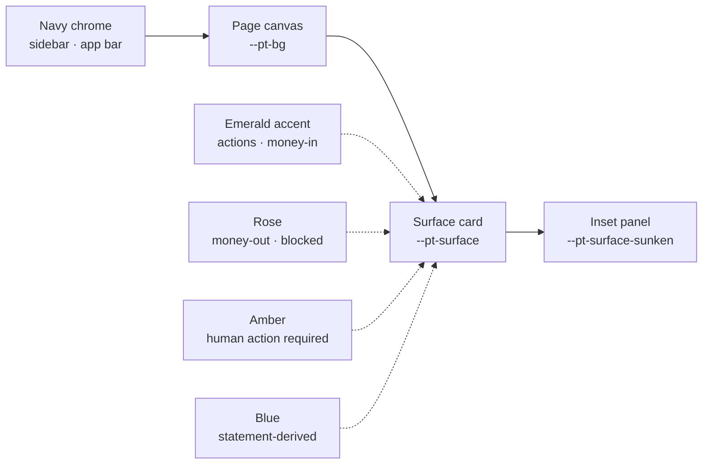

# PropTally — Visual Design System

**Document:** `02_VISUAL_DESIGN_SYSTEM.md`
**Status:** Proposed direction and rationale (implemented in `03`–`06`)
**Date:** October 2026
**Predecessor:** `01_APPLICATION_AUDIT.md`

---

## 1. Direction statement

> **PropTally is a ledger a landlord reads on a Sunday evening and a CPA reads in April.
> The interface is a workpaper: quiet, dense, and unambiguous. Colour marks exception and
> provenance, never decoration.**

The product already has a recognisable identity — dark navy chrome, emerald accent, a
white card canvas, monospaced figures. That identity is the right one for a self-hosted
financial tool and is **kept**. What changes is that every value behind it becomes a named
token, every repeated pattern becomes one component, and every claim on screen becomes
provable.

### 1.1 What is deliberately retained

| Retained | Why |
| :--- | :--- |
| Navy chrome + emerald accent | Existing brand, high contrast on dark (14.5:1 for body text), and it makes the app feel self-hosted rather than SaaS-generic. |
| White cards on `slate-50` canvas | The one surface convention the app already applies consistently. |
| Monospace for all figures | Financial columns only line up in a tabular face; the app already does this (31 uses on a property page). |
| Dense information layout | 1–10 doors is a small portfolio; page-per-answer beats wizard-per-answer. |
| Evidence sub-labels (`POSTED LEDGER`, `FROM STATEMENT`) | The best idea in the current UI. Promoted to a component (§`04` G3). |
| CBD-1 / CBD-2 as **distinct** gates | Legally distinct. Never collapsed into one "approved" badge. |

### 1.2 What is deliberately dropped

| Dropped | Audit ref | Replacement |
| :--- | :--- | :--- |
| Inert utility classes | C1 | Token-based component classes; utilities pruned to those that are defined. |
| Hand-copied Tailwind subset | M2 | Semantic tokens + a small, *verified* utility layer. |
| Three navies / duplicate selectors | M1 | `--pt-navy-900` / `--pt-navy-950`, declared once. |
| Per-screen page headers | M8 | One `page_header` macro with slots. |
| 24 ad-hoc status pills | M6, M7 | Badge component with a closed variant set. |
| Photographic hero + gradients on `/properties` | M9 | `property_identity` panel: no gradients, no emoji, no image zoom. |
| `text-[9px]` … `text-[11px]` | M10 | 12px minimum for any text that carries meaning. |
| Hardcoded portfolio counts in markup | M3 | Nav/property lists rendered from route context. |
| `$0.00` for absent evidence | C7 | `—` + an explicit `unavailable` state (token `--pt-text-muted`). |
| Manual `-` sign prefixes | C8 | Sign comes from one formatter; colour is a secondary cue. |

### 1.3 Design principles

1. **Provenance is part of the number.** Every derived figure carries an evidence badge
   or an explicit "unavailable" state. A number without provenance is a bug.
2. **One concept, one appearance.** A modal is a modal on every screen. A card is a card.
   If two screens need the same object, they import the same component.
3. **Exception earns colour.** Neutral is the default. Emerald means money-in or verified;
   rose means money-out, negative, or blocked; amber means action required by a human;
   blue means statement-derived or informational. Nothing is coloured for emphasis.
4. **Colour is never the only signal.** Signs (`+`/`−`), text labels, and badges carry the
   same meaning as the hue (`06` §3.2).
5. **Tabular by default.** All currency, rates, dates, account numbers, and ids use the
   mono stack with `font-variant-numeric: tabular-nums`.
6. **Density with air.** 4px spacing grid, 14px body, 32px page padding, ≥32px row height.
   Comfortable for extended desktop sessions without becoming a marketing page.
7. **Zero egress stays true.** No webfonts, no CDN, no icon library, no new dependency.
   System font stacks and inline SVG only.

---

## 2. Visual identity

### 2.1 Colour roles

* **Chrome (navy).** Sidebar, mobile app bar, bottom nav, drawer, and the one "total" row
  at the foot of a financial statement (dashboard CADS row, tax Line 22). Not used for
  arbitrary emphasis.
* **Canvas (`--pt-bg`).** Page background, always `slate-50`.
* **Surface (`--pt-surface`).** Every card, table, modal, popover.
* **Sunken (`--pt-surface-sunken`).** Table headers, KPI footers, inset sub-panels
  (the loan/lease "stat cell" that is currently `bg-slate-50`).
* **Accent (emerald).** Primary action fill, active nav item, money-in, success.
* **Semantic.** Rose = error/negative/destructive; amber = warning/needs-human; blue =
  information/statement-derived; slate = neutral/unknown.

### 2.2 Two-surface rule

Exactly two text surfaces exist: **light** (canvas/surface) and **dark** (navy chrome).
Each has one text ramp. Components never invent a third by placing light text on a
coloured chip — chips use their own tinted pair (see `03` §2.4).

---

## 3. Typography

One family, one mono face, six sizes, three weights. No raw pixels.

| Role | Size | Weight | Face | Notes |
| :--- | :--- | :--- | :--- | :--- |
| Page title (`h1`) | 24px | 700 | sans | One per screen. |
| Section heading (`h2`) | 18px | 600 | sans | Card/panel titles. |
| Subsection (`h3`) | 16px | 600 | sans | Modal titles, panel headers. |
| Body | 14px | 400 | sans | Default. |
| Supporting | 13px | 400 | sans | Table cells, form help. |
| Caption / metadata | 12px | 500 | sans | Badges, column headers, sub-labels — **floor**. |
| KPI value | 24–30px | 700 | mono | Tabular numerals. |
| Financial amount (in tables) | 13px | 500–600 | mono | Right-aligned, tabular. |
| Form label | 12px | 600 | sans | Consistent across all forms. |
| Table header | 12px | 600 | sans | Uppercase, `letter-spacing: 0.04em`. |

Rules: titles use `--pt-tracking-tight`; column headers and badge text use
`--pt-tracking-wide`; no other letter-spacing. Only `h1`–`h3` are used as heading
elements — modals no longer skip from `h1` to `h3` (audit m1/§4).

---

## 4. Layout

* **Sidebar** 256px, fixed on `≥1024px`, drawer below (audit: it currently collapses at 768px).
* **Top bar** 44px on desktop (environment strip), 52px on mobile.
* **Content** fluid beside the sidebar, capped at 1920px on ultra-wide displays; 32px
  padding desktop, 16px mobile.
* **Two-surface shell:** chrome is dark, canvas is light; the boundary is a 1px border,
  never a shadow.
* **Grid:** 12 columns on desktop, 4 on tablet, 1 on mobile, 16–20px gutter.
* **Density:** table rows 40px (default) / 32px (compact), form rows 20px apart.

Full values and breakpoints: `03_DESIGN_TOKENS.md` §4–5, `06_RESPONSIVE_AND_ACCESSIBILITY.md`.

---

## 5. What "done" looks like

A screen conforms when:

1. It imports the shell and uses `components/*.html` macros for headers, cards, tables,
   badges, buttons, forms, modals, and empty states — no bespoke card markup.
2. It contains no hardcoded hex, px font size, border radius, or shadow.
3. Every figure is either formatted by `format_cents` / `format_cents_sign` /
   `format_bps` / `format_date`, or rendered with the explicit unavailable state.
4. Every state is covered: empty, populated, unavailable/partial, error.
5. Every interactive control has a visible focus ring, an accessible name, and a ≥32px
   (desktop) / 44px (touch) target.
6. It introduces no new class outside the documented token/component vocabulary.

Enforcement is a review checklist now, and a documented lint rule in `07_IMPLEMENTATION_ROADMAP.md` §5.
