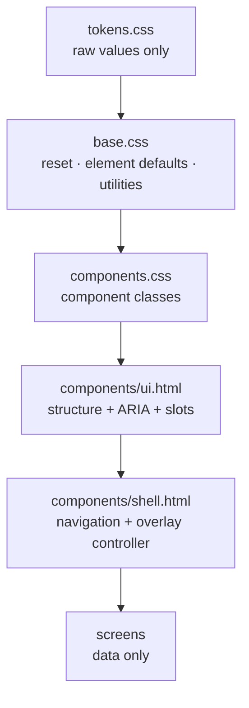

# PropTally — Implementation Roadmap

**Document:** `07_IMPLEMENTATION_ROADMAP.md`
**Status:** Living document. Phase 0–3 shipped in this pass; Phase 4+ planned.
**Date:** October 2026

---

## 1. Deliverables in this documentation set

| # | Document | Contents |
| :-- | :--- | :--- |
| 1 | `01_APPLICATION_AUDIT.md` | Application-wide audit: screen inventory, measured findings (critical / major / minor), domain assessment, contracts that must not change. |
| 2 | `02_VISUAL_DESIGN_SYSTEM.md` | Visual direction, retained/dropped decisions, principles, typography and layout rules, "what done looks like". |
| 3 | `03_DESIGN_TOKENS.md` | Colour, typography, spacing, layout, radius, shadow, z-index, motion, breakpoints — with measured contrast. |
| 4 | `04_COMPONENT_LIBRARY.md` | Component catalogue: purpose, variants, sizes, behaviour, required data, responsive and accessibility notes. |
| 5 | `05_INTERACTION_STANDARDS.md` | Create/edit, destructive, validation, list/detail, review, financial display, feedback, loading conventions. |
| 6 | `06_RESPONSIVE_AND_ACCESSIBILITY.md` | Breakpoints, per-surface behaviour, contrast table, keyboard, semantics, touch targets, verification. |
| 7 | `07_IMPLEMENTATION_ROADMAP.md` | This file: architecture, migration plan and status, enforcement, sequencing, risks. |

## 2. Code artefacts

| Artefact | Purpose |
| :--- | :--- |
| `web/static/css/tokens.css` | All raw values. The only file allowed to contain them. |
| `web/static/css/base.css` | Reset, element defaults, typography, focus, closed utility set, print rules. |
| `web/static/css/components.css` | Every component class, grouped A–G to match `04`. |
| `web/templates/components/ui.html` | Component macros (icons, buttons, badges, amounts, cards, tables, forms, modals, domain components). |
| `web/templates/components/shell.html` | Shell macros (sidebar, app bar, drawer, bottom nav, environment strip) + the overlay controller. |
| `web/navigation.py` | Navigation model; doors read from the database. |
| `scripts/check_design_system.py` | Conformance check: undefined classes, raw values in markup, inline handlers/styles, stylesheet order. |

Removed: `web/static/css/app.css` — the hand-maintained Tailwind-like subset whose 235
undefined classes caused audit finding C1. Its useful utilities were rewritten against
tokens in `base.css`; everything else now has a real component.

---

## 3. Architecture and rationale

### 3.1 Layering



Rules: a screen never names a raw value; a component never names a screen; the shell is
the only place that knows about navigation.

* **Tokens** — semantic names (`--pt-text-muted`, `--pt-money-negative`) not palette names,
  so a theme change re-points two dozen variables and no component rule changes.
* **Utilities are a closed set**, namespaced `pt-`, limited to composition
  (flex/grid/gap/stack/visibility/text alignment). They exist because *some* layout
  decisions are per-screen; they are not a second styling language.
* **Jinja macros own structure, not screens.** A modal's scrim, ARIA roles, heading id and
  close control come from the macro, because getting those wrong is the failure mode the
  audit found. Body content stays in the screen.
* **Navigation is data.** `navigation.py` describes the sections; `nav_doors()` reads the
  property table. Adding a door is a data change (audit M3).

### 3.2 Why not a CSS framework or a build step

The objective was a maintainable design system for a self-hosted, air-gapped application.
Introducing Tailwind, a bundler or a component framework would add a toolchain and a
network-adjacent dependency to solve a problem that 1,400 lines of tokenised CSS solves.
The asset is already served from disk with zero egress, and the check script gives the
enforcement a build step would have provided.

### 3.3 Reuse / refactor / replace decisions

| Existing pattern | Decision | Replacement |
| :--- | :--- | :--- |
| Tailwind-like utility subset (`app.css`) | **Replaced** | Three-layer CSS; closed `pt-` utility set. |
| Inline SVG copies (≈40) | **Replaced** | `ui.icon(name)` with a 38-icon table. |
| Two nav markups (sidebar + drawer) | **Replaced** | `shell.sidebar`/`shell.drawer` from one `NavItem` model. |
| 24 ad-hoc status pills | **Replaced** | `ui.badge` + the closed `ui.evidence` vocabulary. |
| 5 modal implementations | **Replaced** | `ui.modal_open` + one overlay controller. |
| 9 inline `<script>` behaviours | **Refactored** | Delegated listeners + `data-*`; page functions kept. |
| Property hero (photo + gradients) | **Replaced** | `property_identity` panel (data-centric). |
| Evidence sub-labels (`POSTED LEDGER`) | **Kept, promoted** | `ui.provenance` / `ui.evidence`. |
| Escrow ledger-vs-statement split | **Kept** | `pt-provenance-cell` + `ui.stat`. |
| Allocation residual validation | **Kept** | Unchanged logic, restyled, reason stated in text. |
| CBD-1 / CBD-2 gates | **Kept, emphasised** | `ui.cbd_gate`, visually and semantically distinct. |
| Charts/recharts (V2 spec) | **Deferred** | Not in the dependency set; the waterfall is a statement, not a chart. |

---

## 4. Migration plan and status

Implementation order follows the brief: shared layers before pages.

### Phase 0 — Foundations (shipped)

| Step | Status | Evidence |
| :-- | :--- | :--- |
| Token layer | Shipped | `tokens.css`; contrast table in `03`. |
| Base layer + closed utilities | Shipped | `base.css`; focus ring, print rules, element defaults. |
| Component classes | Shipped | `components.css` §A–G. |
| Component macros | Shipped | `ui.html`, `shell.html`. |
| Navigation model | Shipped | `navigation.py`; doors from the DB. |
| Application shell | Shipped | `base.html`; one layout, `hidden`-based overlays, overlay controller. |
| Conformance check | Shipped | `scripts/check_design_system.py`. |
| Queue-count correctness (audit C4) | Shipped | `review_count` = true queue depth; `filtered_count` added for the filtered view. |

### Phase 1 — Screens

| Screen | Template | Status |
| :--- | :--- | :--- |
| Portfolio overview | `dashboard.html` | Migrated (reference implementation). |
| Mortgages & escrow | `mortgages.html` | Migrated. |
| Transactions register + 2 modals | `transactions.html` | Migrated. |
| Review queue | `reconciliation.html` | Migrated. |
| Tax / Schedule E | `tax_schedule_e.html` | Migrated. |
| Property deep dive | `property_detail.html` | Migrated. |
| Client audit report | *removed* | **Deleted** with its routes and generators: the generated HTML embedded a real client portfolio. A client-agnostic replacement is P1-1. |

### Phase 2 — Verification

| Check | Result |
| :--- | :--- |
| `scripts/check_design_system.py` | **Passed** — 0 undefined classes, 0 raw values in markup, 0 inline handlers/styles, stylesheet order correct, no undefined or unused tokens. Was 974 findings before the screen migrations. |
| Full test suite | **211 passed, 0 failed** — identical to the pre-change baseline. |
| Every route renders | 200 for `/`, `/mortgages`, `/transactions`, `/reconciliation`, `/reconciliation?q=APPLE`, `/tax/schedule-e`, all three `/properties/:id`. `/report` and `/report/email` now **404 by design** — the routes were removed with the client report artefacts. |
| Shell behaviour | Drawer closed ⇒ `hidden`, 12/12 descendants non-rendered, 0 tabbable; opens with focus moved inside; Escape closes and restores focus to the opener. Modal controller verified the same way on `/transactions`. |
| Computed styles | KPI label `rgb(82,98,122)` = `--pt-text-muted`; card radius 8px; card shadow `rgba(15,23,42,.05)`; total row `rgb(15,23,42)` = `--pt-navy-900`; 3 sheets loaded in order. |
| Table semantics | `scope="col"` on every header: 26/26 across mortgages (6), transactions (7), tax (7) and the rules modal (6). |
| Form labelling | 0 unlabelled controls on `/transactions` (was 9) and in its modals (was 9/13). |
| Responsive | 7 routes × 3 viewports (375/834/1440): no page-level horizontal overflow anywhere; sidebar↔bottom-nav switch at 1024px correct; 979px tax table scrolls inside a 339px container. |
| Empty states | Unseeded database: `/transactions` renders "No transactions recorded" (previously a bare table); `/mortgages` 2 states; `/reconciliation` "No matching review items" on a no-match filter. |
| Gallery (populated) | Throwaway DB with 2 photos: 2 tiles, 1 cover badge, captions used as `alt`, 5 labelled icon actions, lightbox ids intact. |
| Allocation maths | Exact allocation ⇒ residual `$0.00`, save enabled; over-allocation ⇒ `-$1,000.00`, save disabled **and** the reason stated in words. |
| Queue-count correctness | Unfiltered shell reports 7; `?q=APPLE` still reports **7** in the shell while the screen states "Showing 1 of 7" (audit C4). |
| Contrast | Every documented token pair computed against WCAG 2.1 (`03` §2, `06` §3.1); primary button fill moved to 5.48:1. |

**Not automated** (`06` §4): axe/screen-reader regression testing. Stated as a gap, tracked as P1-4.

### Additional fixes made during verification

These were found *while* verifying (not in the original audit list) and were fixed because
they are the same class of defect the audit names — state that is invisible or unexplained:

| Fix | Why |
| :--- | :--- |
| Page-header actions were rendering outside `.pt-page-header__actions` | The `caller()` slot was misused; actions were not right-aligned with the title block. |
| Door-card badge row overflowed its card | Badge row now wraps (`pt-flex-wrap`); verified 0 overflowing elements. |
| Closed drawer was reachable in the tab order | Resolved by audit C5 (`hidden` attribute + shell controller); verified 0 tabbable descendants. |
| Over-allocation disabled *save* with no explanation | Now states "Over-allocated by $X. Reduce a split line to match the transaction total." (`role="alert"`). |
| Applied vendor filter was invisible on the chips row, and "All" stayed active under a search | Every filtered view now shows exactly one active chip, including a chip for a raw pattern with no top-vendor match. |
| `IN-FLIGHT (21x5)` presented unexplained | Kept the label verbatim (it may be the client's shorthand) and added a title stating only what the code proves: obligation recorded, cash settlement and servicer application not yet confirmed. |
| `.pt-provenance` was being used for plain subtext (city, loan number, property type) | `.pt-table__sub` is for subtext; `pt-provenance` is reserved for evidence about a figure (`04` §D1.2). |

---

## 5. Enforcement

`scripts/check_design_system.py` fails on:

1. A class used by any template that the design system does not define (this is exactly how
   235 inert classes accumulated).
2. A raw hex/rgb colour, inline `style=`, or inline `on*=` handler in markup.
3. `base.html` loading anything other than the three design-system stylesheets in order.
4. A token referenced by `base.css`, `components.css` or a template that `tokens.css` never
   declares — and a token declared but never used (breakpoint values are exempt: CSS custom
   properties cannot be used in media queries).
5. The same selector declared twice, with different values, in the same cascade context of
   the same file. This is precisely the audit-M1 defect (`.bg-navy-900` defined as two
   different navies); the media/keyframe context is tracked so genuine responsive overrides
   are not flagged.

Run it locally after any UI change:

```bash
PYTHONPATH=src .venv/bin/python scripts/check_design_system.py
```

Suggested CI addition (`DEPENDENCY FREE`, no new packages) — `.github/workflows/tests.yml`:

```yaml
      - name: Design system conformance
        run: PYTHONPATH=src python scripts/check_design_system.py
```

**Review checklist for any new screen** (`06` §5): components only; no raw values; one
`h1`; labelled controls; all four states present; figures via `ui.amount` with evidence;
verified at 375/768/1280px; check script passes.

**Rule for new components** (`04` §H): extend a variant first; add CSS with tokens only;
add the macro with a docstring; document it in `04`; re-run the check. A page-specific
style is a defect, not a shortcut.

---

## 6. Prioritised backlog

Severity references are `01_APPLICATION_AUDIT.md`.

### P0 — done in this pass

| ID | Item | Reference |
| :-- | :--- | :--- |
| P0-1 | Style layer made authoritative (no inert classes) | C1 |
| P0-2 | Single navy/chrome ramp; no duplicate or dead colour declarations | M1 |
| P0-3 | Centralised tokens; no raw values in components or markup | M2 |
| P0-4 | Correct queue count in the shell (filtered vs total) | C4 |
| P0-5 | Missing vs zero distinguished (`—`, never `$0.00`) | C7 |
| P0-6 | Single sign convention for amounts | C8 |

### P1 — next

| ID | Item | Why | Effort |
| :-- | :--- | :--- | :--- |
| P1-1 | Client-agnostic reporting: a generator that renders from the design system and takes the client's data at runtime | The previous report artefacts embedded a real client portfolio and had to be deleted; reporting is a genuine product need with no implementation today | M |
| P1-2 | Period selector component on every financial screen | Periods are shown as static chips today; O1 | M |
| P1-3 | Server-side filtering on `/transactions` (account, door, date range, status) | The register has no filtering and no pagination; the audit found its filter strip to be non-functional | M |
| P1-4 | Automated accessibility pass (axe-core via a dev-only script) | `06` §4 states this is not covered; requires a new dev dependency | M |
| P1-5 | Print-optimised Schedule E layout | Print rules exist but the artefact has not been reviewed on paper (the audit report returns with P1-1) | S |
| P1-6 | `MOVE`: property `short_name` in the data model, retiring `DOOR_SHORT_LABELS` | Currently one Python map stands in for a model field; needs a migration | S |

### P2 — later

| ID | Item | Why |
| :-- | :--- | :--- |
| P2-1 | Unify the three reconciliation posting paths behind one action row | O2; partially addressed by `review_item`, still three forms |
| P2-2 | Landing/door-level financial summary on the property screen | The screen shows basis and debt but not rent, debt service and cash flow in one place |
| P2-3 | Dark theme | Tokens make it a `[data-theme="dark"]` block; needs contrast re-verification |
| P2-4 | Escrow movement timeline | `pt-activity` exists; the data is not surfaced |
| P2-5 | Statement-level CSV/print exports beyond tax | Export affordance belongs in the page header |
| P2-6 | Document ingestion UI | Spec-only today; the dashboard's "awaiting ingestion" badge is the only trace |

### Explicitly out of scope

* No change to accounting rules, ledger immutability, posting policy gates, or monetary
  arithmetic. No schema change (P1-6 proposes one and requires its own migration).
* No new runtime dependency, no frontend framework, no build step, no webfont, no CDN.
* `[CPA APPROVED]` and `[SYSTEM RECONCILED]` badges from the V2 spec are **not**
  implemented: the application cannot prove them, and CBD-2 is surfaced as
  `USER-ATTESTED` with the README's caveat (`04` §G3).

---

## 7. Risks and mitigations

| Risk | Mitigation |
| :--- | :--- |
| Broad template rewrite breaks a pinned interaction | Full suite (211 tests) is the gate; the audit catalogued every pinned string and element id in `01` §7. |
| A new screen reintroduces a page-specific style | `check_design_system.py` fails on any undefined class or raw value. |
| Tokens drift from the documentation | Values are quoted verbatim in `03` and asserted by the check's stylesheet-order rule; contrast values are computed, not estimated. |
| Overlay regressions (focus/Escape) | One controller in `shell.html`, not five page scripts. |
| Print output differs from expectation | Print rules are declarative; verification of the tax workpaper on paper is P1-5. |

**Rollback.** The change set is self-contained: three CSS files, two macro files, one
navigation module, one check script, and the template/shell rewrites. Reverting the commit
restores `app.css` and the previous templates without any data or schema implications.

---

## 8. Status summary

| Phase | Scope | Status |
| :--- | :--- | :--- |
| 0 | Tokens, base, components, macros, shell, navigation, check script | **Shipped** |
| 1 | Six application screens | **Shipped** |
| 2 | Verification (check script, suite, route render, computed-style probes) | **Shipped** |
| 3 | Documentation set (`docs/ui-ux/01`–`07`) | **Shipped** |
| 4 | P1 backlog (report artefacts, period selector, transactions filtering, a11y automation) | Planned |

---

## 9. Finding → fix trace

Every finding in `01_APPLICATION_AUDIT.md` maps to something in this change set.

| Audit finding | Resolution |
| :--- | :--- |
| C1 · 235 inert classes | Utilities rewritten against tokens and closed to the `pt-` set; every remaining class is defined. Enforced by the check script. |
| C2 · No focus indicator | Global `:focus-visible` rule on the tokenised focus ring, with a `@supports` fallback. Verified: outline present on buttons/links. |
| C3 · `slate-400` at 2.45:1 | `--pt-text-muted` `#52627a` (6.20:1); emerald-600 money text at 3.77:1 → `--pt-money-positive` `#047857` (5.48:1); primary button fill likewise. |
| C4 · Queue banner showed the filtered count | `review_count` = true pending total on every route; the filtered figure moved to `filtered_count` and is labelled "Showing N of M". |
| C5 · Closed drawer focusable/announced | Overlays use the `hidden` attribute; shell controller owns open/close/focus. Verified 0 tabbable descendants when closed. |
| C6 · Unlabelled controls, no `th scope` | Field macros mint `for`/`id`/`aria-describedby`/`aria-invalid`; `ui.th` always sets `scope`. Verified: 0 unlabelled controls, 26/26 scoped headers. |
| C7 · `$0.00` for absent evidence | `ui.amount(none)` renders `—` with an explanatory title; a true zero renders `$0.00` in neutral tone. |
| C8 · Manually prefixed signs | One renderer decides sign, tone and magnitude mode (`income`/`expense`/`movement`/`plain`/`signed`); no template prefixes a formatter. |
| M1 · Three navies, duplicate selectors | Single `--pt-navy-*` ramp; duplicates removed with `app.css`. |
| M2 · No tokens, 57 raw hexes | `tokens.css` is the only place raw values exist (enforced). |
| M3 · Duplicated nav, hardcoded portfolio | `navigation.py` + `shell.html`: one nav markup, doors read from the database, counts derived. |
| M4 · Radii/shadows per screen; modals 0px/flat | One radius and one shadow scale; all five modals now share `pt-modal__card` (12px, `--pt-shadow-lg`). |
| M5 · 9 font sizes incl. raw px | 11 role-based sizes on a 12–30px scale; 12px floor. |
| M6/M7 · 24 ad-hoc pills, two evidence grammars | Closed `ui.badge` variant set plus the `ui.evidence` vocabulary; `[CPA APPROVED]` deliberately not implemented. |
| M8 · Four page-header compositions | One `ui.page_header`. |
| M9 · Photographic hero and gradients | `pt-property-identity`, data-centric: no gradients, no emoji, no image zoom. Verified absent. |
| M10 · 9–10px status text | Caption floor is 12px. |
| m1 · `stroke-round` typo | Empty-state icon now comes from `ui.icon` (`stroke-linecap`). |
| m2 · Stale version strings | Removed; brand subtitle derives from mode. |
| m3/m4/m5 · Modal behaviour differs per screen | One controller: Escape, scrim click, focus trap, focus restore, `role="dialog"`. |
| m6 · No live-region feedback | Success alerts in `role="status"`; errors/warnings in `role="alert"`. |
| m7 · Inconsistent/absent empty states | `ui.empty_state` on dashboard, property, mortgages, transactions, queue and rules table. Verified on an unseeded database. |
| m8 · Table density inconsistent | One table component (40px rows, 32px compact) and one header treatment. |
| m9 · Three row-hover treatments | `.pt-table tbody tr:hover` only. |
| m10 · Five accent hues in nav | Navigation uses one chrome ramp; the active item is accent-marked by icon, weight and `aria-current`. |
| m11 · 33 inline handlers, duplicated JS row markup | Zero inline handlers; delegated listeners + `data-*`; the split row is a Jinja macro cloned from `<template>`. |
| m12 · `/report` opened without `rel="noopener"` | Nav model emits `rel="noopener noreferrer"` for blank targets. The report artefacts and their routes were removed outright (P1-1 re-introduces reporting client-agnostically). |
| m13 · No `th scope`/`caption` | `ui.th`, `ui.th_row`, `ui.table_open(label=…)`. |
| m14 · Static copy asserting facts (`Status: Active`) | Replaced by derived state (rental/primary badges, evidence badges). |
| O1–O8 (opportunities) | O5 print rules shipped; the rest are P1/P2 backlog items with owners in §6. |
